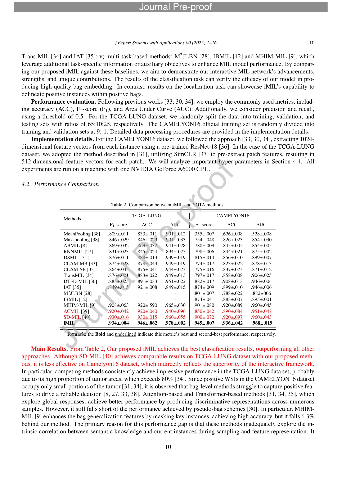
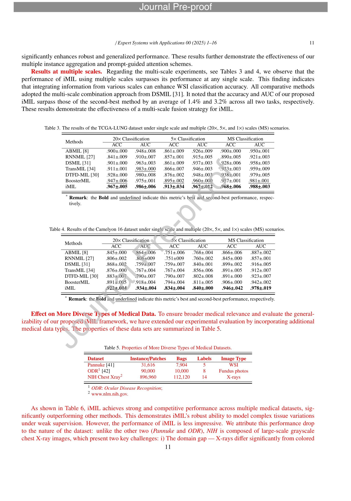
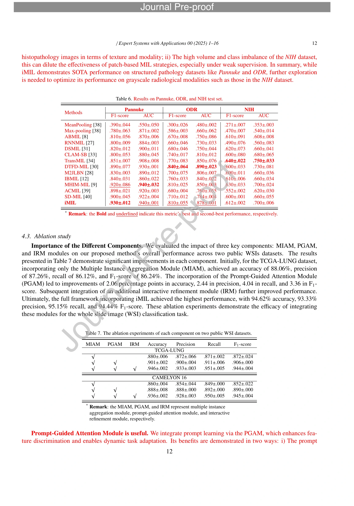
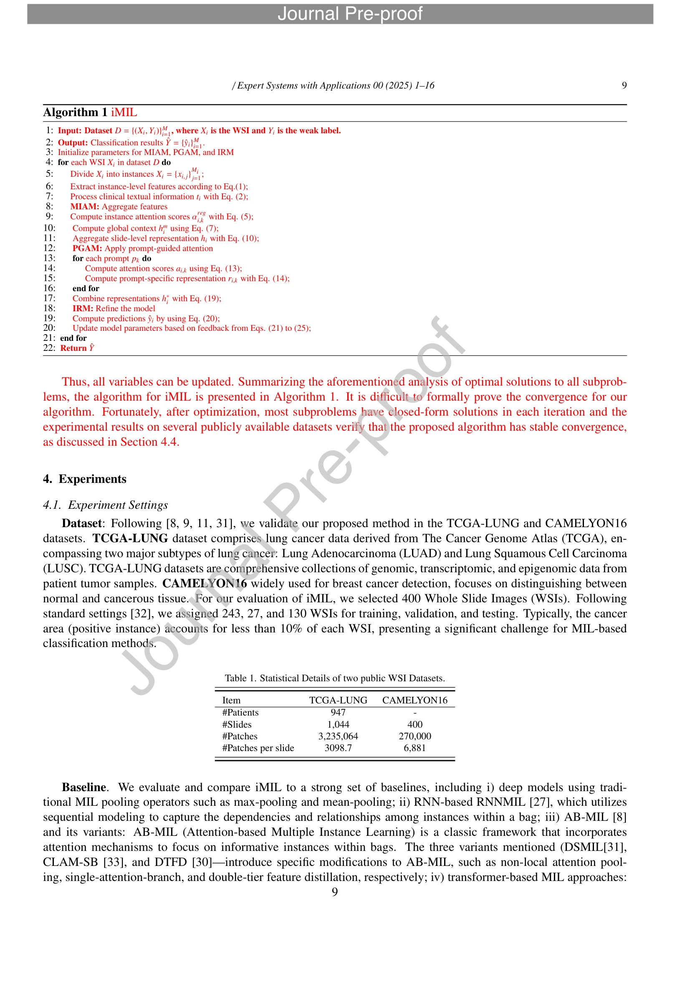
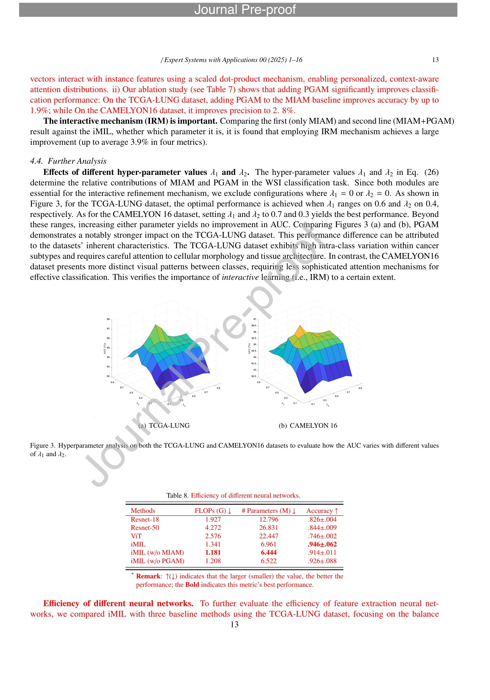

## Interactive Multiple Instance Learning Network for Whole Slide Image Analysis

> data: CAMELYON16、TCGA-LUNG
>
> Expert Systems with Applications 2026 · [论文](https://doi.org/10.1016/j.eswa.2025.129338)

#### 引言

融合局部实例、全局切片和临床文本信息，以提示引导注意力和交互式细化反馈增强弱监督分类与区域定位。

#### 方法

（1）MIAM：整合局部实例、全局切片及临床文本。

（2）PGAM：以可学习提示调整实例内和实例间注意力。

（3）IRM：通过多层特征与上下文反馈迭代细化表示和伪标签。

<!-- wsi-complete-model -->
##### 模型结构图

**图 2 · 模型结构**（PDF 第 6 页）

> 原文图注：Figure 2. An overview of the interactive Multiple Instance Learning (iMIL) framework. The right part of the Figure shows the details of our proposed Prompt-Guided Attention Module (PGAM).

[查看原尺寸](assest/iMIL/figure-2-complete.webp)

<!-- /wsi-complete-model -->

#### 实验

##### 实验设置

C16 使用 243/27/130 的训练/验证/测试切片；比较主流 MIL 与逐组件的交互式学习。

##### 主要结果

主表中 iMIL 表现最好；作者指出 TCGA 中较大病灶占比与 C16 的稀疏病灶使任务难度不同。

<!-- wsi-complete-results -->
##### 完整实验指标与对照

下列实验原页保留表头、全部行列、子图、误差说明和脚注，点击可查看原尺寸。比较时请对应相同的数据集、特征编码器和训练设置；`±`、置信区间、百分比和小数均保留原文的单位与统计口径。

| 原表/图中指标 | 读取方式 |
| --- | --- |
| ROC-AUC / AUROC | 越高越好；若原表明确为 PR-AUC，则按 PR 曲线面积读取 |

| 原文页 | 阅读内容 | 图表及正文引用 |
| --- | --- | --- |
| PDF 第 10 页 | 数据与实验设置 | Table 1 |
| PDF 第 11 页 | 实验结果 | Table 2 |
| PDF 第 12 页 | 实验结果 | Table 3、Table 4、Table 5 |
| PDF 第 13 页 | 实验结果 | Table 6、Table 7 |
| PDF 第 14 页 | 消融与参数分析 | Figure 3、Table 8 |

**实验原页 · PDF 第 11 页**（图表及正文引用：Table 2）

[查看原尺寸](assest/iMIL/experiment-page-11.webp)

**实验原页 · PDF 第 12 页**（图表及正文引用：Table 3、Table 4、Table 5）

[查看原尺寸](assest/iMIL/experiment-page-12.webp)

**实验原页 · PDF 第 13 页**（图表及正文引用：Table 6、Table 7）

[查看原尺寸](assest/iMIL/experiment-page-13.webp)

展开消融、参数、数据设置及效率原页

**实验原页 · PDF 第 10 页**（图表及正文引用：Table 1）

[查看原尺寸](assest/iMIL/experiment-page-10.webp)

**实验原页 · PDF 第 14 页**（图表及正文引用：Figure 3、Table 8）

[查看原尺寸](assest/iMIL/experiment-page-14.webp)

<!-- /wsi-complete-results -->

##### 消融与讨论

考察 MIAM、PGAM、IRM 对实例定位与切片分类的贡献，避免仅根据最终 AUC 推断文本使用是否有效。

#### 参考文献

> Interactive Multiple Instance Learning Network for Whole Slide Image Analysis
>
> Expert Systems with Applications 2026 · [论文](https://doi.org/10.1016/j.eswa.2025.129338)
