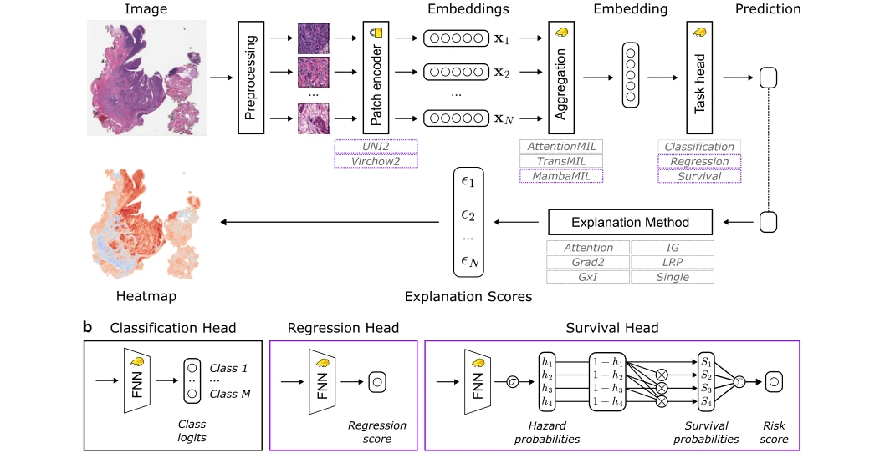

## Beyond attention heatmaps: How to get better explanations for multiple instance learning models in histopathology

> data: 分类、回归、生存任务，多种 MIL 架构和 UNI2/Virchow2 特征
>
> Medical Image Analysis 2026 · [论文](https://doi.org/10.1016/j.media.2026.104148) · [作者代码](https://github.com/bifold-pathomics/xMIL)

#### 引言

系统评价分类、回归和生存任务中 MIL 热图的解释质量，比较扰动、相关性传播、积分梯度与注意力等解释方法。

#### 方法

（1）热图评估：通过对输入/实例的扰动检验解释是否忠实于模型。

（2）多方法基准：比较注意力、梯度、IG、LRP 及扰动等解释。

（3）生物学对照：探索空间转录组相关与组织模式，区分解释忠实度和生物可读性。

原文Fig. 1，PDF 第 3 页。

#### 实验

##### 实验设置

用无需额外标签的热图评价框架比较六种解释方式，并探索空间转录组与 HPV 预测。

##### 主要结果

Single 扰动与 LRP/IG 通常优于原始注意力，但排名依任务和模型而变；TransMIL 中 LRP 尤为突出。

##### 消融与讨论

解释忠实度与预测准确度分开评价；不能因一张热图与病灶相似就断言其解释了模型决策。

#### 参考文献

> Beyond attention heatmaps: How to get better explanations for multiple instance learning models in histopathology
>
> Medical Image Analysis 2026 · [论文](https://doi.org/10.1016/j.media.2026.104148) · [作者代码](https://github.com/bifold-pathomics/xMIL)
