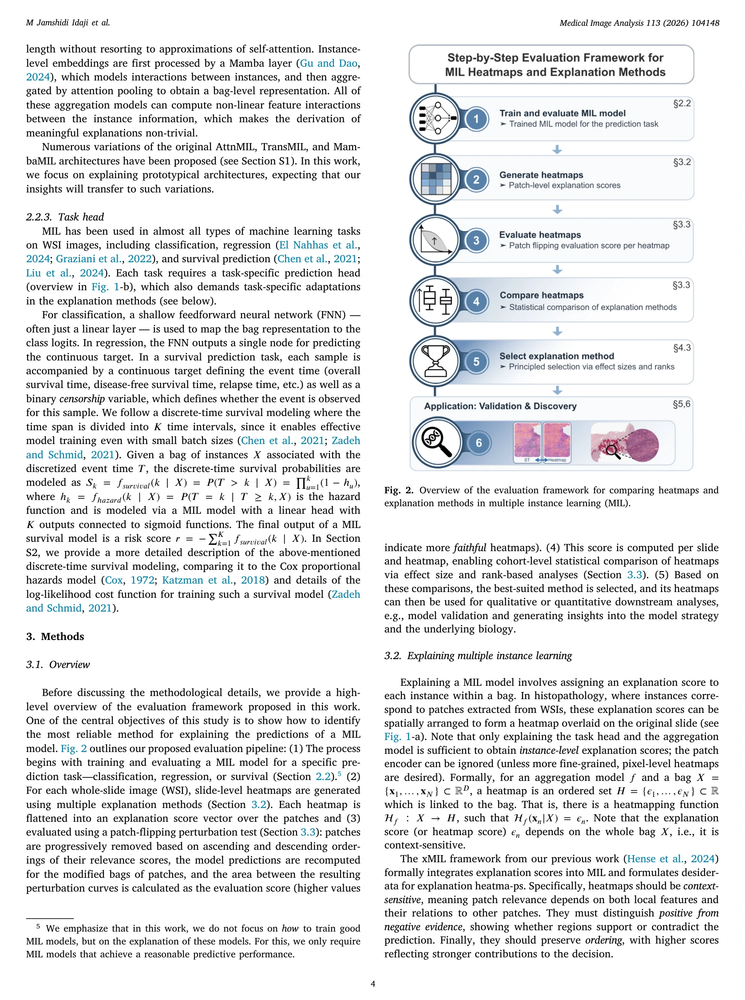
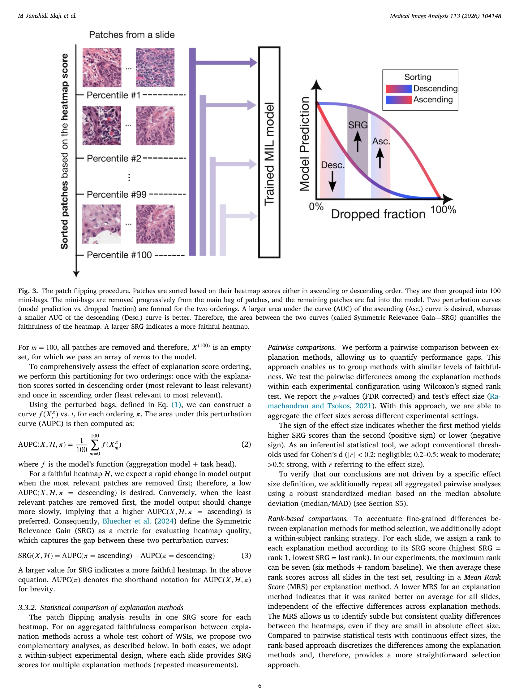
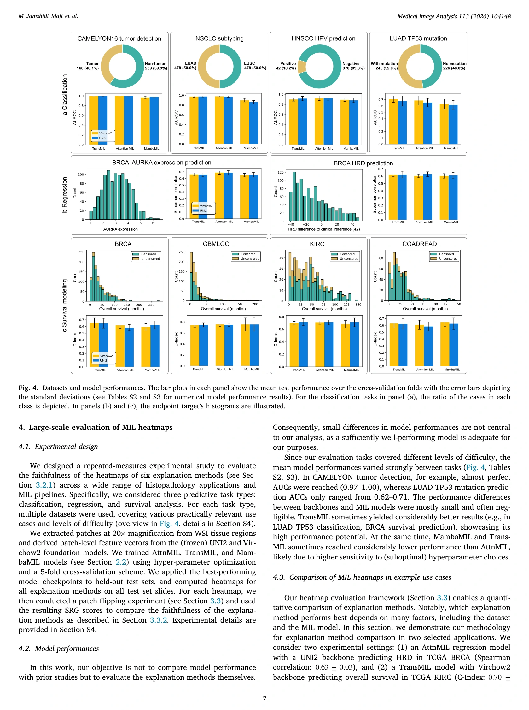
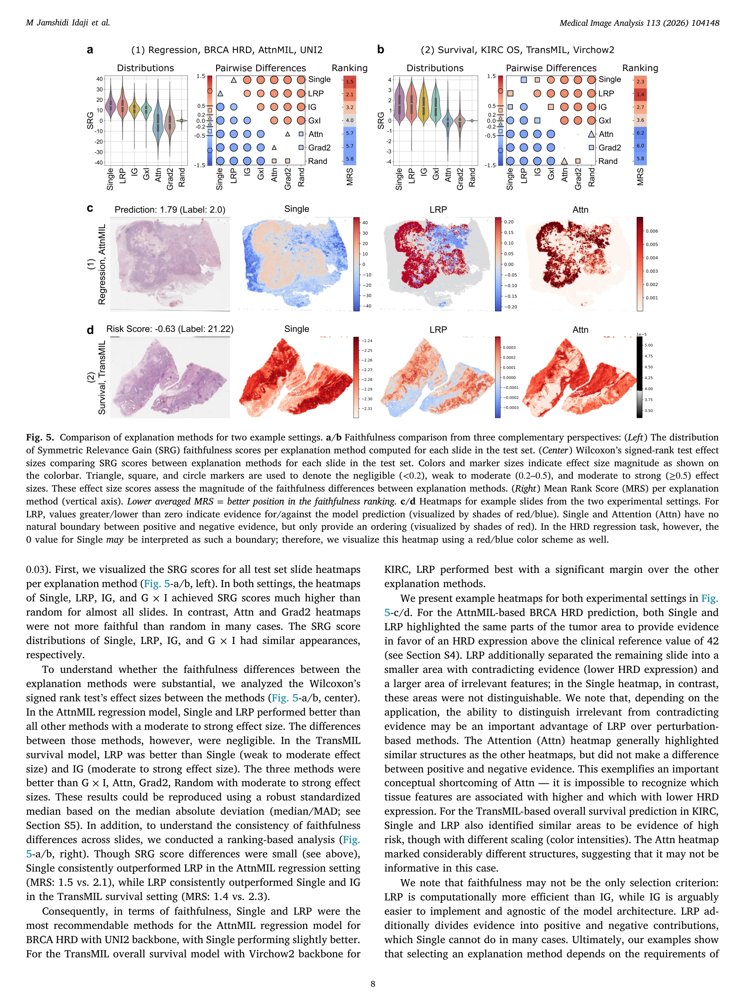
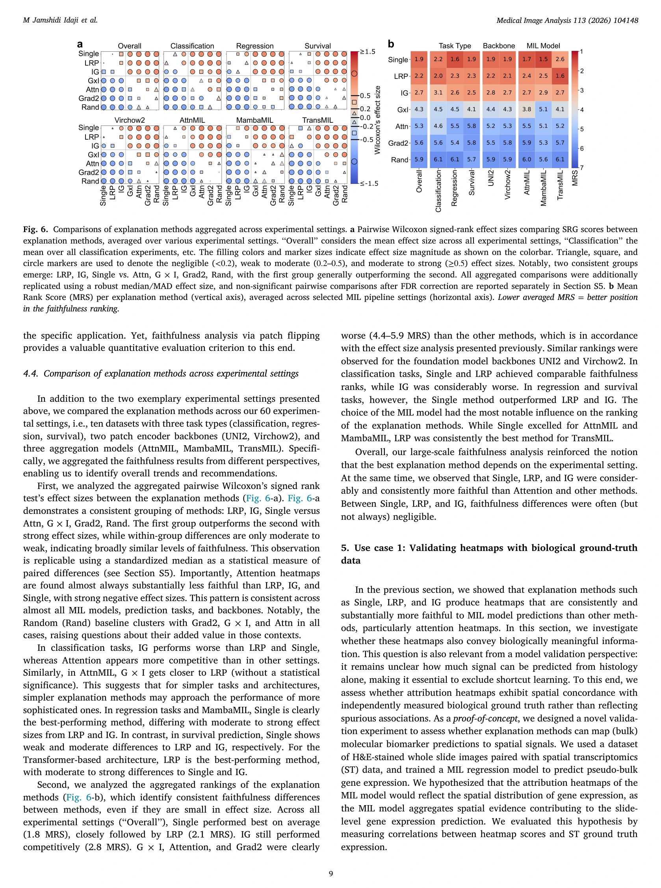
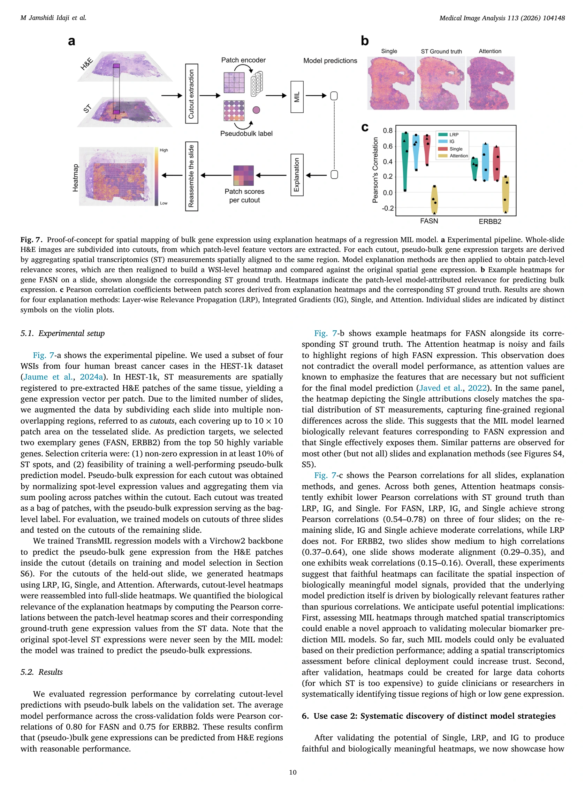
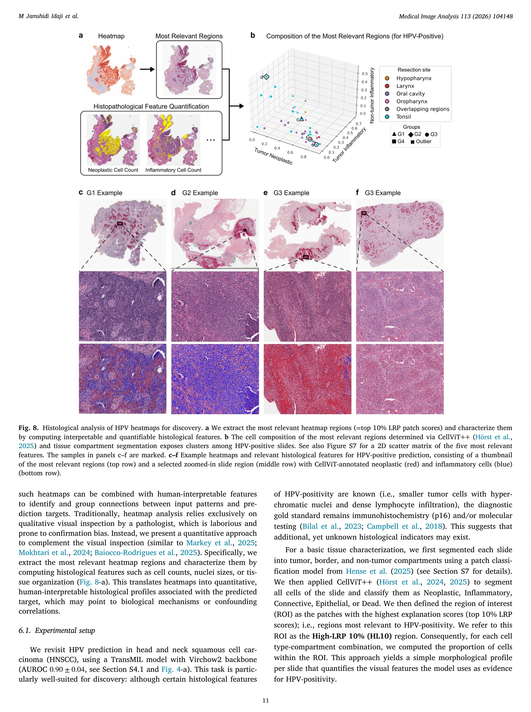

## Beyond attention heatmaps: How to get better explanations for multiple instance learning models in histopathology

> data: 分类、回归、生存任务，多种 MIL 架构和 UNI2/Virchow2 特征
>
> Medical Image Analysis 2026 · [论文](https://doi.org/10.1016/j.media.2026.104148) · [作者代码](https://github.com/bifold-pathomics/xMIL)

#### 引言

系统评价分类、回归和生存任务中 MIL 热图的解释质量，比较扰动、相关性传播、积分梯度与注意力等解释方法。

#### 方法

（1）热图评估：通过对输入/实例的扰动检验解释是否忠实于模型。

（2）多方法基准：比较注意力、梯度、IG、LRP 及扰动等解释。

（3）生物学对照：探索空间转录组相关与组织模式，区分解释忠实度和生物可读性。

<!-- wsi-complete-model -->
##### 模型结构图

**图 1 · 模型结构**（PDF 第 3 页）

> 原文图注：Fig. 1. Overview of our explanation pipeline for multiple instance learning (MIL). a Block diagram of a general MIL approach to make predictions directly from whole slide images, and to obtain heatmaps to interpret the model predictions. The explanation methods produce patch-wise scores by explaining (only) the task head and the aggregation model, but not the patch encoder. In this work, we assess six explanation methods in the context of two patch encoders, three aggregation model architectures, and three types of prediction heads. b Composition of the task heads. In the survival head, the discrete-time model predicts hazard probabilities {ℎ𝑘} for survival time intervals 𝑘= 1, … , 𝐾, and subsequently aggregates them into a patient risk score. See Section S2 for details. Purple highlighting marks components not present in the conference paper (Hense et al., 2024). 𝜎 = sigmoid function; FNN = feedforward neural network.

[查看原尺寸](assest/xMIL-2026/figure-1-complete.webp)

<!-- /wsi-complete-model -->

#### 实验

##### 实验设置

用无需额外标签的热图评价框架比较六种解释方式，并探索空间转录组与 HPV 预测。

##### 主要结果

Single 扰动与 LRP/IG 通常优于原始注意力，但排名依任务和模型而变；TransMIL 中 LRP 尤为突出。

<!-- wsi-complete-results -->
##### 完整实验指标与对照

下列实验原页保留表头、全部行列、子图、误差说明和脚注，点击可查看原尺寸。比较时请对应相同的数据集、特征编码器和训练设置；`±`、置信区间、百分比和小数均保留原文的单位与统计口径。

| 原表/图中指标 | 读取方式 |
| --- | --- |
| ROC-AUC / AUROC | 越高越好；若原表明确为 PR-AUC，则按 PR 曲线面积读取 |

| 原文页 | 阅读内容 | 图表及正文引用 |
| --- | --- | --- |
| PDF 第 4 页 | 实验结果 | Figure 2 |
| PDF 第 6 页 | 实验结果 | Figure 3 |
| PDF 第 7 页 | 实验结果 | Figure 4 |
| PDF 第 8 页 | 实验结果 | Figure 5 |
| PDF 第 9 页 | 实验结果 | Figure 6 |
| PDF 第 10 页 | 实验结果 | Figure 7 |
| PDF 第 11 页 | 实验结果 | Figure 8 |

**实验原页 · PDF 第 4 页**（图表及正文引用：Figure 2）

[查看原尺寸](assest/xMIL-2026/experiment-page-04.webp)

**实验原页 · PDF 第 6 页**（图表及正文引用：Figure 3）

[查看原尺寸](assest/xMIL-2026/experiment-page-06.webp)

**实验原页 · PDF 第 7 页**（图表及正文引用：Figure 4）

[查看原尺寸](assest/xMIL-2026/experiment-page-07.webp)

**实验原页 · PDF 第 8 页**（图表及正文引用：Figure 5）

[查看原尺寸](assest/xMIL-2026/experiment-page-08.webp)

**实验原页 · PDF 第 9 页**（图表及正文引用：Figure 6）

[查看原尺寸](assest/xMIL-2026/experiment-page-09.webp)

**实验原页 · PDF 第 10 页**（图表及正文引用：Figure 7）

[查看原尺寸](assest/xMIL-2026/experiment-page-10.webp)

**实验原页 · PDF 第 11 页**（图表及正文引用：Figure 8）

[查看原尺寸](assest/xMIL-2026/experiment-page-11.webp)

<!-- /wsi-complete-results -->

##### 消融与讨论

解释忠实度与预测准确度分开评价；不能因一张热图与病灶相似就断言其解释了模型决策。

#### 参考文献

> Beyond attention heatmaps: How to get better explanations for multiple instance learning models in histopathology
>
> Medical Image Analysis 2026 · [论文](https://doi.org/10.1016/j.media.2026.104148) · [作者代码](https://github.com/bifold-pathomics/xMIL)
