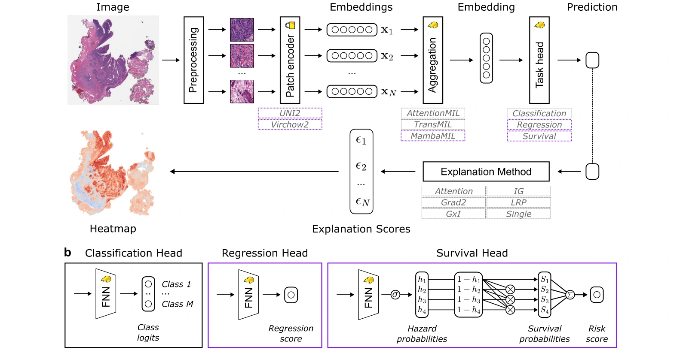

## Beyond attention heatmaps: How to get better explanations for multiple instance learning models in histopathology

> data: 分类、回归、生存任务，多种 MIL 架构和 UNI2/Virchow2 特征
>
> Medical Image Analysis 2026 · [论文](https://doi.org/10.1016/j.media.2026.104148) · [作者代码](https://github.com/bifold-pathomics/xMIL)

#### 引言

系统评价分类、回归和生存任务中 MIL 热图的解释质量，比较扰动、相关性传播、积分梯度与注意力等解释方法。

#### 方法

（1）热图评估：通过对输入/实例的扰动检验解释是否忠实于模型。

（2）多方法基准：比较注意力、梯度、IG、LRP 及扰动等解释。

（3）生物学对照：探索空间转录组相关与组织模式，区分解释忠实度和生物可读性。

##### 模型结构图

图 1（PDF 第 3 页）

#### 实验

##### 实验设置

用无需额外标签的热图评价框架比较六种解释方式，并探索空间转录组与 HPV 预测。

##### 关键指标 { #key-results }

| 归因方法 | 平均排序分数（MRS）↓ |
| --- | --- |
| Single | 1.8 |
| LRP | 2.1 |
| IG | 2.8 |
| G × I、Attention、Grad² | 4.4–5.9 |

数据来源为原文图 6b 与正文，跨架构、任务及编码器汇总。

##### 结果解读

Single 在整体归因排序中领先，LRP 在 TransMIL 上更稳定地排在首位。这个比较衡量的是热图对模型预测的忠实度，热图与生物学标注的对应由另一组实验检验。

##### 消融与讨论

解释忠实度与预测准确度分开评价；不能因一张热图与病灶相似就断言其解释了模型决策。

#### 参考文献

> Beyond attention heatmaps: How to get better explanations for multiple instance learning models in histopathology
>
> Medical Image Analysis 2026 · [论文](https://doi.org/10.1016/j.media.2026.104148) · [作者代码](https://github.com/bifold-pathomics/xMIL)
