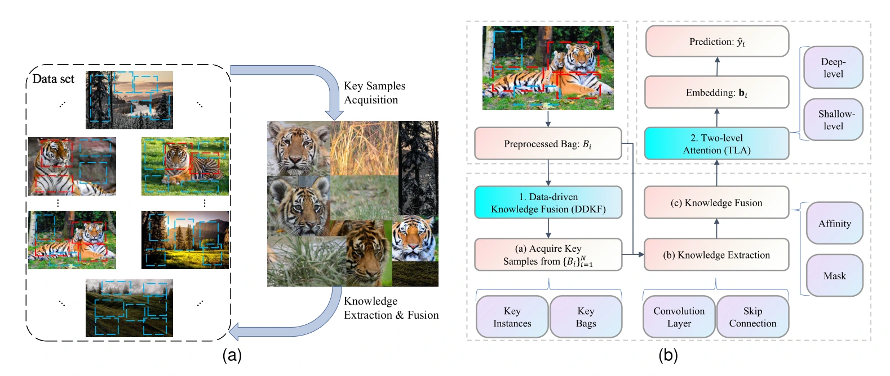
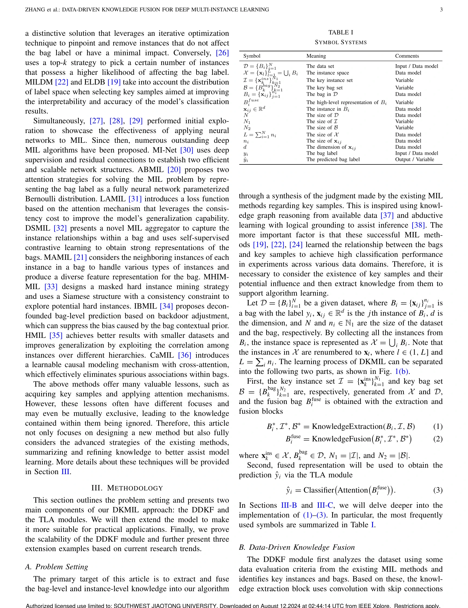
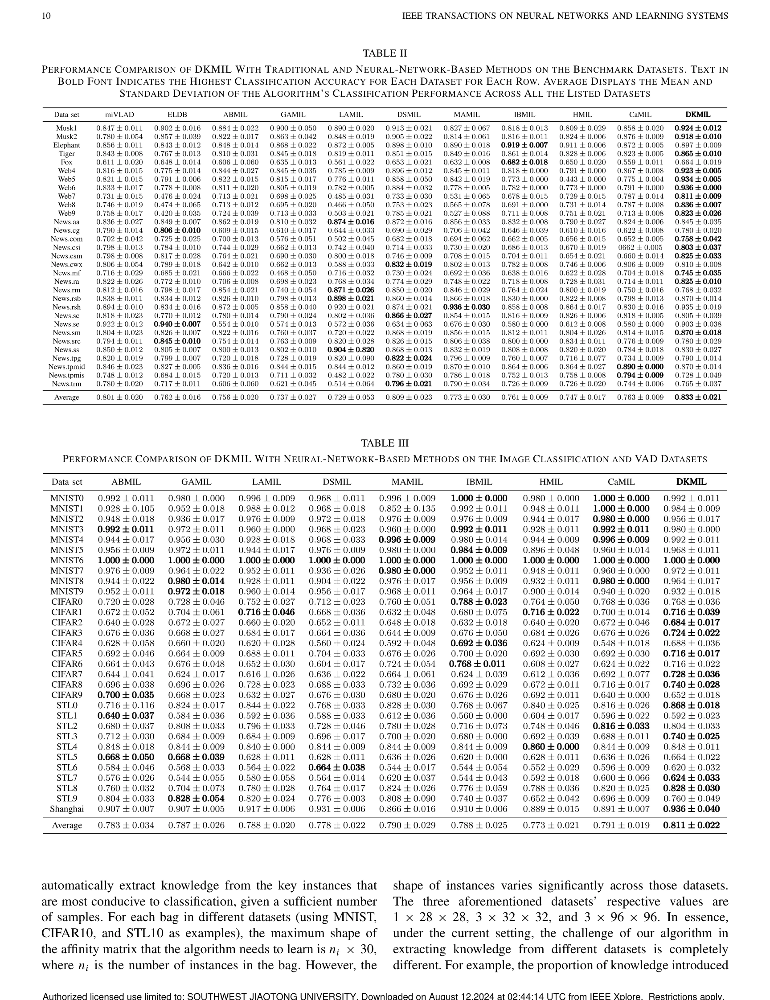
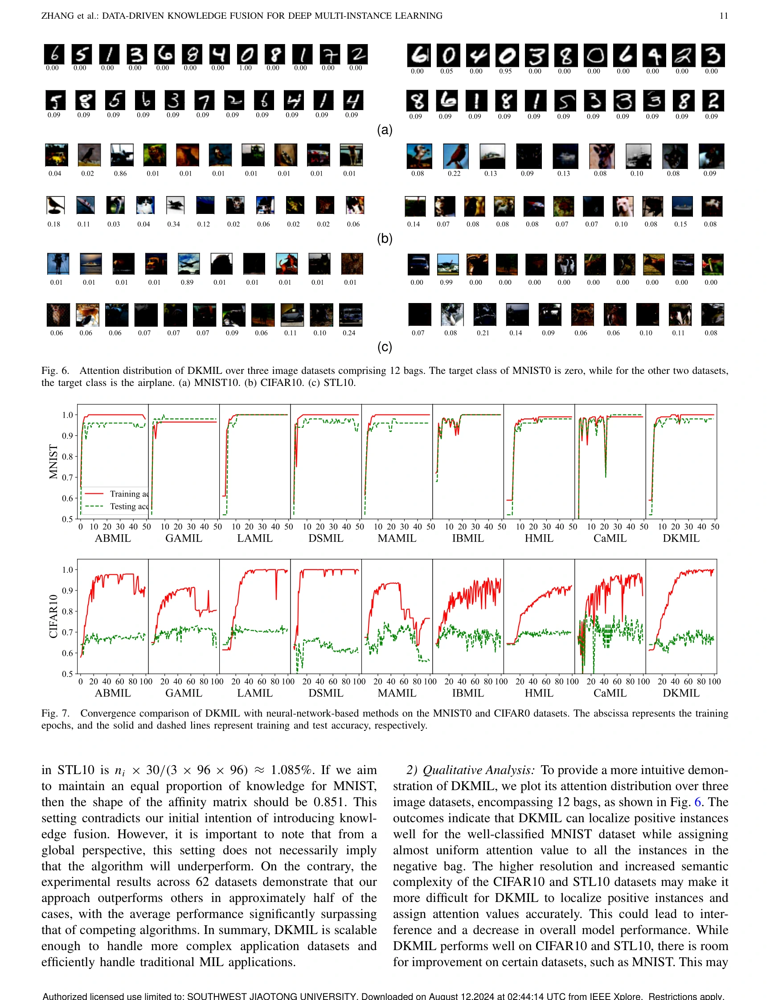
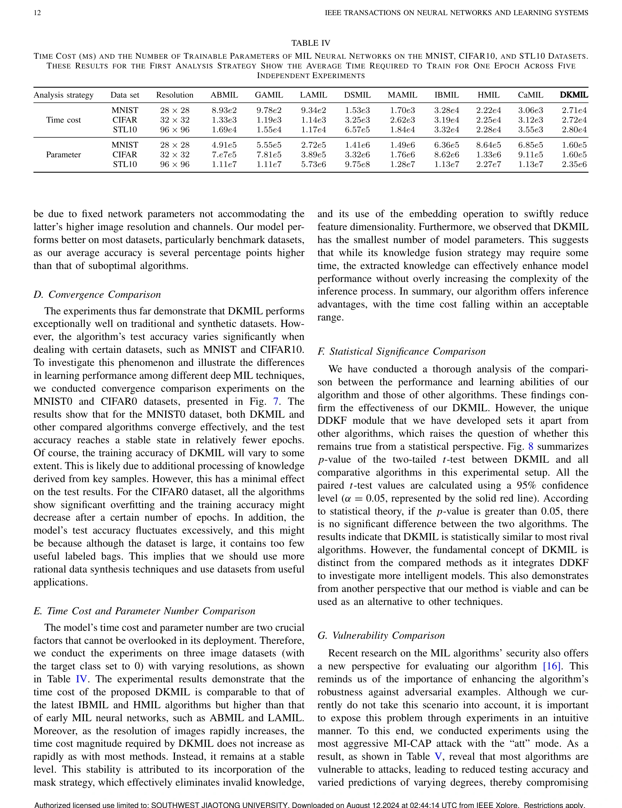
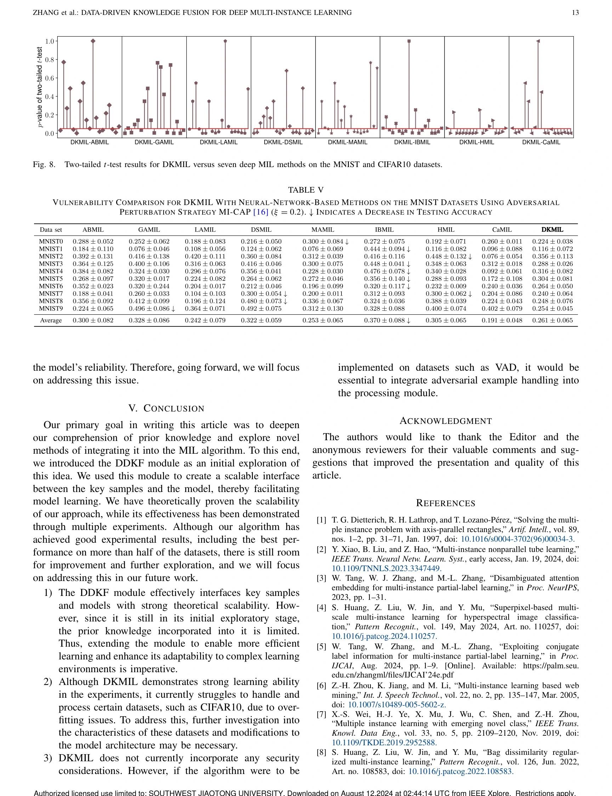
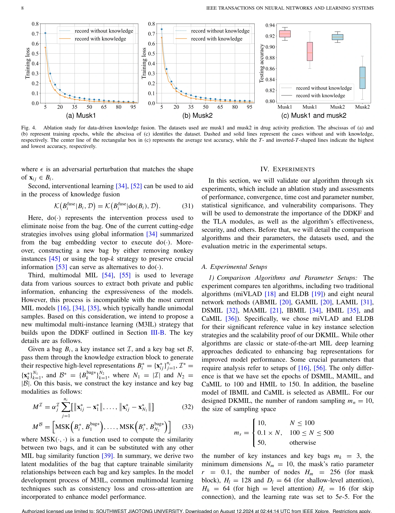
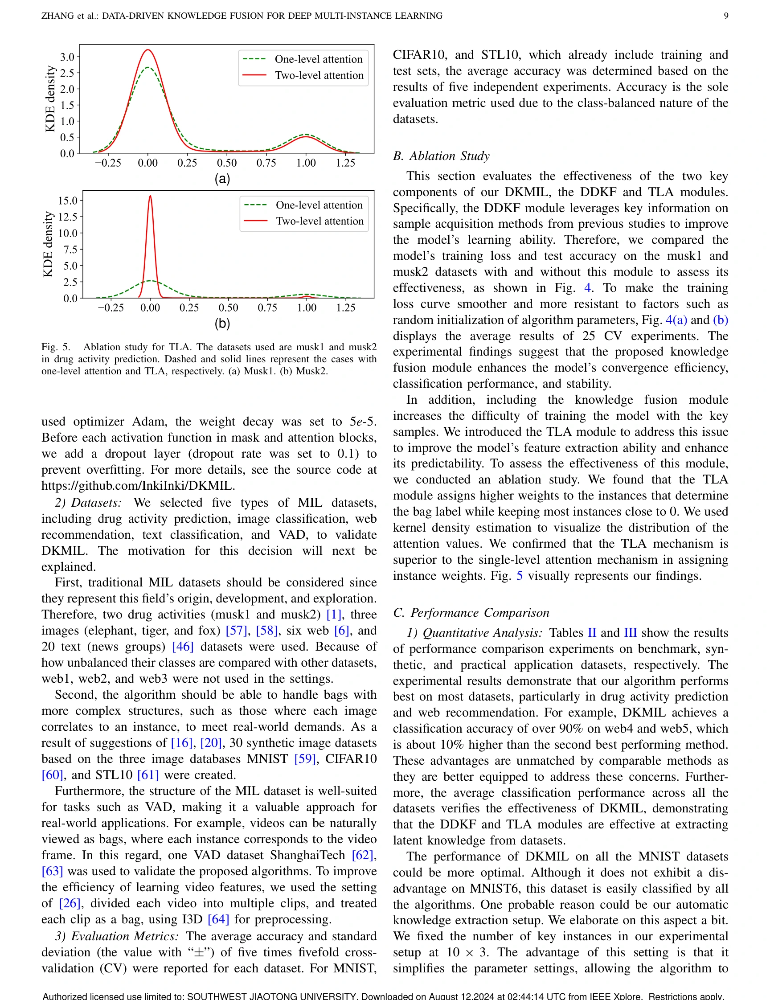

## Data-Driven Knowledge Fusion for Deep Multi-Instance Learning

> data: MUSK、动物图像、网页、20 Newsgroups、图像构造包及视频异常检测基准
>
> IEEE Transactions on Neural Networks and Learning Systems 2025 · [论文](https://doi.org/10.1109/TNNLS.2024.3436944)

#### 引言

从关键样本的决策中提取数据驱动知识，再用知识融合和两级注意力支持深度 MIL，重点是通用 MIL 的知识复用。

#### 方法

（1）关键样本：分析已有算法或数据中的代表性决策信息。

（2）知识融合：将数据驱动知识注入深度实例特征。

（3）两级注意力：逐步学习浅层与深层包信息，以适应知识增强表征。

<!-- wsi-complete-model -->
##### 模型结构图

**图 1 · 模型结构**（PDF 第 2 页）

> 原文图注：Fig. 1. Semantic example and model architecture of DKMIL. All the images used in this example are from the open-source image library Pexel. We consider each image a bag for demonstration and description, with instances inside the bag represented as patches. In practice, a bag may be a more complex scenario, such as collecting various images, which will be further explained in the methodology and experiments. (a) Semantic example. (b) Model architecture.

[查看原尺寸](../assest/DKMIL/figure-1-complete.webp)

<!-- /wsi-complete-model -->

#### 实验

##### 实验设置

使用五类共 62 个数据集验证通用 MIL；不同任务的数据表示及类别不平衡条件不同。

##### 主要结果

作者观察到 MNIST 与 CIFAR 构造包的测试准确率变化较大，并专门分析收敛；不能只引用平均名次。

<!-- wsi-complete-results -->
##### 完整实验指标与对照

下列实验原页保留表头、全部行列、子图、误差说明和脚注，点击可查看原尺寸。比较时请对应相同的数据集、特征编码器和训练设置；`±`、置信区间、百分比和小数均保留原文的单位与统计口径。

| 原表/图中指标 | 读取方式 |
| --- | --- |
| ACC / Accuracy | 越高越好；平衡准确率、平均准确率以原表标注为准 |

| 原文页 | 阅读内容 | 图表及正文引用 |
| --- | --- | --- |
| PDF 第 3 页 | 实验结果 | Table I |
| PDF 第 8 页 | 消融与参数分析 | Figure 4 |
| PDF 第 9 页 | 消融与参数分析 | Figure 5 |
| PDF 第 10 页 | 实验结果 | Table II、Table III |
| PDF 第 11 页 | 实验结果 | Figure 7 |
| PDF 第 12 页 | 实验结果 | Table IV |
| PDF 第 13 页 | 实验结果 | Table V |

**实验原页 · PDF 第 3 页**（图表及正文引用：Table I）

[查看原尺寸](../assest/DKMIL/experiment-page-03.webp)

**实验原页 · PDF 第 10 页**（图表及正文引用：Table II、Table III）

[查看原尺寸](../assest/DKMIL/experiment-page-10.webp)

**实验原页 · PDF 第 11 页**（图表及正文引用：Figure 7）

[查看原尺寸](../assest/DKMIL/experiment-page-11.webp)

**实验原页 · PDF 第 12 页**（图表及正文引用：Table IV）

[查看原尺寸](../assest/DKMIL/experiment-page-12.webp)

**实验原页 · PDF 第 13 页**（图表及正文引用：Table V）

[查看原尺寸](../assest/DKMIL/experiment-page-13.webp)

展开消融、参数、数据设置及效率原页

**实验原页 · PDF 第 8 页**（图表及正文引用：Figure 4）

[查看原尺寸](../assest/DKMIL/experiment-page-08.webp)

**实验原页 · PDF 第 9 页**（图表及正文引用：Figure 5）

[查看原尺寸](../assest/DKMIL/experiment-page-09.webp)

<!-- /wsi-complete-results -->

##### 消融与讨论

考察知识融合和两级注意力，比较训练/测试曲线与关键样本知识的作用。

#### 参考文献

> Data-Driven Knowledge Fusion for Deep Multi-Instance Learning
>
> IEEE Transactions on Neural Networks and Learning Systems 2025 · [论文](https://doi.org/10.1109/TNNLS.2024.3436944)

本文归入相关 MIL 方法：具体研究对象见数据与实验设置。
