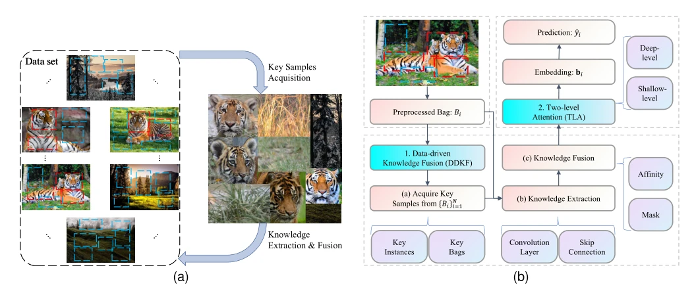

## Data-Driven Knowledge Fusion for Deep Multi-Instance Learning

> data: MUSK、动物图像、网页、20 Newsgroups、图像构造包及视频异常检测基准
>
> IEEE Transactions on Neural Networks and Learning Systems 2025 · [论文](https://doi.org/10.1109/TNNLS.2024.3436944)

#### 引言

从关键样本的决策中提取数据驱动知识，再用知识融合和两级注意力支持深度 MIL，重点是通用 MIL 的知识复用。

#### 方法

（1）关键样本：分析已有算法或数据中的代表性决策信息。

（2）知识融合：将数据驱动知识注入深度实例特征。

（3）两级注意力：逐步学习浅层与深层包信息，以适应知识增强表征。

原文Fig. 1，PDF 第 2 页。

#### 实验

##### 实验设置

使用五类共 62 个数据集验证通用 MIL；不同任务的数据表示及类别不平衡条件不同。

##### 主要结果

作者观察到 MNIST 与 CIFAR 构造包的测试准确率变化较大，并专门分析收敛；不能只引用平均名次。

##### 消融与讨论

考察知识融合和两级注意力，比较训练/测试曲线与关键样本知识的作用。

#### 参考文献

> Data-Driven Knowledge Fusion for Deep Multi-Instance Learning
>
> IEEE Transactions on Neural Networks and Learning Systems 2025 · [论文](https://doi.org/10.1109/TNNLS.2024.3436944)

本文归入相关 MIL 方法：具体研究对象见数据与实验设置。
