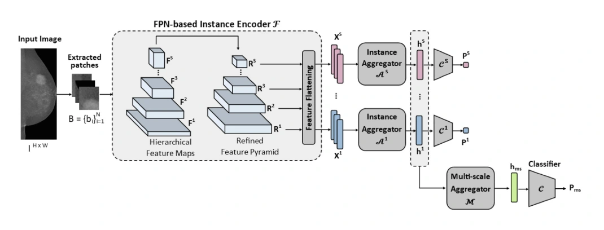
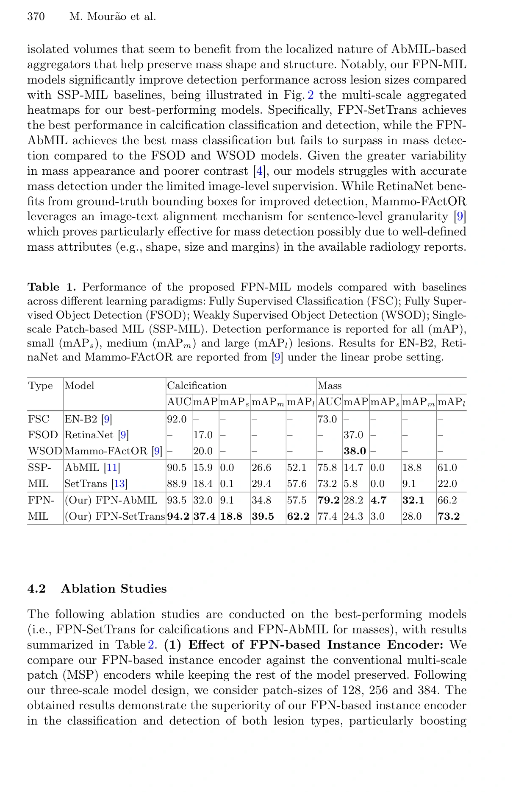
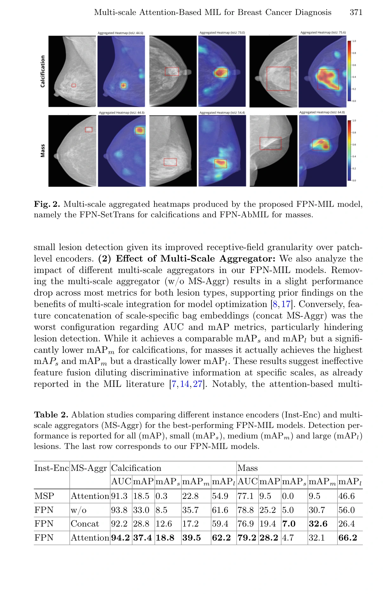

## Multi-scale Attention-Based Multiple Instance Learning for Breast Cancer Diagnosis

> data: VinDr-Mammo，5,000 例四视图乳腺摄影检查
>
> MICCAI 2025 · [论文](https://doi.org/10.1007/978-3-032-05182-0_36) · [作者代码](https://github.com/marianamourao-37/Multi-scale-Attention-based-MIL)

#### 引言

在乳腺 X 线影像中结合特征金字塔、多尺度实例聚合和深层监督，兼顾肿块与钙化病灶的不同尺度。研究对象为乳腺摄影。

#### 方法

（1）FPN 编码：单尺度输入 patch 产生多个尺度的实例表示。

（2）尺度内聚合：分别使用注意力或 Set Transformer 处理实例关系。

（3）尺度间聚合：通过注意力融合多个尺度并进行深层监督。

<!-- wsi-complete-model -->
##### 模型结构图

**图 1 · 模型结构**（PDF 第 3 页）

> 原文图注：Fig. 1. Overview of the proposed FPN-MIL model. Deep-supervised instance aggrega- tors leverage instance features Xs across pyramid levels s, computing bag embeddings hs and predictions P s . The attention-based multi-scale aggregator combines {hs }S s=1

[查看原尺寸](../assest/FPN-MIL/figure-1-complete.webp)

<!-- /wsi-complete-model -->

#### 实验

##### 实验设置

保留官方训练/测试划分，训练部分再按分组 80/20 取验证；分别评价肿块和钙化的分类及检测。

##### 主要结果

FPN-SetTrans 更适合钙化，FPN-AbMIL 在肿块任务表现更好，不能把某一聚合器写成所有病灶统一最优。

<!-- wsi-complete-results -->
##### 完整实验指标与对照

下列实验原页保留表头、全部行列、子图、误差说明和脚注，点击可查看原尺寸。比较时请对应相同的数据集、特征编码器和训练设置；`±`、置信区间、百分比和小数均保留原文的单位与统计口径。

| 原表/图中指标 | 读取方式 |
| --- | --- |
| AP / AUPRC / mAP | 越高越好；与 ROC-AUC 不同，保留任务和召回定义 |

| 原文页 | 阅读内容 | 图表及正文引用 |
| --- | --- | --- |
| PDF 第 7 页 | 实验结果 | Table 1 |
| PDF 第 8 页 | 消融与参数分析 | Table 2 |

**实验原页 · PDF 第 7 页**（图表及正文引用：Table 1）

[查看原尺寸](../assest/FPN-MIL/experiment-page-07.webp)

展开消融、参数、数据设置及效率原页

**实验原页 · PDF 第 8 页**（图表及正文引用：Table 2）

[查看原尺寸](../assest/FPN-MIL/experiment-page-08.webp)

<!-- /wsi-complete-results -->

##### 消融与讨论

比较 FPN 实例编码器与多尺度 patch 编码，以及尺度聚合器；不同输入 patch 大小是重要配置条件。

#### 参考文献

> Multi-scale Attention-Based Multiple Instance Learning for Breast Cancer Diagnosis
>
> MICCAI 2025 · [论文](https://doi.org/10.1007/978-3-032-05182-0_36) · [作者代码](https://github.com/marianamourao-37/Multi-scale-Attention-based-MIL)

本文归入相关 MIL 方法：具体研究对象见数据与实验设置。
