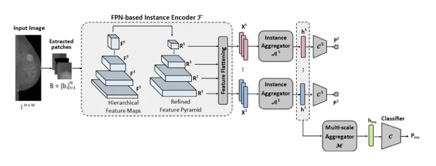
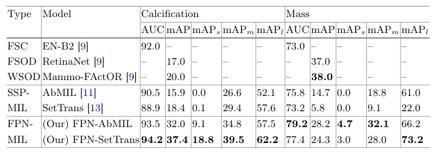

## Multi-scale Attention-Based Multiple Instance Learning for Breast Cancer Diagnosis

> data: VinDr-Mammo，5,000 例四视图乳腺摄影检查
>
> MICCAI 2025 · [论文](https://doi.org/10.1007/978-3-032-05182-0_36) · [作者代码](https://github.com/marianamourao-37/Multi-scale-Attention-based-MIL)

#### 引言

在乳腺 X 线影像中结合特征金字塔、多尺度实例聚合和深层监督，兼顾肿块与钙化病灶的不同尺度。研究对象为乳腺摄影。

#### 方法

（1）FPN 编码：单尺度输入 patch 产生多个尺度的实例表示。

（2）尺度内聚合：分别使用注意力或 Set Transformer 处理实例关系。

（3）尺度间聚合：通过注意力融合多个尺度并进行深层监督。

原文Fig. 1，PDF 第 3 页。

#### 实验

##### 实验设置

保留官方训练/测试划分，训练部分再按分组 80/20 取验证；分别评价肿块和钙化的分类及检测。

##### 主要结果

FPN-SetTrans 更适合钙化，FPN-AbMIL 在肿块任务表现更好，不能把某一聚合器写成所有病灶统一最优。

原文Table 1，PDF 第 7 页。

##### 消融与讨论

比较 FPN 实例编码器与多尺度 patch 编码，以及尺度聚合器；不同输入 patch 大小是重要配置条件。

#### 参考文献

> Multi-scale Attention-Based Multiple Instance Learning for Breast Cancer Diagnosis
>
> MICCAI 2025 · [论文](https://doi.org/10.1007/978-3-032-05182-0_36) · [作者代码](https://github.com/marianamourao-37/Multi-scale-Attention-based-MIL)

本文归入相关 MIL 方法：具体研究对象见数据与实验设置。
