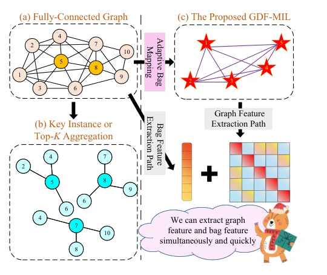

## Rethinking Multi-Instance Learning Through Graph-Driven Fusion: A Dual-Path Approach to Adaptive Representation

> data: 文本、网页、图像、医学四类共 24 个 MIL 数据集
>
> AAAI 2026 · [论文](https://doi.org/10.1609/aaai.v40i34.40081)

#### 引言

用软聚类压缩实例并学习动态稀疏图，再通过门控融合图特征与包级语义特征；属于跨任务的通用图 MIL 框架。

#### 方法

（1）ABMM：软聚类把包映射为更紧凑的表示。

（2）DGSL：以加权连接学习动态稀疏图。

（3）DPFF：门控融合图拓扑特征与保留的包语义。

原文Figure 1，PDF 第 1 页。

#### 实验

##### 实验设置

与 18 种方法比较；耗时采用五折、每折重复 100 次，统计每 epoch 平均时间。

##### 主要结果

news.rsb 上报告满分，但主文文本数据只是整体评估的一部分；ABMIL 仍有明显速度优势。

##### 消融与讨论

消融软聚类映射、动态图与双路门控，考察表征质量和图构建效率的折中。

#### 参考文献

> Rethinking Multi-Instance Learning Through Graph-Driven Fusion: A Dual-Path Approach to Adaptive Representation
>
> AAAI 2026 · [论文](https://doi.org/10.1609/aaai.v40i34.40081)

本文归入相关 MIL 方法：具体研究对象见数据与实验设置。
