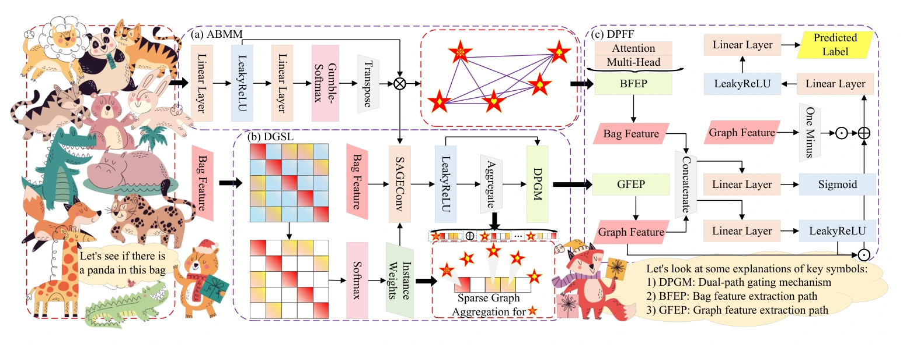
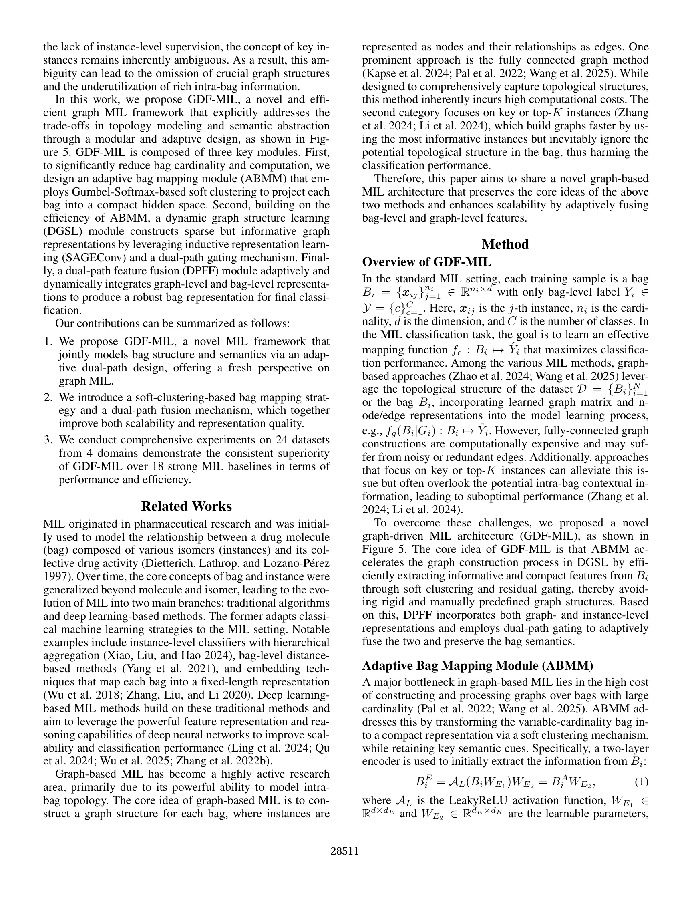
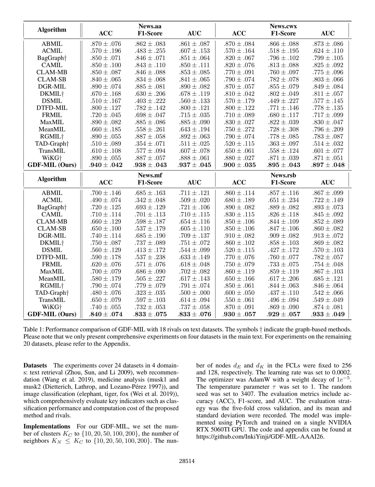
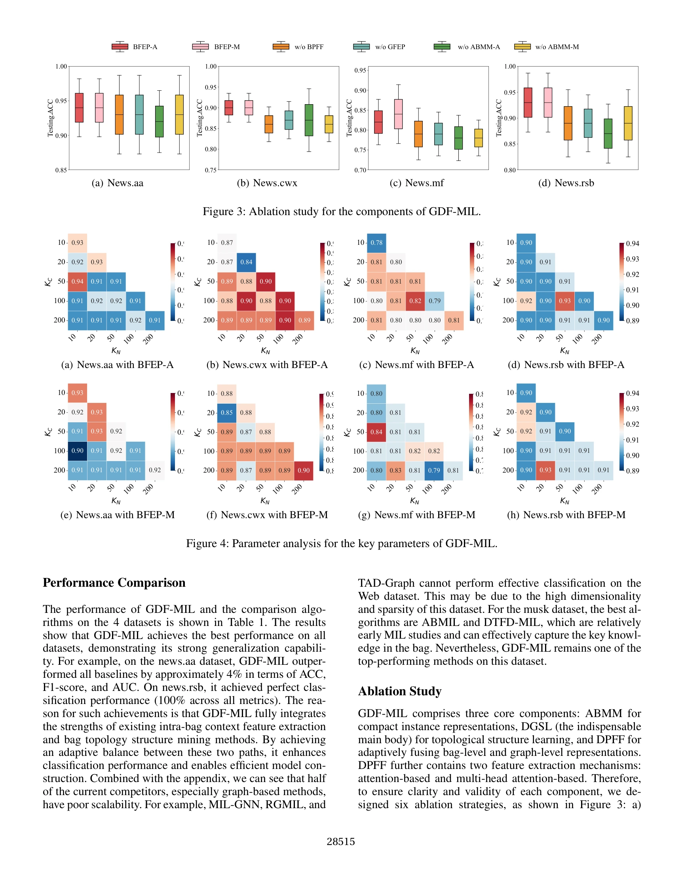

## Rethinking Multi-Instance Learning Through Graph-Driven Fusion: A Dual-Path Approach to Adaptive Representation

> data: 文本、网页、图像、医学四类共 24 个 MIL 数据集
>
> AAAI 2026 · [论文](https://doi.org/10.1609/aaai.v40i34.40081)

#### 引言

用软聚类压缩实例并学习动态稀疏图，再通过门控融合图特征与包级语义特征；属于跨任务的通用图 MIL 框架。

#### 方法

（1）ABMM：软聚类把包映射为更紧凑的表示。

（2）DGSL：以加权连接学习动态稀疏图。

（3）DPFF：门控融合图拓扑特征与保留的包语义。

<!-- wsi-complete-model -->
##### 模型结构图

**图 2 · 模型结构**（PDF 第 3 页）

> 原文图注：Figure 2: The overview of the proposed GDF-MIL. (a) Adaptive bag mapping module (ABMM): Performs preliminary feature extraction and generates a compact representation; (b) Dynamic graph structure learning (DGSL): Fully explores the graph topological structure based on the weighted connectivity, SAGEConv (inductive representation learning (Hamilton, Ying, and Leskovec 2017)), and DPGM; (c) Dual-path feature fusion (DPFF): Adaptively fuse bag-level and graph-level representations.

[查看原尺寸](../assest/GDF-MIL/figure-2-complete.webp)

<!-- /wsi-complete-model -->

#### 实验

##### 实验设置

与 18 种方法比较；耗时采用五折、每折重复 100 次，统计每 epoch 平均时间。

##### 主要结果

news.rsb 上报告满分，但主文文本数据只是整体评估的一部分；ABMIL 仍有明显速度优势。

<!-- wsi-complete-results -->
##### 完整实验指标与对照

下列实验原页保留表头、全部行列、子图、误差说明和脚注，点击可查看原尺寸。比较时请对应相同的数据集、特征编码器和训练设置；`±`、置信区间、百分比和小数均保留原文的单位与统计口径。

| 原文页 | 阅读内容 | 图表及正文引用 |
| --- | --- | --- |
| PDF 第 2 页 | 实验结果 | Figure 5 |
| PDF 第 5 页 | 实验结果 | Table 1 |
| PDF 第 6 页 | 消融与参数分析 | Figure 3 |

**实验原页 · PDF 第 2 页**（图表及正文引用：Figure 5）

[查看原尺寸](../assest/GDF-MIL/experiment-page-02.webp)

**实验原页 · PDF 第 5 页**（图表及正文引用：Table 1）

[查看原尺寸](../assest/GDF-MIL/experiment-page-05.webp)

展开消融、参数、数据设置及效率原页

**实验原页 · PDF 第 6 页**（图表及正文引用：Figure 3）

[查看原尺寸](../assest/GDF-MIL/experiment-page-06.webp)

<!-- /wsi-complete-results -->

##### 消融与讨论

消融软聚类映射、动态图与双路门控，考察表征质量和图构建效率的折中。

#### 参考文献

> Rethinking Multi-Instance Learning Through Graph-Driven Fusion: A Dual-Path Approach to Adaptive Representation
>
> AAAI 2026 · [论文](https://doi.org/10.1609/aaai.v40i34.40081)

本文归入相关 MIL 方法：具体研究对象见数据与实验设置。
