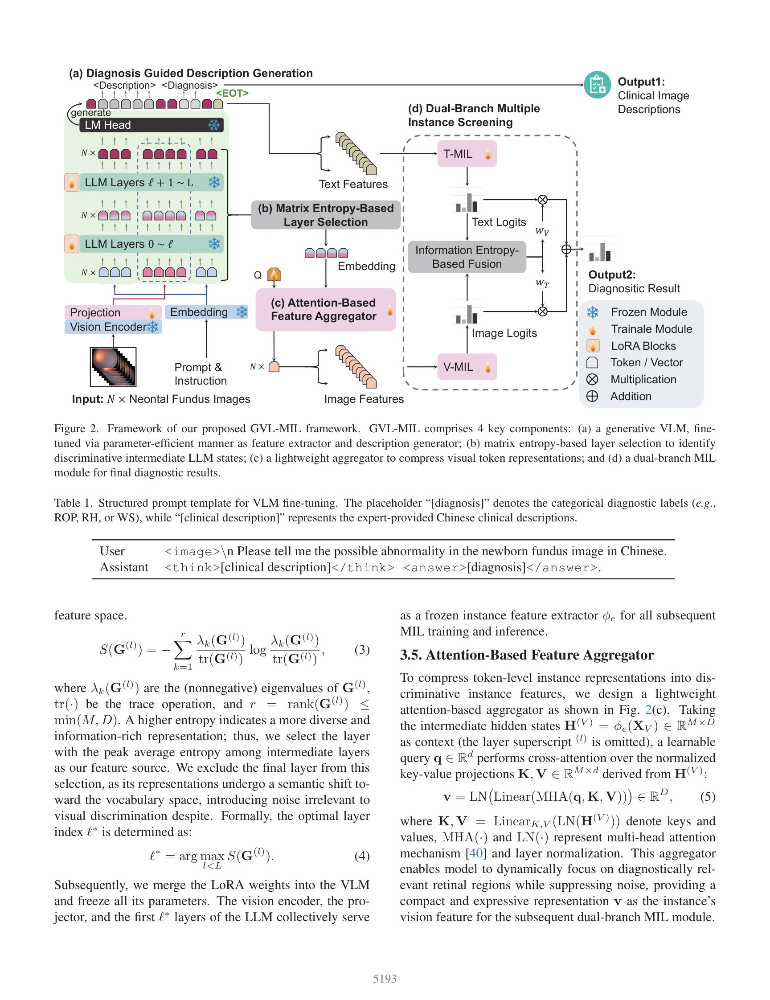
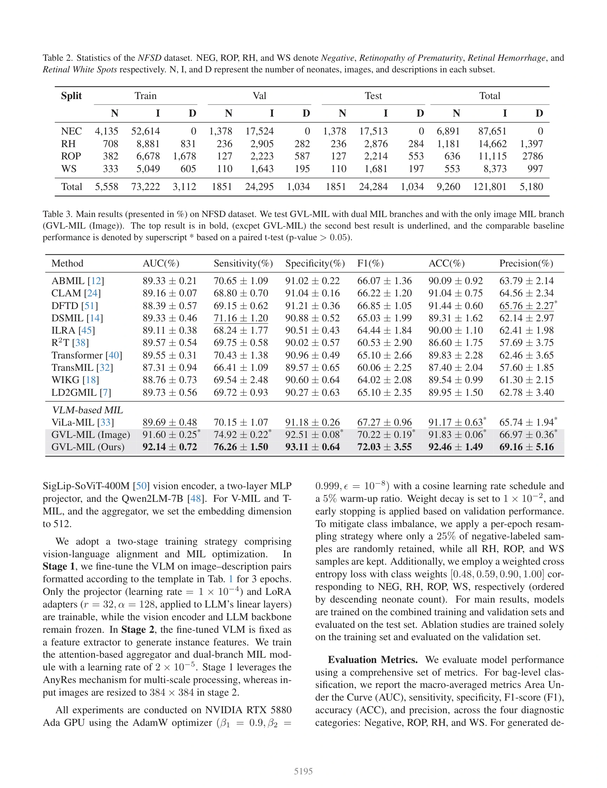
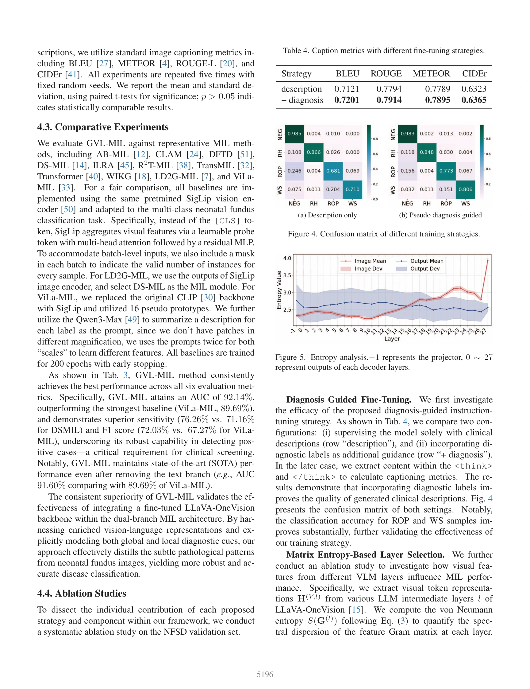
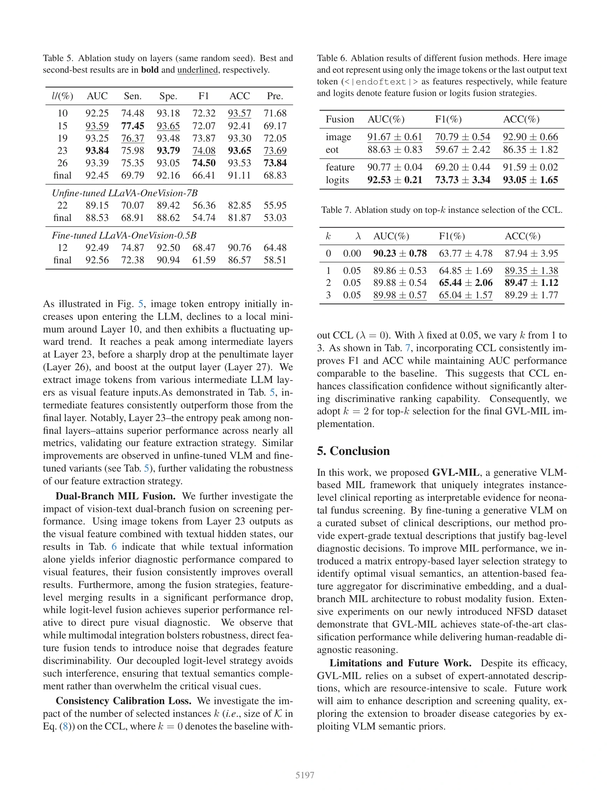

## Generative Vision-Language Multiple Instance Learning for Weakly Supervised Neonatal Fundus Screening and Reporting

> data: NFSD：9,260 位新生儿、121,801 张眼底图像
>
> 收藏标记 CVPR 2026；本次核对 PDF，会议归属待核实 · [作者代码](https://github.com/CVIU-CSU/GVL-MIL)

#### 引言

微调生成式视觉语言模型以产生新生儿眼底实例描述，再通过双分支 MIL 和熵感知融合进行筛查。研究对象为新生儿眼底图像。

#### 方法

（1）生成式适配：用少量专家图文微调 VLM，获得实例级描述。

（2）双分支 MIL：分别汇总视觉与生成文本信息。

（3）熵感知融合：结合两分支置信情况输出患者级筛查结果。

<!-- wsi-complete-model -->
##### 模型结构图

**图 2 · 模型结构**（PDF 第 4 页）

> 原文图注：Figure 2. Framework of our proposed GVL-MIL framework. GVL-MIL comprises 4 key components: (a) a generative VLM, fine- tuned via parameter-efficient manner as feature extractor and description generator; (b) matrix entropy-based layer selection to identify discriminative intermediate LLM states; (c) a lightweight aggregator to compress visual token representations; and (d) a dual-branch MIL module for final diagnostic results.

[查看原尺寸](../assest/GVL-MIL/figure-2-complete.webp)

<!-- /wsi-complete-model -->

#### 实验

##### 实验设置

按约 6:2:2 划分，5,180 张图像有专家文字描述；主结果合并训练与验证训练，消融用单独验证集。

##### 主要结果

同时报告患者级筛查和实例描述；两类结果不能互相代替，且主结果和消融的训练样本量不同。

<!-- wsi-complete-results -->
##### 完整实验指标与对照

下列实验原页保留表头、全部行列、子图、误差说明和脚注，点击可查看原尺寸。比较时请对应相同的数据集、特征编码器和训练设置；`±`、置信区间、百分比和小数均保留原文的单位与统计口径。

| 原文页 | 阅读内容 | 图表及正文引用 |
| --- | --- | --- |
| PDF 第 4 页 | 实验结果 | Table 1 |
| PDF 第 6 页 | 实验结果 | Table 2、Table 3 |
| PDF 第 7 页 | 实验结果 | Table 4 |
| PDF 第 8 页 | 消融与参数分析 | Table 5、Table 6、Table 7 |

**实验原页 · PDF 第 4 页**（图表及正文引用：Table 1）

[查看原尺寸](../assest/GVL-MIL/experiment-page-04.webp)

**实验原页 · PDF 第 6 页**（图表及正文引用：Table 2、Table 3）

[查看原尺寸](../assest/GVL-MIL/experiment-page-06.webp)

**实验原页 · PDF 第 7 页**（图表及正文引用：Table 4）

[查看原尺寸](../assest/GVL-MIL/experiment-page-07.webp)

展开消融、参数、数据设置及效率原页

**实验原页 · PDF 第 8 页**（图表及正文引用：Table 5、Table 6、Table 7）

[查看原尺寸](../assest/GVL-MIL/experiment-page-08.webp)

<!-- /wsi-complete-results -->

##### 消融与讨论

考察生成式 VLM 适配、视觉/文本双分支及熵融合，并保留类别重采样和加权损失设置。

#### 参考文献

> Generative Vision-Language Multiple Instance Learning for Weakly Supervised Neonatal Fundus Screening and Reporting
>
> 收藏标记 CVPR 2026；本次核对 PDF，会议归属待核实 · [作者代码](https://github.com/CVIU-CSU/GVL-MIL)

本文归入相关 MIL 方法：具体研究对象见数据与实验设置。
