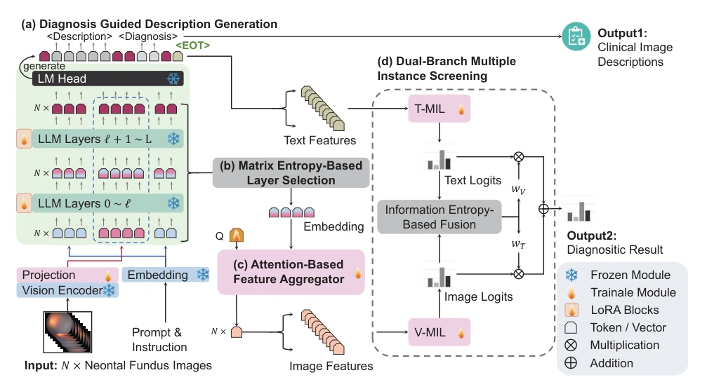
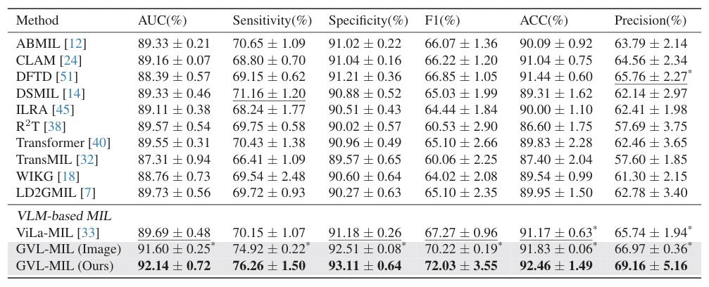

## Generative Vision-Language Multiple Instance Learning for Weakly Supervised Neonatal Fundus Screening and Reporting

> data: NFSD：9,260 位新生儿、121,801 张眼底图像
>
> 收藏标记 CVPR 2026；本次核对 PDF，会议归属待核实 · [作者代码](https://github.com/CVIU-CSU/GVL-MIL)

#### 引言

微调生成式视觉语言模型以产生新生儿眼底实例描述，再通过双分支 MIL 和熵感知融合进行筛查。研究对象为新生儿眼底图像。

#### 方法

（1）生成式适配：用少量专家图文微调 VLM，获得实例级描述。

（2）双分支 MIL：分别汇总视觉与生成文本信息。

（3）熵感知融合：结合两分支置信情况输出患者级筛查结果。

原文Figure 2，PDF 第 4 页。

#### 实验

##### 实验设置

按约 6:2:2 划分，5,180 张图像有专家文字描述；主结果合并训练与验证训练，消融用单独验证集。

##### 主要结果

同时报告患者级筛查和实例描述；两类结果不能互相代替，且主结果和消融的训练样本量不同。

原文Table 3，PDF 第 6 页。

##### 消融与讨论

考察生成式 VLM 适配、视觉/文本双分支及熵融合，并保留类别重采样和加权损失设置。

#### 参考文献

> Generative Vision-Language Multiple Instance Learning for Weakly Supervised Neonatal Fundus Screening and Reporting
>
> 收藏标记 CVPR 2026；本次核对 PDF，会议归属待核实 · [作者代码](https://github.com/CVIU-CSU/GVL-MIL)

本文归入相关 MIL 方法：具体研究对象见数据与实验设置。
