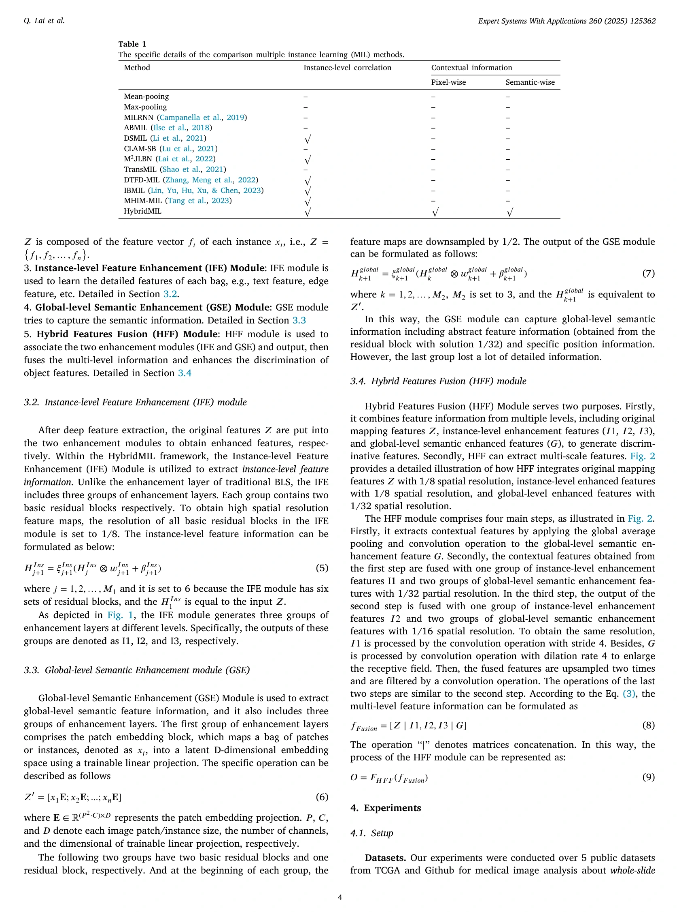
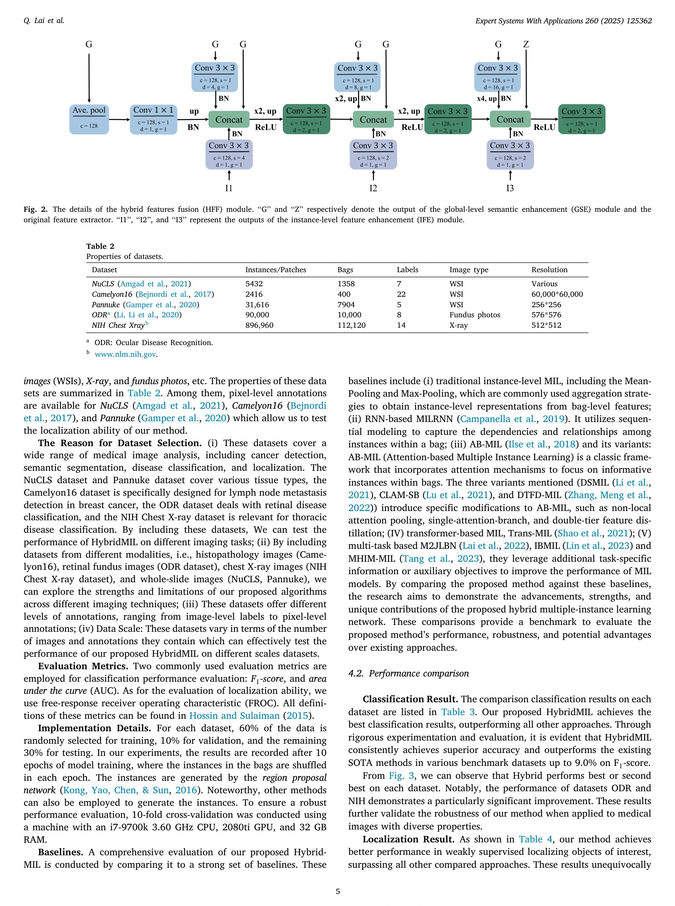
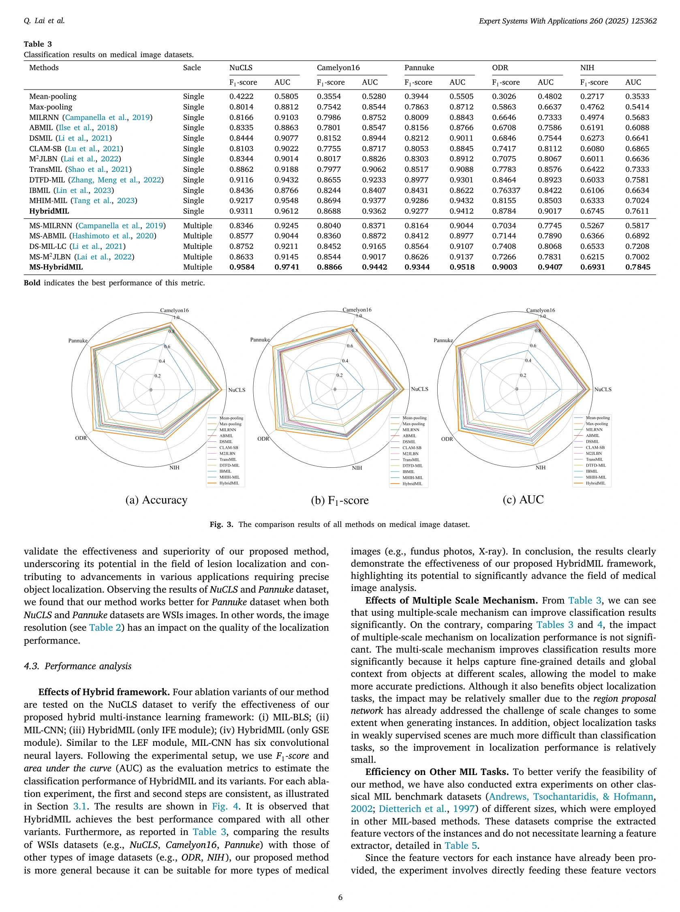
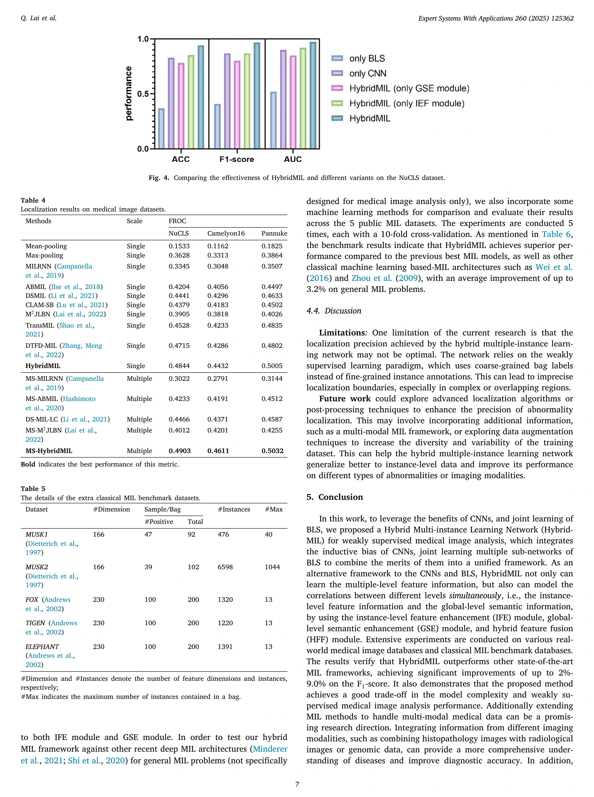
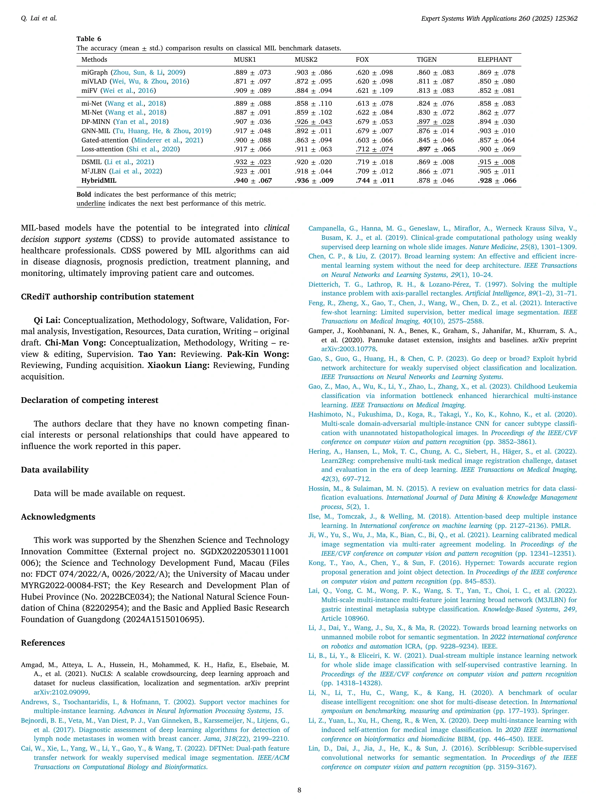

## Hybrid multiple instance learning network for weakly supervised medical image classification and localization

> data: NuCLS、CAMELYON16、PanNuke、ODR、NIH Chest X-ray；另有经典 MIL 基准
>
> Expert Systems with Applications 2025 · [论文](https://doi.org/10.1016/j.eswa.2024.125362)

#### 引言

将 CNN 与宽度学习系统结合，通过实例特征增强、全局语义增强和混合特征融合完成弱监督分类与定位，属于通用医学图像 MIL。

#### 方法

（1）IFE：同时提取不同层级实例特征，保留局部多尺度信息。

（2）GSE：用宽度学习分支强化全局语义。

（3）HFF：对齐与融合局部和全局表示，支持分类及定位。

<!-- wsi-complete-model -->
##### 模型结构图

**图 1 · 模型结构**（PDF 第 2 页）

> 原文图注：Fig. 1. The overall architecture of HybridMIL. The ‘‘Seg. Head’’ represents the classifier which can be switched between different structures to complete different visual tasks. When the visual task is a classification task, the ‘‘Seg. Head’’ is fully connected layers. When is a semantic segmentation task, the ‘‘Seg. Head’’ contains at least one 3 × 3 convolution and one 1 × 1 convolution. The letters ‘‘Z’’ and ‘‘G’’ denote the output of the feature extractor and the GSE module, respectively. I1, I2, and I3 represent the outputs of the IFE module.

[查看原尺寸](../assest/HybridMIL/figure-1-complete.webp)

<!-- /wsi-complete-model -->

#### 实验

##### 实验设置

随机训练/验证/测试为 60%/10%/30%；另做十折评估，经典 MIL 数据直接使用已给定的实例特征。

##### 主要结果

分类和定位分别报告，论文还检验通用 MIL 数据上的效果；不能把所有数据均称为病理 WSI。

<!-- wsi-complete-results -->
##### 完整实验指标与对照

下列实验原页保留表头、全部行列、子图、误差说明和脚注，点击可查看原尺寸。比较时请对应相同的数据集、特征编码器和训练设置；`±`、置信区间、百分比和小数均保留原文的单位与统计口径。

| 原表/图中指标 | 读取方式 |
| --- | --- |
| ACC / Accuracy | 越高越好；平衡准确率、平均准确率以原表标注为准 |

| 原文页 | 阅读内容 | 图表及正文引用 |
| --- | --- | --- |
| PDF 第 4 页 | 实验结果 | Table 1 |
| PDF 第 5 页 | 实验结果 | Table 2 |
| PDF 第 6 页 | 实验结果 | Table 3 |
| PDF 第 7 页 | 实验结果 | Table 4、Table 5 |
| PDF 第 8 页 | 实验结果 | Table 6 |

**实验原页 · PDF 第 4 页**（图表及正文引用：Table 1）

[查看原尺寸](../assest/HybridMIL/experiment-page-04.webp)

**实验原页 · PDF 第 5 页**（图表及正文引用：Table 2）

[查看原尺寸](../assest/HybridMIL/experiment-page-05.webp)

**实验原页 · PDF 第 6 页**（图表及正文引用：Table 3）

[查看原尺寸](../assest/HybridMIL/experiment-page-06.webp)

**实验原页 · PDF 第 7 页**（图表及正文引用：Table 4、Table 5）

[查看原尺寸](../assest/HybridMIL/experiment-page-07.webp)

**实验原页 · PDF 第 8 页**（图表及正文引用：Table 6）

[查看原尺寸](../assest/HybridMIL/experiment-page-08.webp)

<!-- /wsi-complete-results -->

##### 消融与讨论

比较实例特征增强、全局语义增强与混合融合，区分 CNN 编码和宽度学习分支的贡献。

#### 参考文献

> Hybrid multiple instance learning network for weakly supervised medical image classification and localization
>
> Expert Systems with Applications 2025 · [论文](https://doi.org/10.1016/j.eswa.2024.125362)

本文归入相关 MIL 方法：具体研究对象见数据与实验设置。
