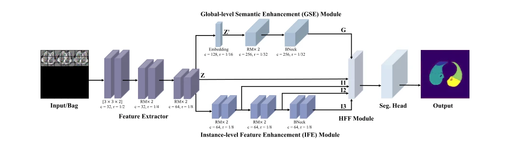

## Hybrid multiple instance learning network for weakly supervised medical image classification and localization

> data: NuCLS、CAMELYON16、PanNuke、ODR、NIH Chest X-ray；另有经典 MIL 基准
>
> Expert Systems with Applications 2025 · [论文](https://doi.org/10.1016/j.eswa.2024.125362)

#### 引言

将 CNN 与宽度学习系统结合，通过实例特征增强、全局语义增强和混合特征融合完成弱监督分类与定位，属于通用医学图像 MIL。

#### 方法

（1）IFE：同时提取不同层级实例特征，保留局部多尺度信息。

（2）GSE：用宽度学习分支强化全局语义。

（3）HFF：对齐与融合局部和全局表示，支持分类及定位。

原文Fig. 1，PDF 第 2 页。

#### 实验

##### 实验设置

随机训练/验证/测试为 60%/10%/30%；另做十折评估，经典 MIL 数据直接使用已给定的实例特征。

##### 主要结果

分类和定位分别报告，论文还检验通用 MIL 数据上的效果；不能把所有数据均称为病理 WSI。

##### 消融与讨论

比较实例特征增强、全局语义增强与混合融合，区分 CNN 编码和宽度学习分支的贡献。

#### 参考文献

> Hybrid multiple instance learning network for weakly supervised medical image classification and localization
>
> Expert Systems with Applications 2025 · [论文](https://doi.org/10.1016/j.eswa.2024.125362)

本文归入相关 MIL 方法：具体研究对象见数据与实验设置。
