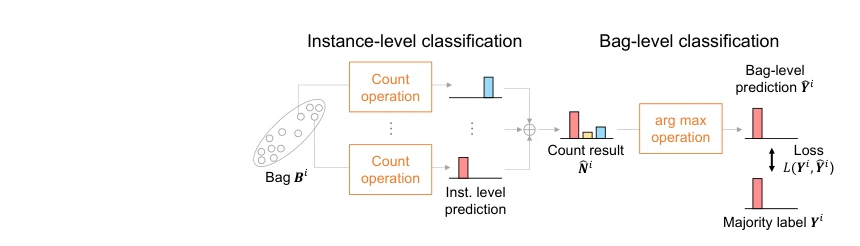

## Learning from Majority Label: A Novel Problem in Multi-class Multiple-Instance Learning

> data: 论文中的四个多类 MIL 数据集
>
> 收藏标记 Pattern Recognition 2026；所附链接为 arXiv 2025 版本 · [论文](https://arxiv.org/abs/2509.04023) · [作者代码](https://github.com/Shiku-Kaito/Learning-from-Majority-Label-A-Novel-Problem-in-Multi-class-Multiple-Instance-Learning)

#### 引言

研究包标签等于实例多数类别的多类 MIL，以计数网络和多数比例增强模块学习实例分类；其标签假设与经典阳性包 MIL 不同。

#### 方法

（1）计数网络：估计每个实例类别，并按类别数量形成包内多数预测。

（2）多数标签训练：只用包级多数类别监督实例学习。

（3）MPEM：移除部分少数实例以增加多数比例，缓解监督歧义。

原文Figure 4，PDF 第 9 页。

#### 实验

##### 实验设置

以包内多数类别为包标签，目标是学习实例类别；该设定不同于经典存在一个阳性即阳性包。

##### 主要结果

比较实例级准确率，结果支持计数网络和多数比例增强；不能把该标签机制直接套到稀疏肿瘤检测。

##### 消融与讨论

消融计数网络与 MPEM，并分析多数类比例；先确认真实任务是否满足多数标签假设。

#### 参考文献

> Learning from Majority Label: A Novel Problem in Multi-class Multiple-Instance Learning
>
> 收藏标记 Pattern Recognition 2026；所附链接为 arXiv 2025 版本 · [论文](https://arxiv.org/abs/2509.04023) · [作者代码](https://github.com/Shiku-Kaito/Learning-from-Majority-Label-A-Novel-Problem-in-Multi-class-Multiple-Instance-Learning)

本文归入相关 MIL 方法：具体研究对象见数据与实验设置。
