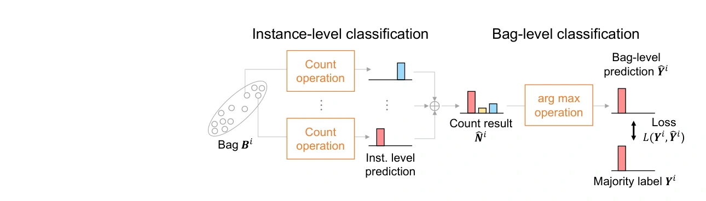
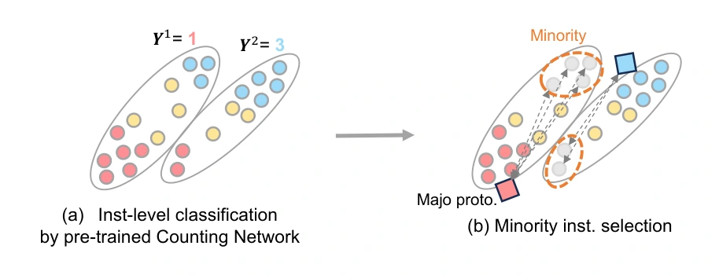
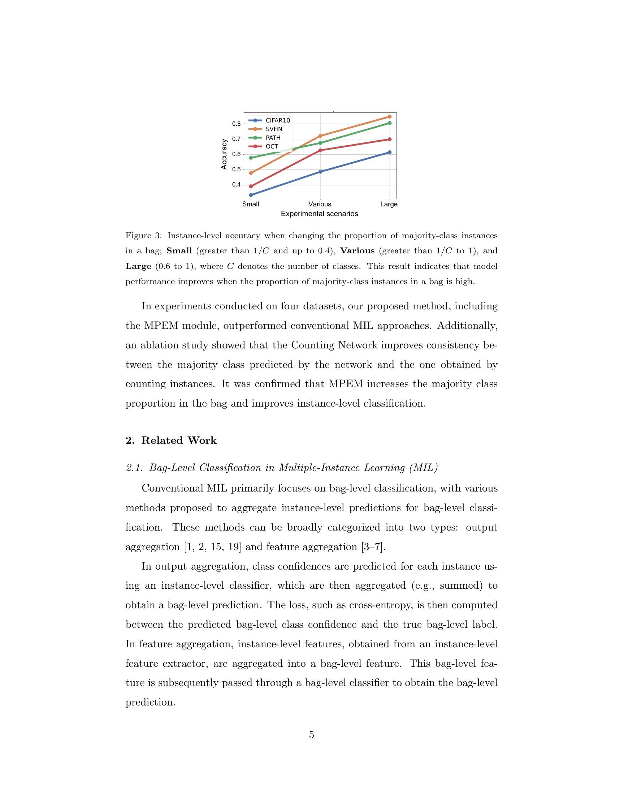
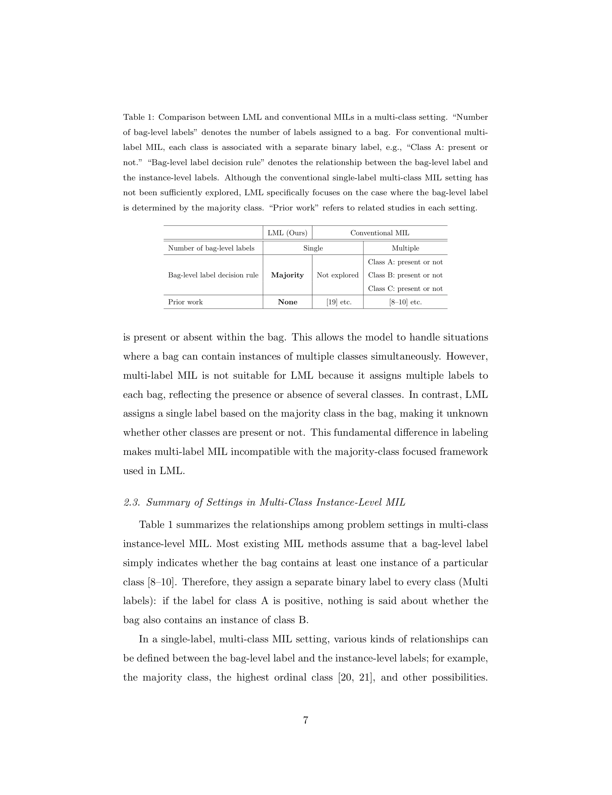
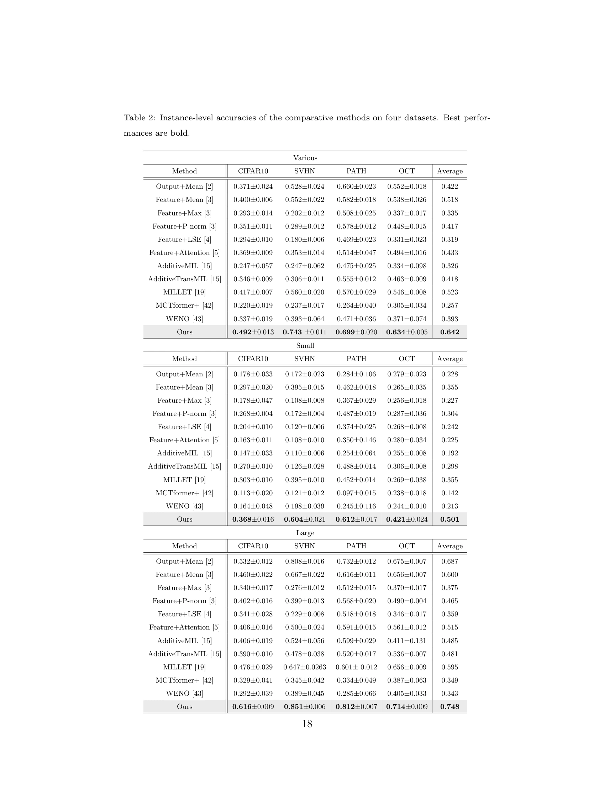
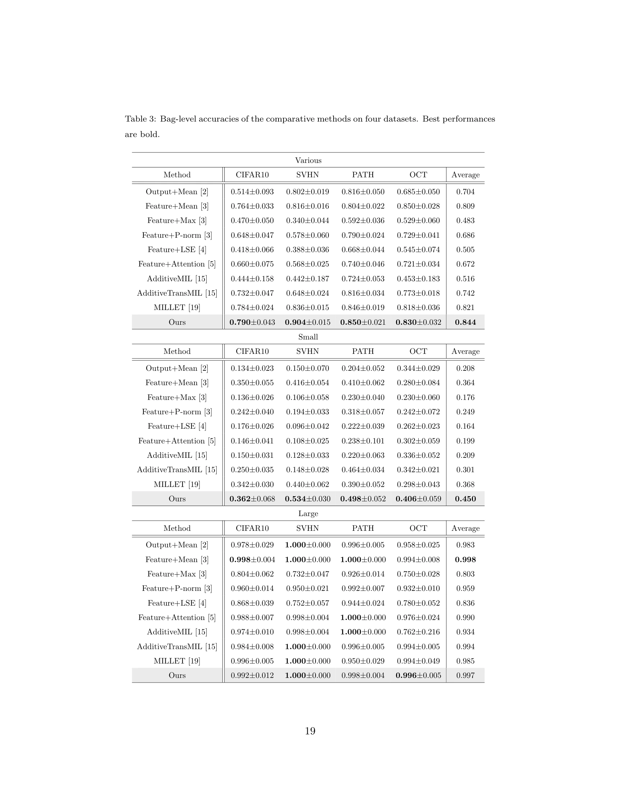
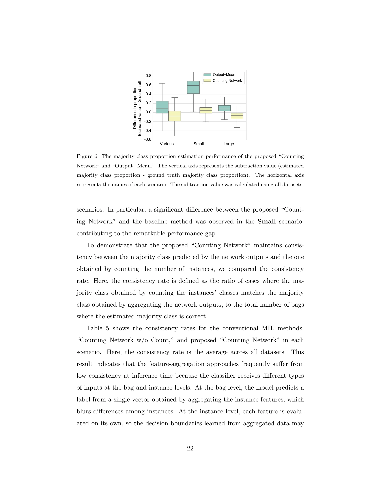
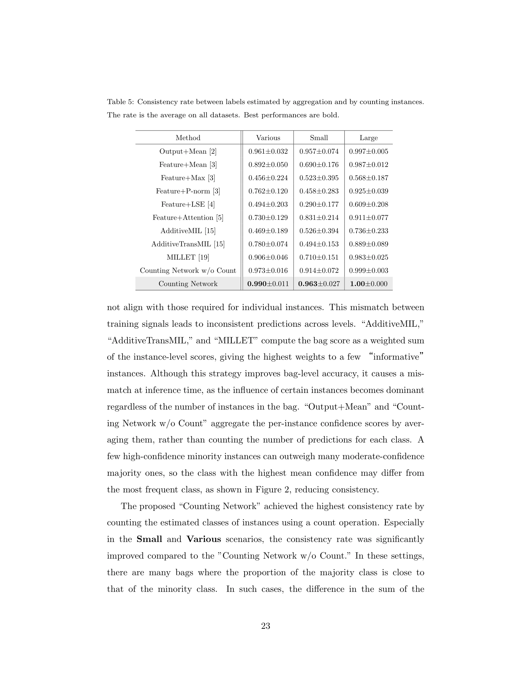
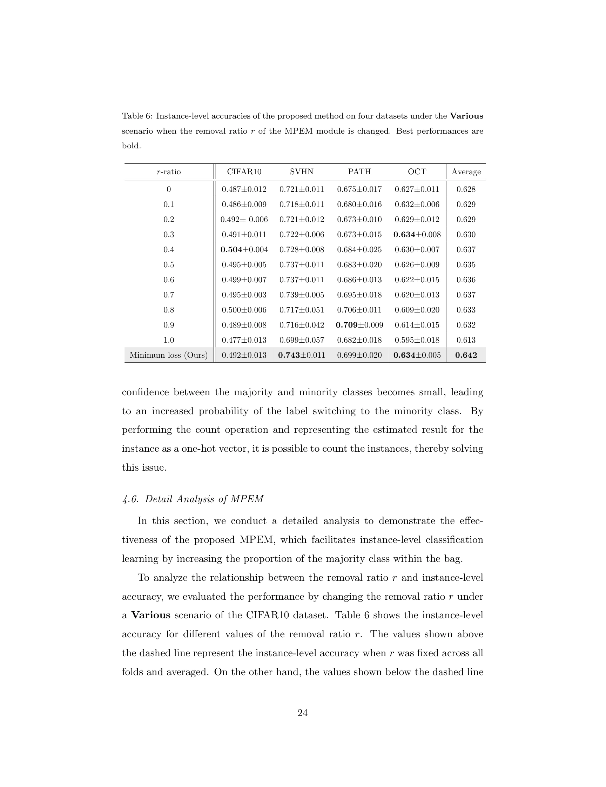
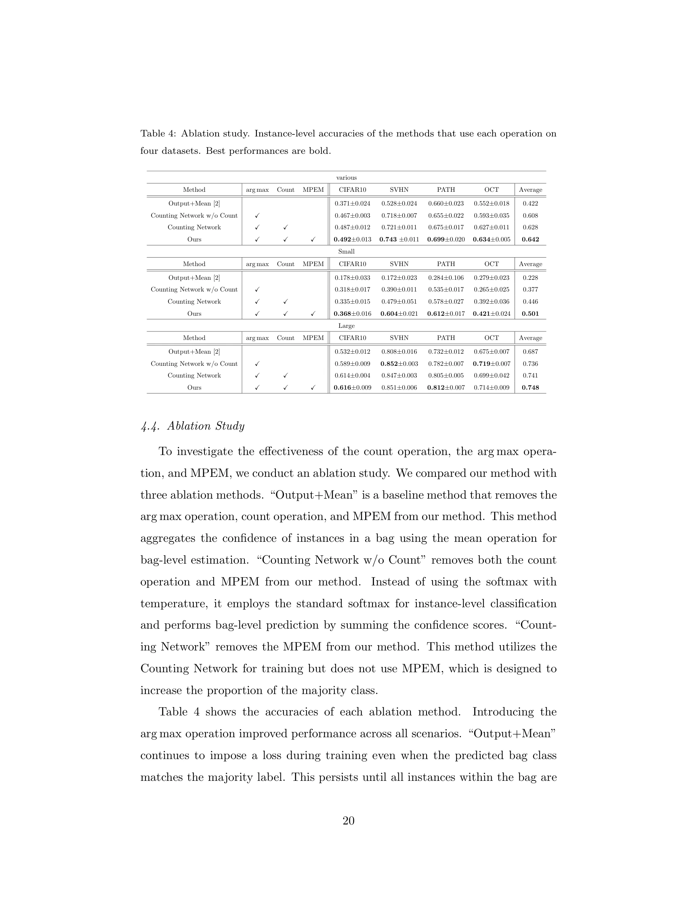

## Learning from Majority Label: A Novel Problem in Multi-class Multiple-Instance Learning

> data: 论文中的四个多类 MIL 数据集
>
> 收藏标记 Pattern Recognition 2026；所附链接为 arXiv 2025 版本 · [论文](https://arxiv.org/abs/2509.04023) · [作者代码](https://github.com/Shiku-Kaito/Learning-from-Majority-Label-A-Novel-Problem-in-Multi-class-Multiple-Instance-Learning)

#### 引言

研究包标签等于实例多数类别的多类 MIL，以计数网络和多数比例增强模块学习实例分类；其标签假设与经典阳性包 MIL 不同。

#### 方法

（1）计数网络：估计每个实例类别，并按类别数量形成包内多数预测。

（2）多数标签训练：只用包级多数类别监督实例学习。

（3）MPEM：移除部分少数实例以增加多数比例，缓解监督歧义。

<!-- wsi-complete-model -->
##### 模型结构图

**图 4 · 模型结构**（PDF 第 9 页）

> 原文图注：Figure 4: Overview of the Counting Network, which consists of two steps: instance-level

[查看原尺寸](../assest/LML-MPEM/figure-4-complete.webp)

**图 5 · 模型结构**（PDF 第 13 页）

> 原文图注：Figure 5: Overview of the majority proportion enhancement module. (a) Pre-trained Counting

[查看原尺寸](../assest/LML-MPEM/figure-5-complete.webp)

<!-- /wsi-complete-model -->

#### 实验

##### 实验设置

以包内多数类别为包标签，目标是学习实例类别；该设定不同于经典存在一个阳性即阳性包。

##### 主要结果

比较实例级准确率，结果支持计数网络和多数比例增强；不能把该标签机制直接套到稀疏肿瘤检测。

<!-- wsi-complete-results -->
##### 完整实验指标与对照

下列实验原页保留表头、全部行列、子图、误差说明和脚注，点击可查看原尺寸。比较时请对应相同的数据集、特征编码器和训练设置；`±`、置信区间、百分比和小数均保留原文的单位与统计口径。

| 原表/图中指标 | 读取方式 |
| --- | --- |
| ACC / Accuracy | 越高越好；平衡准确率、平均准确率以原表标注为准 |

| 原文页 | 阅读内容 | 图表及正文引用 |
| --- | --- | --- |
| PDF 第 5 页 | 实验结果 | Figure 3 |
| PDF 第 7 页 | 实验结果 | Table 1 |
| PDF 第 18 页 | 实验结果 | Table 2 |
| PDF 第 19 页 | 实验结果 | Table 3 |
| PDF 第 20 页 | 消融与参数分析 | Table 4 |
| PDF 第 22 页 | 实验结果 | Figure 6 |
| PDF 第 23 页 | 实验结果 | Table 5 |
| PDF 第 24 页 | 实验结果 | Table 6 |

**实验原页 · PDF 第 5 页**（图表及正文引用：Figure 3）

[查看原尺寸](../assest/LML-MPEM/experiment-page-05.webp)

**实验原页 · PDF 第 7 页**（图表及正文引用：Table 1）

[查看原尺寸](../assest/LML-MPEM/experiment-page-07.webp)

**实验原页 · PDF 第 18 页**（图表及正文引用：Table 2）

[查看原尺寸](../assest/LML-MPEM/experiment-page-18.webp)

**实验原页 · PDF 第 19 页**（图表及正文引用：Table 3）

[查看原尺寸](../assest/LML-MPEM/experiment-page-19.webp)

**实验原页 · PDF 第 22 页**（图表及正文引用：Figure 6）

[查看原尺寸](../assest/LML-MPEM/experiment-page-22.webp)

**实验原页 · PDF 第 23 页**（图表及正文引用：Table 5）

[查看原尺寸](../assest/LML-MPEM/experiment-page-23.webp)

**实验原页 · PDF 第 24 页**（图表及正文引用：Table 6）

[查看原尺寸](../assest/LML-MPEM/experiment-page-24.webp)

展开消融、参数、数据设置及效率原页

**实验原页 · PDF 第 20 页**（图表及正文引用：Table 4）

[查看原尺寸](../assest/LML-MPEM/experiment-page-20.webp)

<!-- /wsi-complete-results -->

##### 消融与讨论

消融计数网络与 MPEM，并分析多数类比例；先确认真实任务是否满足多数标签假设。

#### 参考文献

> Learning from Majority Label: A Novel Problem in Multi-class Multiple-Instance Learning
>
> 收藏标记 Pattern Recognition 2026；所附链接为 arXiv 2025 版本 · [论文](https://arxiv.org/abs/2509.04023) · [作者代码](https://github.com/Shiku-Kaito/Learning-from-Majority-Label-A-Novel-Problem-in-Multi-class-Multiple-Instance-Learning)

本文归入相关 MIL 方法：具体研究对象见数据与实验设置。
