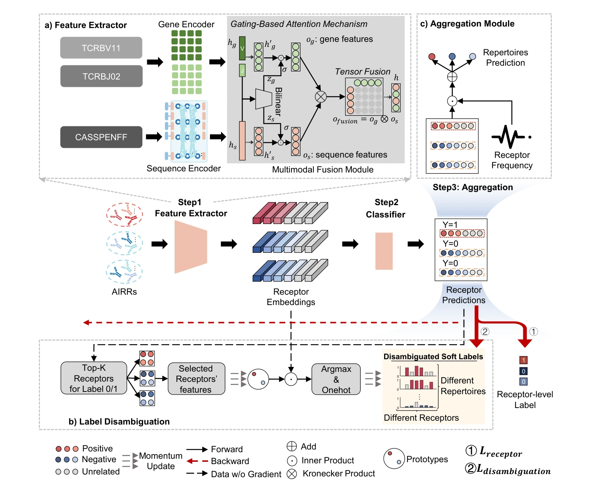

## A Label Disambiguation-Based Multimodal Massive Multiple Instance Learning Approach for Immune Repertoire Classification

> data: CMV 免疫组库、癌症相关受体数据
>
> AAAI 2024（PDF 出版信息） · [作者代码](https://github.com/Josie-xufan/LaDM3IL)

#### 引言

面向免疫组库分类，将基因片段和氨基酸序列进行多模态融合，并用标签消歧缓解海量实例中的监督噪声。属于跨领域 MIL 方法。

#### 方法

（1）受体编码：分别处理基因片段和氨基酸序列，获得互补特征。

（2）标签消歧：修正实例继承组库标签造成的错误监督。

（3）多模态融合：用门控注意力及张量融合聚合受体信息，输出组库与受体预测。

##### 模型结构图

图 2（PDF 第 4 页）

#### 实验

##### 实验设置

CMV 使用完整信息的 684 个组库；癌症数据训练/测试受体数为 70,000/20,000，并开展五折评估。

##### 关键指标 { #key-results }

| 任务 | AUC（%） | ACC（%） | F1（%） |
| --- | --- | --- | --- |
| CMV 组库分类 | 84.88 ± 2.20 | 78.80 ± 2.30 | 78.56 ± 2.40 |
| 癌症相关受体识别 | 90.22 ± 0.33 | 83.00 ± 0.57 | 80.59 ± 0.37 |

数据来源为原文表 2，PDF 第 6 页。

##### 结果解读

与表中次优方法相比，CMV 组库分类和癌症受体识别的 AUC 分别高 1.64 和 1.19 个百分点。两项任务的预测单位不同，癌症数据也缺少 CMV 实验使用的 VDJ 信息。

##### 消融与讨论

比较 DeepRC、DeepTCR、NLLIRC，并消融标签消歧及多模态融合；癌症数据缺少 VDJ 信息，不能套用 CMV 的融合设置。

#### 参考文献

> A Label Disambiguation-Based Multimodal Massive Multiple Instance Learning Approach for Immune Repertoire Classification
>
> AAAI 2024（PDF 出版信息） · [作者代码](https://github.com/Josie-xufan/LaDM3IL)

本文归入相关 MIL 方法：具体研究对象见数据与实验设置。
