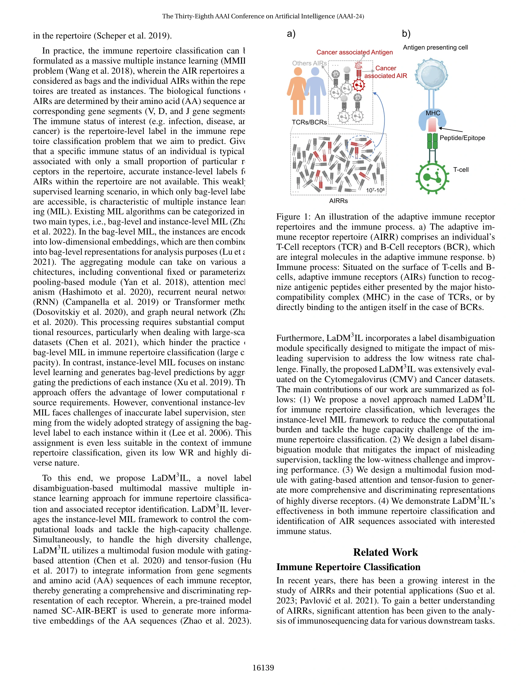
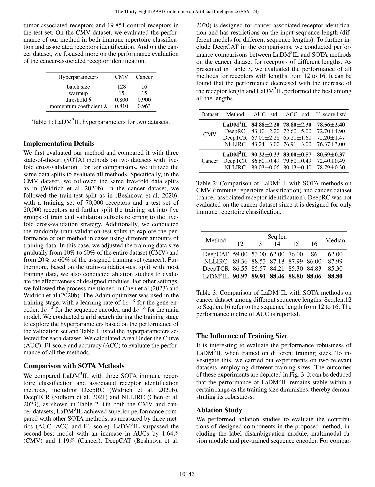
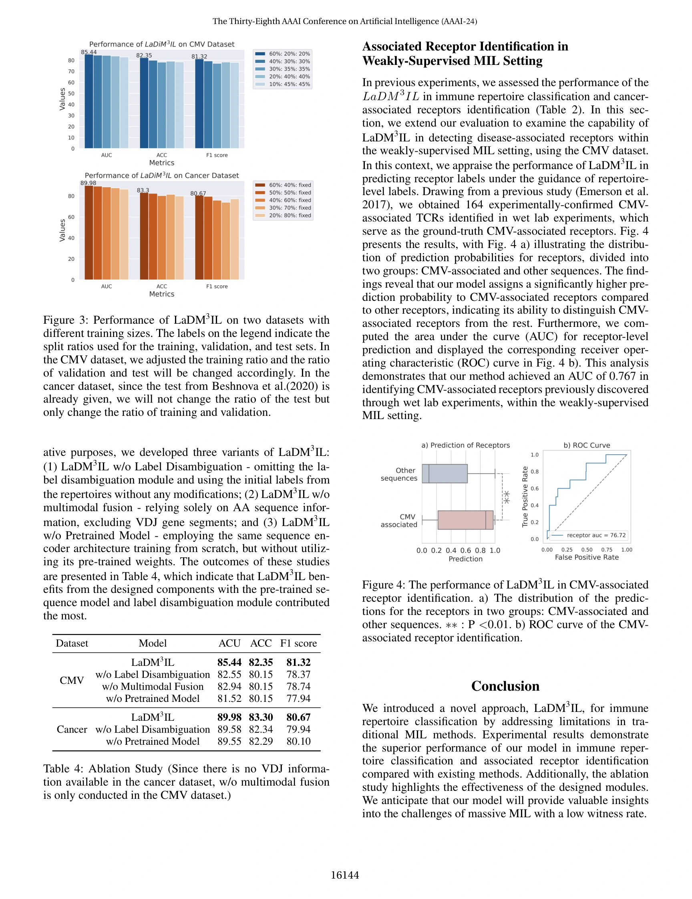

## A Label Disambiguation-Based Multimodal Massive Multiple Instance Learning Approach for Immune Repertoire Classification

> data: CMV 免疫组库、癌症相关受体数据
>
> AAAI 2024（PDF 出版信息） · [作者代码](https://github.com/Josie-xufan/LaDM3IL)

#### 引言

面向免疫组库分类，将基因片段和氨基酸序列进行多模态融合，并用标签消歧缓解海量实例中的监督噪声。属于跨领域 MIL 方法。

#### 方法

（1）受体编码：分别处理基因片段和氨基酸序列，获得互补特征。

（2）标签消歧：修正实例继承组库标签造成的错误监督。

（3）多模态融合：用门控注意力及张量融合聚合受体信息，输出组库与受体预测。

<!-- wsi-complete-model -->
##### 模型结构图

**图 2 · 模型结构**（PDF 第 4 页）

> 原文图注：Figure 2: The overall framework of LaDM3IL, which consists of a feature extractor, a label disambiguation module and an aggregation module. a) Feature Extractor: A pre-trained model SC-AIR-BERT (Zhao et al. 2023) works as the sequence encoder to embed the sequence and a trainable embedding layer works as a gene encoder to embed the V(D)J gene segments. Gating- based attention mechanism and a tensor fusion module are applied to integrate the learnt gene and AA sequence features. b) Label Disambiguation (To facilitate a clearer understanding of the core concept, we present the binary classification scenario as an exemplar in this figure, as it offers a more straightforward illustration.): The prototype is generated to represent the feature embedding of each class. During the training process, the top-K receptors will be selected to update the embedding of the corresponding class in the prototype and the label of each receptor will be adjusted according to the similarity between the receptors’ feature embedding and prototypes’ feature embedding. c) Aggregation Module: After obtaining the prediction of each receptor from the classifier (multilayer perception), the aggregating module integrates these predictions by multiplying them with their corresponding frequencies and subsequently normalizing the results to generate the repertoire-level prediction.

[查看原尺寸](../assest/LaDM3IL/figure-2-complete.webp)

<!-- /wsi-complete-model -->

#### 实验

##### 实验设置

CMV 使用完整信息的 684 个组库；癌症数据训练/测试受体数为 70,000/20,000，并开展五折评估。

##### 主要结果

相对次优方法，两个任务的 AUC 分别提高 1.64 和 1.19 个百分点；输入是免疫受体序列与基因信息。

<!-- wsi-complete-results -->
##### 完整实验指标与对照

下列实验原页保留表头、全部行列、子图、误差说明和脚注，点击可查看原尺寸。比较时请对应相同的数据集、特征编码器和训练设置；`±`、置信区间、百分比和小数均保留原文的单位与统计口径。

| 原表/图中指标 | 读取方式 |
| --- | --- |
| ROC-AUC / AUROC | 越高越好；若原表明确为 PR-AUC，则按 PR 曲线面积读取 |

| 原文页 | 阅读内容 | 图表及正文引用 |
| --- | --- | --- |
| PDF 第 2 页 | 实验结果 | Figure 1 |
| PDF 第 6 页 | 实验结果 | Table 1、Table 2、Table 3 |
| PDF 第 7 页 | 实验结果 | Figure 3、Table 4、Figure 4 |

**实验原页 · PDF 第 2 页**（图表及正文引用：Figure 1）

[查看原尺寸](../assest/LaDM3IL/experiment-page-02.webp)

**实验原页 · PDF 第 6 页**（图表及正文引用：Table 1、Table 2、Table 3）

[查看原尺寸](../assest/LaDM3IL/experiment-page-06.webp)

**实验原页 · PDF 第 7 页**（图表及正文引用：Figure 3、Table 4、Figure 4）

[查看原尺寸](../assest/LaDM3IL/experiment-page-07.webp)

<!-- /wsi-complete-results -->

##### 消融与讨论

比较 DeepRC、DeepTCR、NLLIRC，并消融标签消歧及多模态融合；癌症数据缺少 VDJ 信息，不能套用 CMV 的融合设置。

#### 参考文献

> A Label Disambiguation-Based Multimodal Massive Multiple Instance Learning Approach for Immune Repertoire Classification
>
> AAAI 2024（PDF 出版信息） · [作者代码](https://github.com/Josie-xufan/LaDM3IL)

本文归入相关 MIL 方法：具体研究对象见数据与实验设置。
