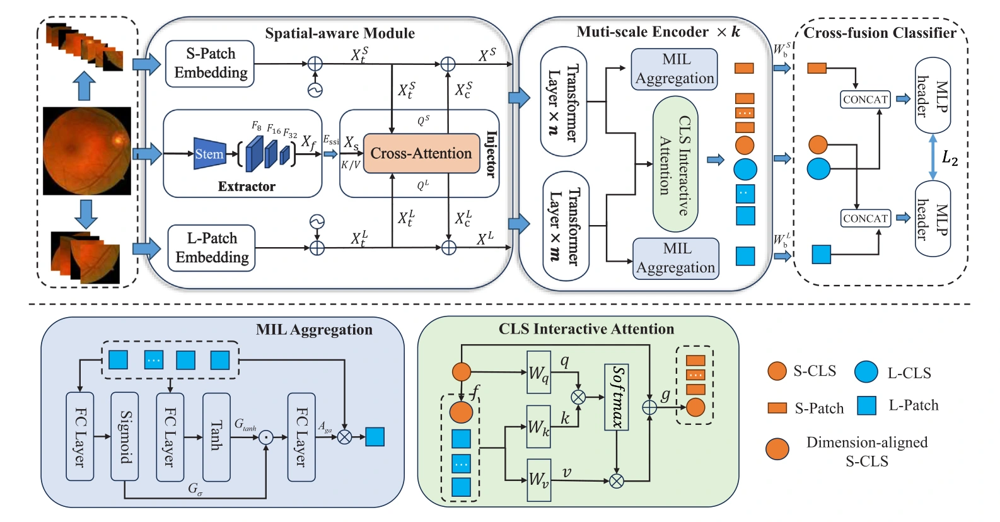
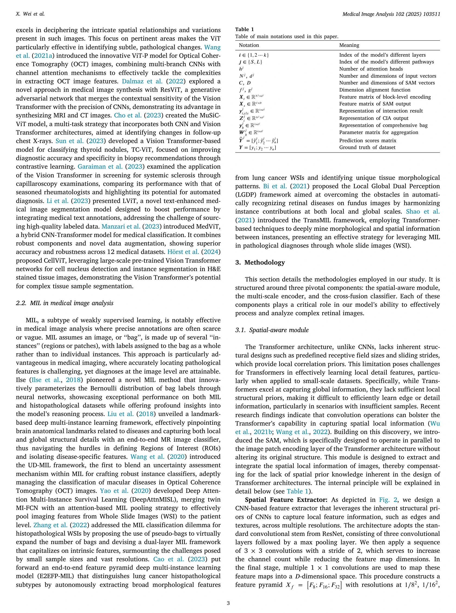
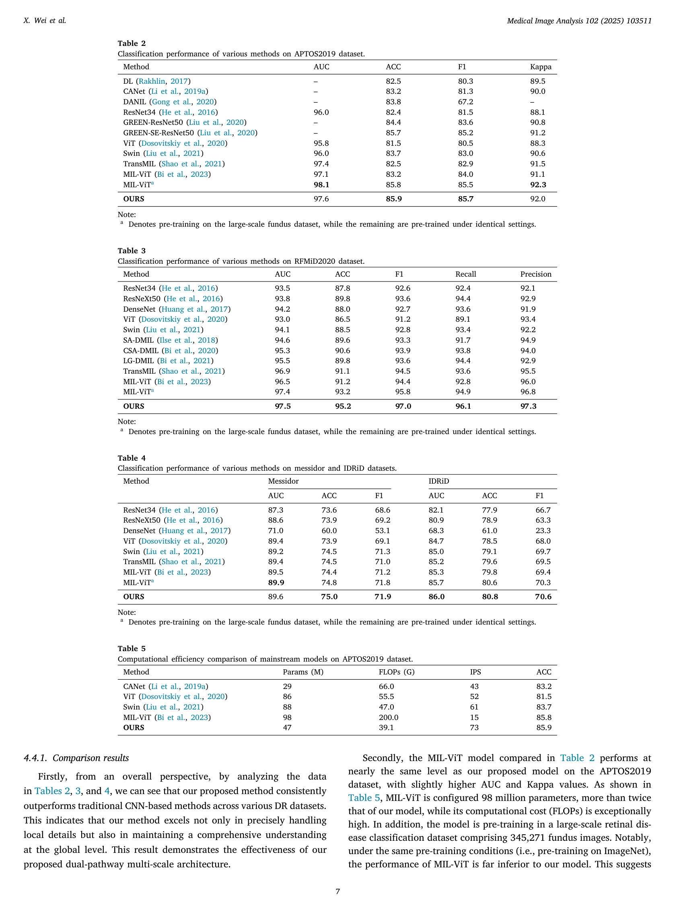
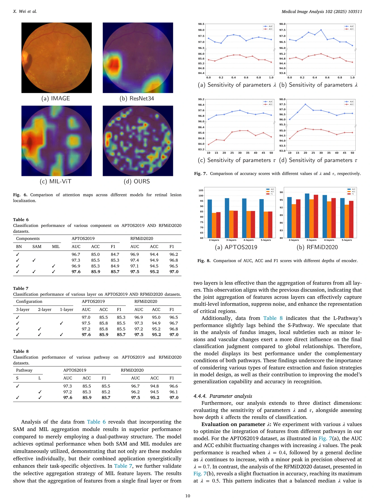

## MSTNet: Multi-scale spatial-aware transformer with multi-instance learning for diabetic retinopathy classification

> data: APTOS2019、RFMiD2020、Messidor、IDRiD
>
> Medical Image Analysis 2025 · [论文](https://doi.org/10.1016/j.media.2025.103511)

#### 引言

结合双路多尺度 Transformer、空间感知模块和 MIL 聚合，建模眼底微小病灶及上下文，用于糖尿病视网膜病变分级。

#### 方法

（1）双路多尺度：两类 Transformer 编码器分别捕捉局部细节和全局上下文。

（2）空间模块：注入眼底病灶的局部结构先验。

（3）MIL 与交叉融合：聚合不同区域及不同尺度，输出分级结果。

<!-- wsi-complete-model -->
##### 模型结构图

**图 2 · 模型结构**（PDF 第 4 页）

> 原文图注：Fig. 2. The overall architecture of the proposed method. It is mainly composed of three parts: spatial-aware module, multi-scale encoder and cross-fusion classifier. In the spatial-aware module, spatial features at different scales are extracted through an extractor to form a feature bank 𝑋𝑠. Then, 𝑋𝑠information is injected into the dual-pathway feature 𝑋𝑡by an injector. In the multi-scale encoder, the feature sequences 𝑋𝑗of different pathways pass through the corresponding Transformer layer, and then the output is aggregated by MIL aggregation applied to the sequence 𝑋𝑗 𝑖,𝑝𝑎𝑡𝑐 ℎ, resulting in 𝑥𝑗 𝑖,𝑏. After stacking 𝑘encoders, each layer’s 𝑥𝑗 𝑖,𝑏is aggregated into 𝑦𝑗 𝑏via 𝑊𝑗 𝑏. Subsequently, the output

[查看原尺寸](../assest/MSTNet/figure-2-complete.webp)

<!-- /wsi-complete-model -->

#### 实验

##### 实验设置

在四个眼底数据集评价诊断/分级，主要在 APTOS2019 与 RFMiD2020 上做组件和参数消融。

##### 主要结果

训练周期的最佳设置依数据集而异，论文中两个数据集分别在 30、20 个周期附近最优；更长训练可能过拟合。

<!-- wsi-complete-results -->
##### 完整实验指标与对照

下列实验原页保留表头、全部行列、子图、误差说明和脚注，点击可查看原尺寸。比较时请对应相同的数据集、特征编码器和训练设置；`±`、置信区间、百分比和小数均保留原文的单位与统计口径。

| 原表/图中指标 | 读取方式 |
| --- | --- |
| ROC-AUC / AUROC | 越高越好；若原表明确为 PR-AUC，则按 PR 曲线面积读取 |
| ACC / Accuracy | 越高越好；平衡准确率、平均准确率以原表标注为准 |
| F1 | 越高越好；保留 macro / weighted / micro 等平均方式 |

| 原文页 | 阅读内容 | 图表及正文引用 |
| --- | --- | --- |
| PDF 第 3 页 | 实验结果 | Table 1 |
| PDF 第 7 页 | 实验结果 | Table 2、Table 3、Table 4、Table 5 |
| PDF 第 10 页 | 实验结果 | Table 6、Table 7、Table 8、Figure 7、Figure 8 |

**实验原页 · PDF 第 3 页**（图表及正文引用：Table 1）

[查看原尺寸](../assest/MSTNet/experiment-page-03.webp)

**实验原页 · PDF 第 7 页**（图表及正文引用：Table 2、Table 3、Table 4、Table 5）

[查看原尺寸](../assest/MSTNet/experiment-page-07.webp)

**实验原页 · PDF 第 10 页**（图表及正文引用：Table 6、Table 7、Table 8、Figure 7、Figure 8）

[查看原尺寸](../assest/MSTNet/experiment-page-10.webp)

<!-- /wsi-complete-results -->

##### 消融与讨论

比较双路多尺度特征、空间感知模块及 MIL 聚合，SAM 在本文指 Spatial-aware Module。

#### 参考文献

> MSTNet: Multi-scale spatial-aware transformer with multi-instance learning for diabetic retinopathy classification
>
> Medical Image Analysis 2025 · [论文](https://doi.org/10.1016/j.media.2025.103511)

本文归入相关 MIL 方法：具体研究对象见数据与实验设置。
