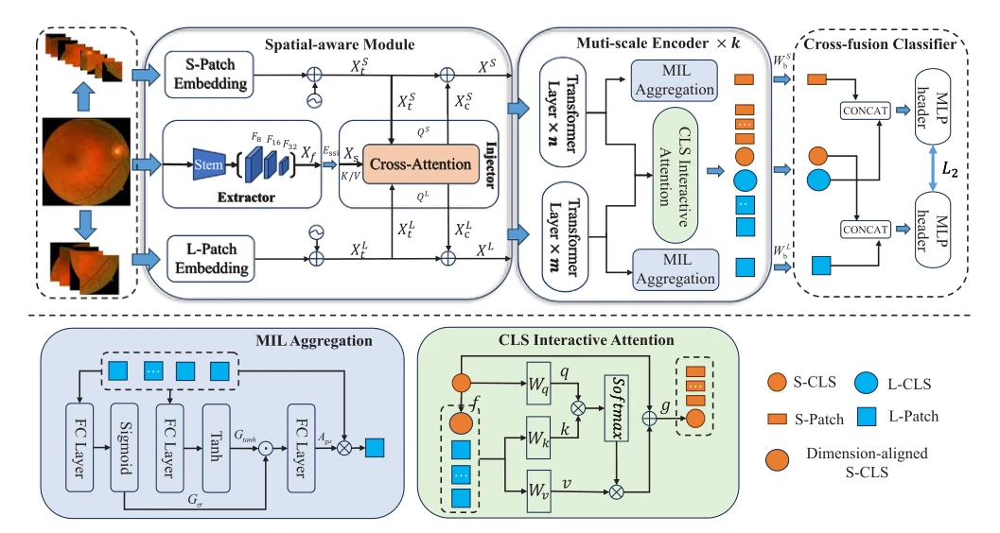

## MSTNet: Multi-scale spatial-aware transformer with multi-instance learning for diabetic retinopathy classification

> data: APTOS2019、RFMiD2020、Messidor、IDRiD
>
> Medical Image Analysis 2025 · [论文](https://doi.org/10.1016/j.media.2025.103511)

#### 引言

结合双路多尺度 Transformer、空间感知模块和 MIL 聚合，建模眼底微小病灶及上下文，用于糖尿病视网膜病变分级。

#### 方法

（1）双路多尺度：两类 Transformer 编码器分别捕捉局部细节和全局上下文。

（2）空间模块：注入眼底病灶的局部结构先验。

（3）MIL 与交叉融合：聚合不同区域及不同尺度，输出分级结果。

原文Fig. 2，PDF 第 4 页。

#### 实验

##### 实验设置

在四个眼底数据集评价诊断/分级，主要在 APTOS2019 与 RFMiD2020 上做组件和参数消融。

##### 主要结果

训练周期的最佳设置依数据集而异，论文中两个数据集分别在 30、20 个周期附近最优；更长训练可能过拟合。

##### 消融与讨论

比较双路多尺度特征、空间感知模块及 MIL 聚合，SAM 在本文指 Spatial-aware Module。

#### 参考文献

> MSTNet: Multi-scale spatial-aware transformer with multi-instance learning for diabetic retinopathy classification
>
> Medical Image Analysis 2025 · [论文](https://doi.org/10.1016/j.media.2025.103511)

本文归入相关 MIL 方法：具体研究对象见数据与实验设置。
