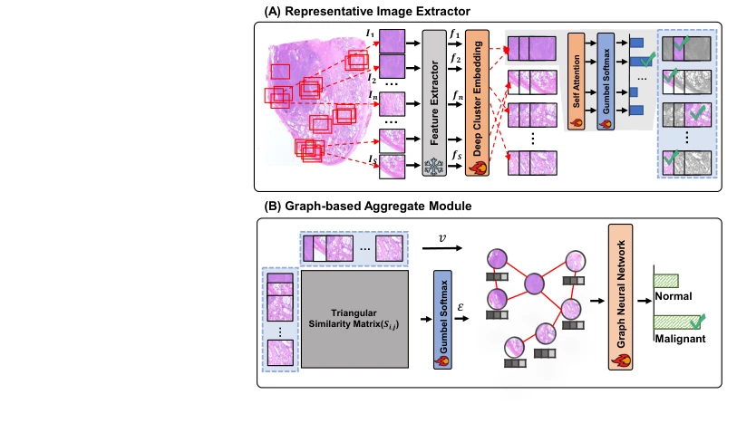
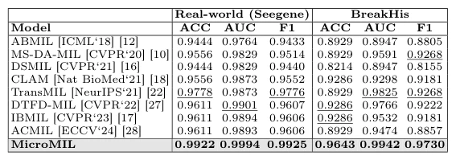

## MicroMIL: Graph-Based Multiple Instance Learning for Context-Aware Diagnosis with Microscopic Images

> data: Seegene 结肠癌显微镜数据、BreakHis
>
> MICCAI 2025（PDF 与作者代码；2024 预印本合并） · [论文](https://papers.miccai.org/miccai-2025/0566-Paper0707.html) · [作者代码](https://github.com/kimjongwoo-cell/MicroMIL)

#### 引言

面向普通光学显微镜采集图像，以聚类和 Gumbel-Softmax 选择代表图像，再按特征相似度建图，无需绝对空间坐标。

#### 方法

（1）RIE：以深度聚类和 hard Gumbel-Softmax 选取代表图像。

（2）相似度图：按余弦相似度连接代表节点，无需绝对坐标。

（3）图聚合：学习局部与跨图像上下文，生成患者级预测。

原文Fig. 2，PDF 第 4 页。

#### 实验

##### 实验设置

按患者组织图像包，并模拟冗余图像比例变化；BreakHis 含 7,909 张图像、81 位患者。

##### 主要结果

高冗余训练/测试设置使部分基线退化，MicroMIL 在相关对照中更稳定；输入无需已知绝对空间位置。

原文Table 1，PDF 第 6 页。

##### 消融与讨论

考察代表图像提取与相似度图聚合，并在冗余迁移实验中检验去重能力。

#### 参考文献

> MicroMIL: Graph-Based Multiple Instance Learning for Context-Aware Diagnosis with Microscopic Images
>
> MICCAI 2025（PDF 与作者代码；2024 预印本合并） · [论文](https://papers.miccai.org/miccai-2025/0566-Paper0707.html) · [作者代码](https://github.com/kimjongwoo-cell/MicroMIL)

本文归入相关 MIL 方法：具体研究对象见数据与实验设置。
