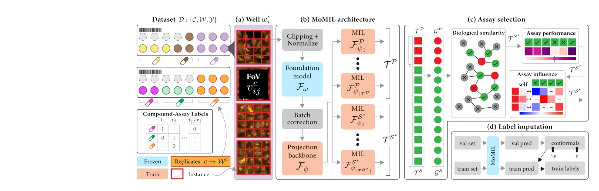
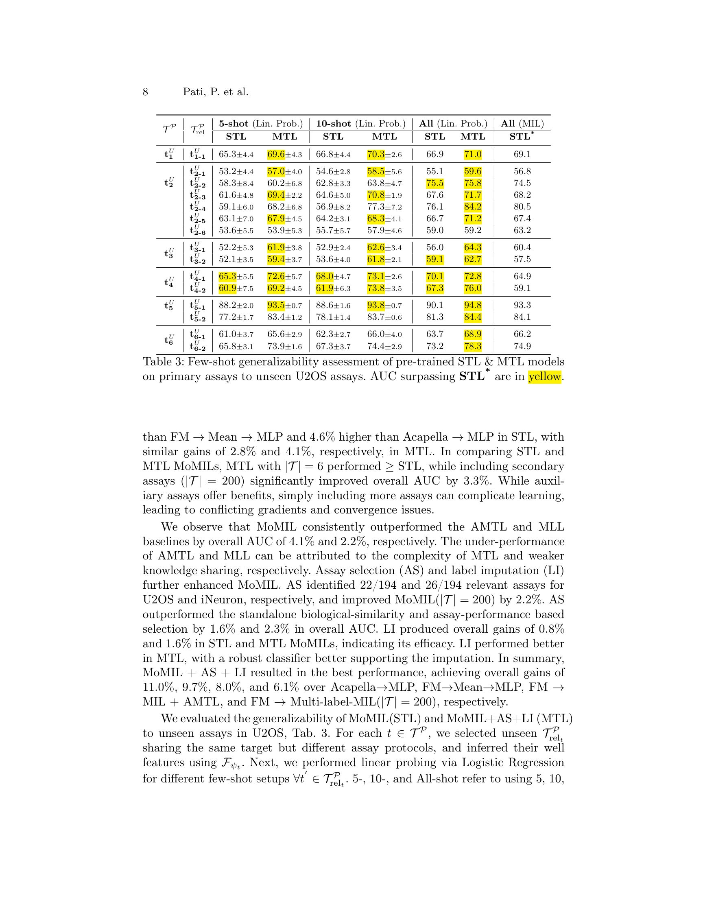
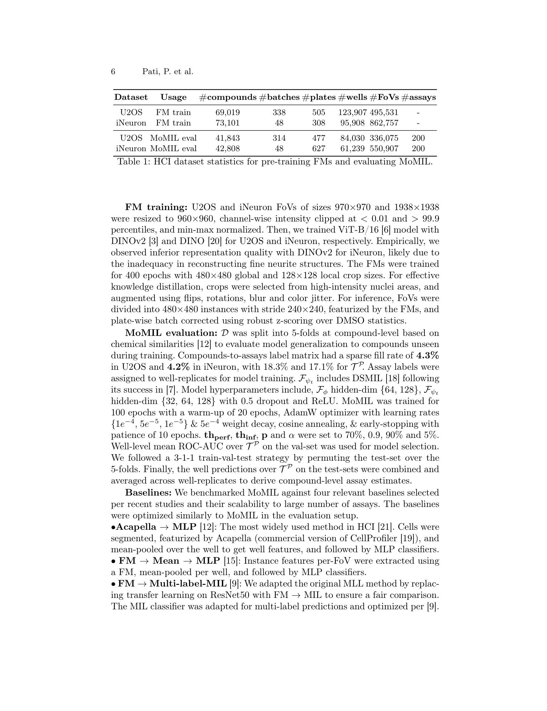
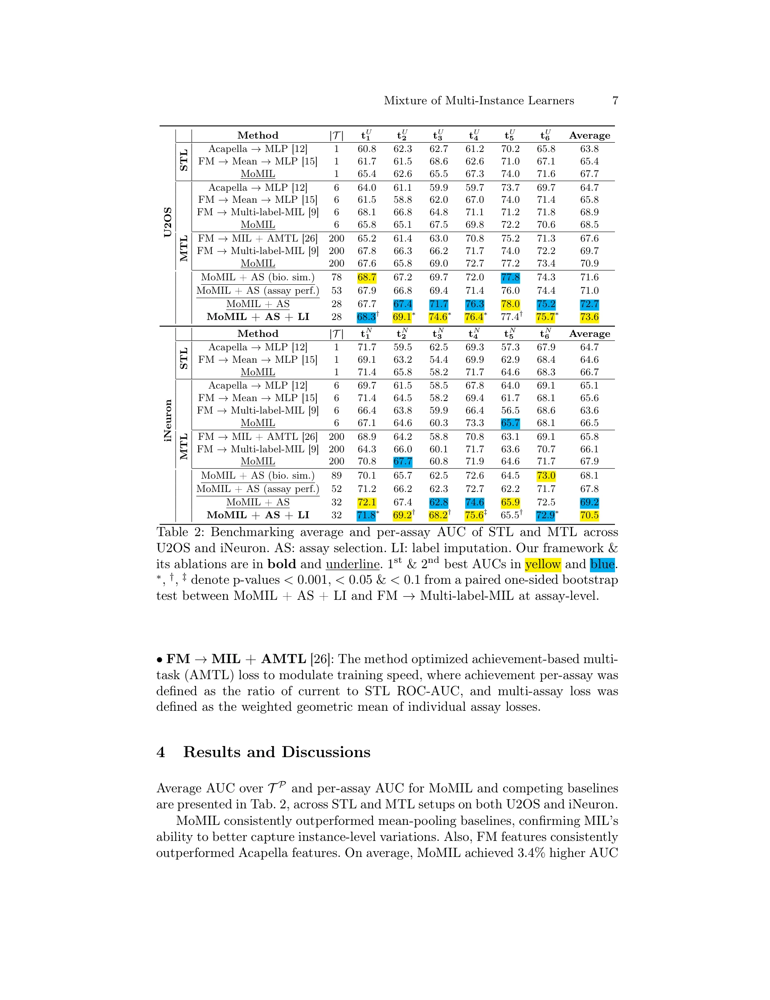

## MoMIL: Mixture of Multi-Instance Learners for Modeling Multiple Compound Activities in High Content Imaging

> data: U2OS、iNeuron 两套内部 Cell Painting 高内涵数据
>
> MICCAI 2025 · [论文](https://papers.miccai.org/miccai-2025/0578-Paper1746.html)

#### 引言

在高内涵细胞成像中，以共享编码器和实验任务专属 MIL 学习器预测化合物活性，缓解多任务标签稀疏问题。研究对象为药物筛选。

#### 方法

（1）共享编码：用 HCI 特征模型学习不同实验共享的细胞表示。

（2）任务专属 MIL：每个 assay 使用自己的实例学习器。

（3）辅助学习：结合 assay 选择和标签补全，处理稀疏活性标签。

<!-- wsi-complete-model -->
##### 模型结构图

**图 1 · 模型结构**（PDF 第 3 页）

> 原文图注：Fig. 1: Overview of MoMIL framework. HCI input (a) is fed to multi-task MoMIL model (b) to predict binary activities for the primary assays. (c) and (d) are the assay selection and label imputation algorithms that boost knowledge sharing in MoMIL by selecting relevant secondary assays and augmenting reliable activities.

[查看原尺寸](../assest/MoMIL/figure-1-complete.webp)

<!-- /wsi-complete-model -->

#### 实验

##### 实验设置

按化合物及化学相似性划分五折，防止同类化合物泄漏；标签矩阵填充率约 4.3%/4.2%。

##### 主要结果

多任务收益来自共享表示与任务专属学习器；评价在 well/assay 层面进行，不能当作病理切片分类。

<!-- wsi-complete-results -->
##### 完整实验指标与对照

下列实验原页保留表头、全部行列、子图、误差说明和脚注，点击可查看原尺寸。比较时请对应相同的数据集、特征编码器和训练设置；`±`、置信区间、百分比和小数均保留原文的单位与统计口径。

| 原表/图中指标 | 读取方式 |
| --- | --- |
| ROC-AUC / AUROC | 越高越好；若原表明确为 PR-AUC，则按 PR 曲线面积读取 |

| 原文页 | 阅读内容 | 图表及正文引用 |
| --- | --- | --- |
| PDF 第 6 页 | 数据与实验设置 | Table 1 |
| PDF 第 7 页 | 消融与参数分析 | Table 2 |
| PDF 第 8 页 | 实验结果 | Table 3 |

**实验原页 · PDF 第 8 页**（图表及正文引用：Table 3）

[查看原尺寸](../assest/MoMIL/experiment-page-08.webp)

展开消融、参数、数据设置及效率原页

**实验原页 · PDF 第 6 页**（图表及正文引用：Table 1）

[查看原尺寸](../assest/MoMIL/experiment-page-06.webp)

**实验原页 · PDF 第 7 页**（图表及正文引用：Table 2）

[查看原尺寸](../assest/MoMIL/experiment-page-07.webp)

<!-- /wsi-complete-results -->

##### 消融与讨论

考察 HCI 基础模型、assay 选择和标签补全，并验证未见 assay 的泛化。

#### 参考文献

> MoMIL: Mixture of Multi-Instance Learners for Modeling Multiple Compound Activities in High Content Imaging
>
> MICCAI 2025 · [论文](https://papers.miccai.org/miccai-2025/0578-Paper1746.html)

本文归入相关 MIL 方法：具体研究对象见数据与实验设置。
