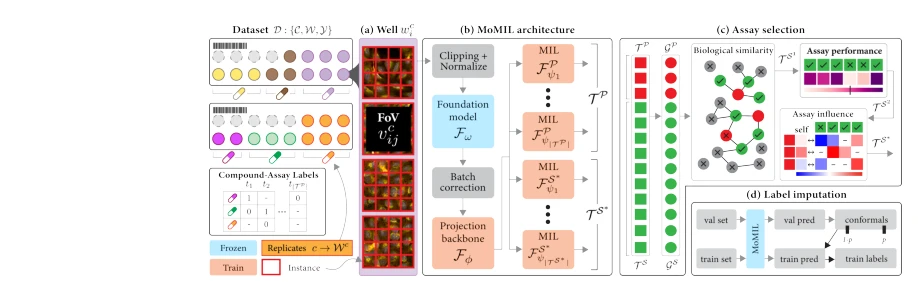
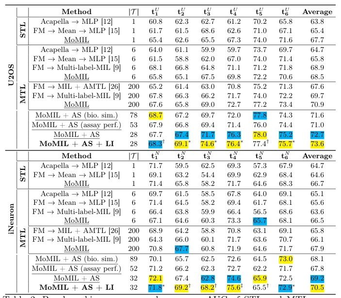

## MoMIL: Mixture of Multi-Instance Learners for Modeling Multiple Compound Activities in High Content Imaging

> data: U2OS、iNeuron 两套内部 Cell Painting 高内涵数据
>
> MICCAI 2025 · [论文](https://papers.miccai.org/miccai-2025/0578-Paper1746.html)

#### 引言

在高内涵细胞成像中，以共享编码器和实验任务专属 MIL 学习器预测化合物活性，缓解多任务标签稀疏问题。研究对象为药物筛选。

#### 方法

（1）共享编码：用 HCI 特征模型学习不同实验共享的细胞表示。

（2）任务专属 MIL：每个 assay 使用自己的实例学习器。

（3）辅助学习：结合 assay 选择和标签补全，处理稀疏活性标签。

原文Fig. 1，PDF 第 3 页。

#### 实验

##### 实验设置

按化合物及化学相似性划分五折，防止同类化合物泄漏；标签矩阵填充率约 4.3%/4.2%。

##### 主要结果

多任务收益来自共享表示与任务专属学习器；评价在 well/assay 层面进行，不能当作病理切片分类。

原文Table 2，PDF 第 7 页。

##### 消融与讨论

考察 HCI 基础模型、assay 选择和标签补全，并验证未见 assay 的泛化。

#### 参考文献

> MoMIL: Mixture of Multi-Instance Learners for Modeling Multiple Compound Activities in High Content Imaging
>
> MICCAI 2025 · [论文](https://papers.miccai.org/miccai-2025/0578-Paper1746.html)

本文归入相关 MIL 方法：具体研究对象见数据与实验设置。
