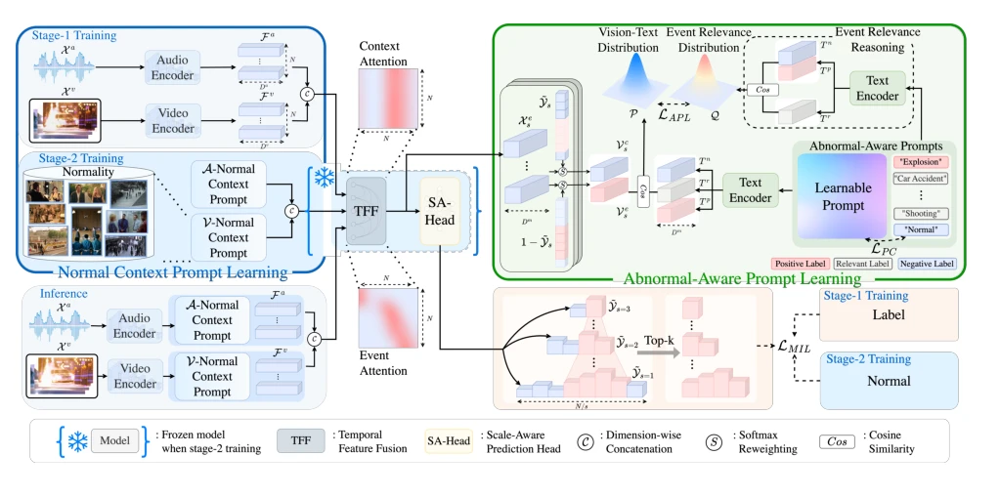
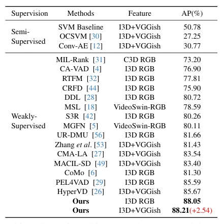

## Prompt-Enhanced Multiple Instance Learning for Weakly Supervised Video Anomaly Detection

> data: XD-Violence、ShanghaiTech、UCF-Crime
>
> CVPR 2024 · [论文](https://openaccess.thecvf.com/content/CVPR2024/html/Chen_Prompt-Enhanced_Multiple_Instance_Learning_for_Weakly_Supervised_Video_Anomaly_Detection_CVPR_2024_paper.html) · [作者代码](https://github.com/Junxi-Chen/PE-MIL)

#### 引言

利用异常感知提示与正常上下文提示增强视频片段特征，改善弱监督视频异常检测的事件识别与边界定位。研究对象为视频。

#### 方法

（1）异常提示：把异常类别语义与可学习提示结合，增强视频特征。

（2）正常上下文：利用正常场景提示区分异常及其背景。

（3）边界检测：用互补提示形成更清晰的帧级异常分数。

原文Figure 2，PDF 第 3 页。

#### 实验

##### 实验设置

XD-Violence 使用 AP；ShanghaiTech 和 UCF-Crime 使用帧级 ROC AUC，比较同类视频特征下的检测结果。

##### 主要结果

正常上下文提示用于减少误报和澄清事件边界；异常提示用于区分多种异常模式。

原文Table 1，PDF 第 6 页。

##### 消融与讨论

分别考察两类提示及异常边界；这些帧级指标不能直接与病理切片分类 AUC 横向比较。

#### 参考文献

> Prompt-Enhanced Multiple Instance Learning for Weakly Supervised Video Anomaly Detection
>
> CVPR 2024 · [论文](https://openaccess.thecvf.com/content/CVPR2024/html/Chen_Prompt-Enhanced_Multiple_Instance_Learning_for_Weakly_Supervised_Video_Anomaly_Detection_CVPR_2024_paper.html) · [作者代码](https://github.com/Junxi-Chen/PE-MIL)

本文归入相关 MIL 方法：具体研究对象见数据与实验设置。
