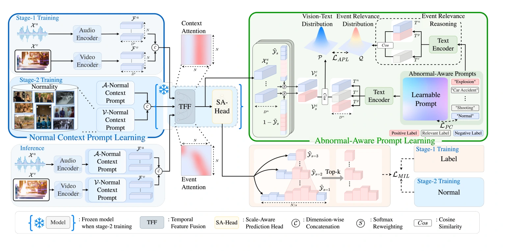
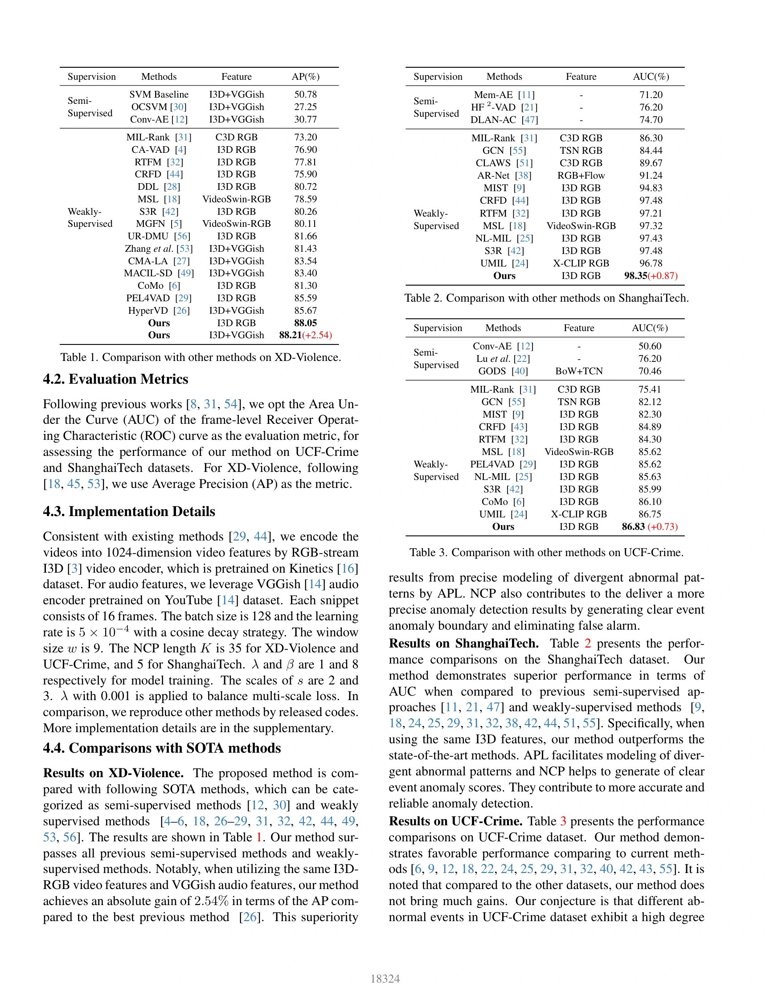
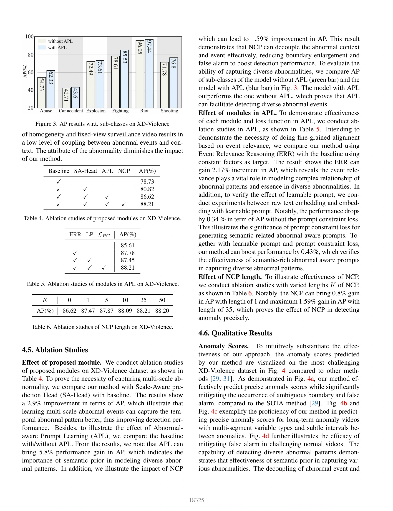

## Prompt-Enhanced Multiple Instance Learning for Weakly Supervised Video Anomaly Detection

> data: XD-Violence、ShanghaiTech、UCF-Crime
>
> CVPR 2024 · [论文](https://openaccess.thecvf.com/content/CVPR2024/html/Chen_Prompt-Enhanced_Multiple_Instance_Learning_for_Weakly_Supervised_Video_Anomaly_Detection_CVPR_2024_paper.html) · [作者代码](https://github.com/Junxi-Chen/PE-MIL)

#### 引言

利用异常感知提示与正常上下文提示增强视频片段特征，改善弱监督视频异常检测的事件识别与边界定位。研究对象为视频。

#### 方法

（1）异常提示：把异常类别语义与可学习提示结合，增强视频特征。

（2）正常上下文：利用正常场景提示区分异常及其背景。

（3）边界检测：用互补提示形成更清晰的帧级异常分数。

<!-- wsi-complete-model -->
##### 模型结构图

**图 2 · 模型结构**（PDF 第 3 页）

> 原文图注：Figure 2. Pipeline of the proposed method: (1) Temporal Feature Fusion module (Sec. 3.2) and Scale-Aware Prediction Head (Sec. 3.3) are utilized to model the temporal relationships and generate multi-scale anomaly scores. (2) Abnormal-Aware Prompt Learning (Sec. 3.4) is applied to facilitate the intermediate feature incorporating a semantic priors by abnormal-aware prompts. (3) Normal Context Prompt (Sec. 3.5) is learned by two-stage training and enriches the boundary context feature to exhibit a discriminative pattern.

[查看原尺寸](../assest/PE-MIL/figure-2-complete.webp)

<!-- /wsi-complete-model -->

#### 实验

##### 实验设置

XD-Violence 使用 AP；ShanghaiTech 和 UCF-Crime 使用帧级 ROC AUC，比较同类视频特征下的检测结果。

##### 主要结果

正常上下文提示用于减少误报和澄清事件边界；异常提示用于区分多种异常模式。

<!-- wsi-complete-results -->
##### 完整实验指标与对照

下列实验原页保留表头、全部行列、子图、误差说明和脚注，点击可查看原尺寸。比较时请对应相同的数据集、特征编码器和训练设置；`±`、置信区间、百分比和小数均保留原文的单位与统计口径。

| 原表/图中指标 | 读取方式 |
| --- | --- |
| ROC-AUC / AUROC | 越高越好；若原表明确为 PR-AUC，则按 PR 曲线面积读取 |
| AP / AUPRC / mAP | 越高越好；与 ROC-AUC 不同，保留任务和召回定义 |

| 原文页 | 阅读内容 | 图表及正文引用 |
| --- | --- | --- |
| PDF 第 6 页 | 实验结果 | Table 1、Table 2、Table 3 |
| PDF 第 7 页 | 消融与参数分析 | Table 4、Table 5、Table 6 |

**实验原页 · PDF 第 6 页**（图表及正文引用：Table 1、Table 2、Table 3）

[查看原尺寸](../assest/PE-MIL/experiment-page-06.webp)

展开消融、参数、数据设置及效率原页

**实验原页 · PDF 第 7 页**（图表及正文引用：Table 4、Table 5、Table 6）

[查看原尺寸](../assest/PE-MIL/experiment-page-07.webp)

<!-- /wsi-complete-results -->

##### 消融与讨论

分别考察两类提示及异常边界；这些帧级指标不能直接与病理切片分类 AUC 横向比较。

#### 参考文献

> Prompt-Enhanced Multiple Instance Learning for Weakly Supervised Video Anomaly Detection
>
> CVPR 2024 · [论文](https://openaccess.thecvf.com/content/CVPR2024/html/Chen_Prompt-Enhanced_Multiple_Instance_Learning_for_Weakly_Supervised_Video_Anomaly_Detection_CVPR_2024_paper.html) · [作者代码](https://github.com/Junxi-Chen/PE-MIL)

本文归入相关 MIL 方法：具体研究对象见数据与实验设置。
