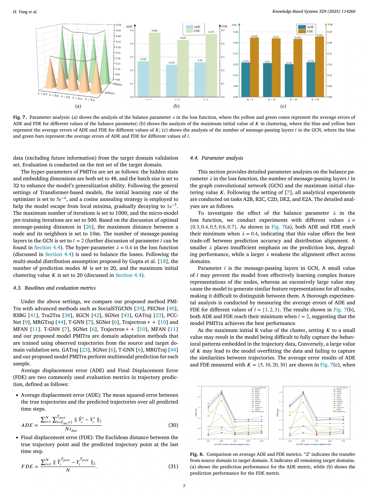
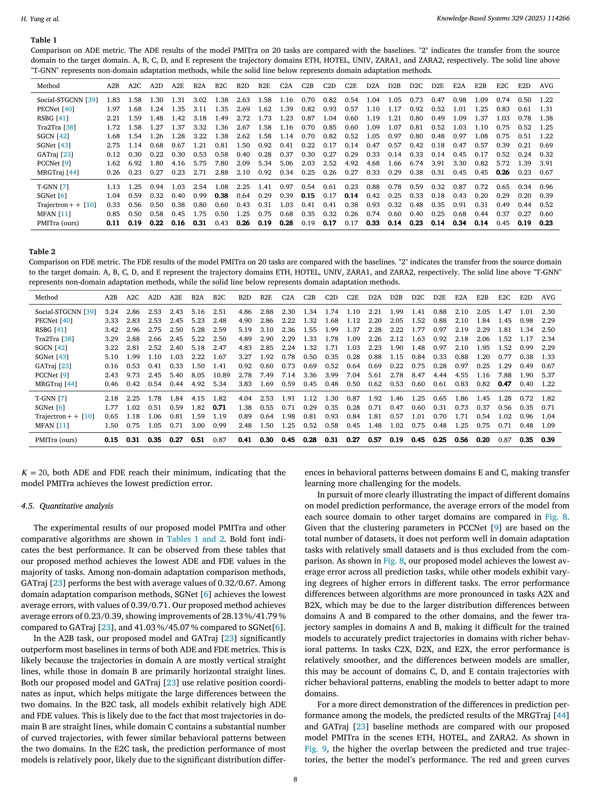
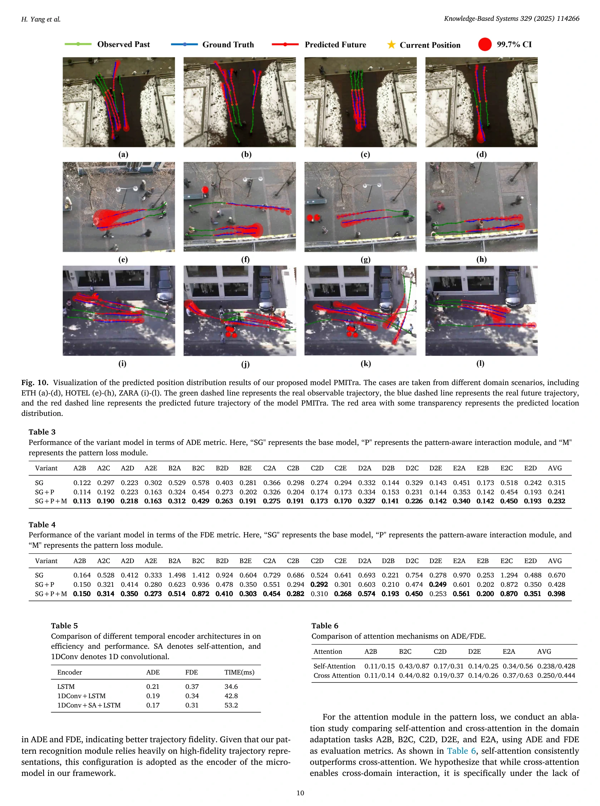

## Cross-domain pedestrian trajectory prediction via behavioral pattern-aware multi-instance GCN

> data: ETH、UCY：ETH/HOTEL/UNIV/ZARA1/ZARA2
>
> Knowledge-Based Systems 2025 · [论文](https://doi.org/10.1016/j.knosys.2025.114266)

#### 引言

通过行为模式聚类、多实例图卷积及模式对齐实现跨域行人轨迹预测，属于跨领域 MIL 方法。

#### 方法

（1）轨迹嵌入：用预训练微模型提取时空特征。

（2）模式交互：聚类行为模式并通过多实例 GCN 迁移相近轨迹信息。

（3）模式对齐：在源域和目标域间约束加权行为表征。

<!-- wsi-complete-model -->
##### 模型结构图

**图 4 · 模型结构**（PDF 第 3 页）

> 原文图注：Fig. 4. It consists of three main parts: 1) Trajectory embedding mod- ule: extracting historical temporal features and rough future represen- tations from pedestrian trajectories in the source and target domains. 2) Pattern-aware interaction module: extracting and aggregating multiple

[查看原尺寸](../assest/PMITra/figure-4-complete.webp)

<!-- /wsi-complete-model -->

#### 实验

##### 实验设置

观察 8 个时间步（3.2 秒），预测之后 12 步（4.8 秒），按跨场景轨迹预测协议评价。

##### 主要结果

结果比较不同场景的轨迹误差与迁移表现；不能将其误差指标映射成 WSI 分类准确率。

<!-- wsi-complete-results -->
##### 完整实验指标与对照

下列实验原页保留表头、全部行列、子图、误差说明和脚注，点击可查看原尺寸。比较时请对应相同的数据集、特征编码器和训练设置；`±`、置信区间、百分比和小数均保留原文的单位与统计口径。

| 原表/图中指标 | 读取方式 |
| --- | --- |
| ADE / FDE / HD | 越低越好；保留误差定义与单位 |

| 原文页 | 阅读内容 | 图表及正文引用 |
| --- | --- | --- |
| PDF 第 7 页 | 实验结果 | Figure 8 |
| PDF 第 8 页 | 实验结果 | Table 1、Table 2 |
| PDF 第 10 页 | 实验结果 | Table 3、Table 4、Table 5、Table 6 |

**实验原页 · PDF 第 7 页**（图表及正文引用：Figure 8）

[查看原尺寸](../assest/PMITra/experiment-page-07.webp)

**实验原页 · PDF 第 8 页**（图表及正文引用：Table 1、Table 2）

[查看原尺寸](../assest/PMITra/experiment-page-08.webp)

**实验原页 · PDF 第 10 页**（图表及正文引用：Table 3、Table 4、Table 5、Table 6）

[查看原尺寸](../assest/PMITra/experiment-page-10.webp)

<!-- /wsi-complete-results -->

##### 消融与讨论

消融轨迹嵌入、模式识别/交互与模式对齐，分析行为模式数等超参数。

#### 参考文献

> Cross-domain pedestrian trajectory prediction via behavioral pattern-aware multi-instance GCN
>
> Knowledge-Based Systems 2025 · [论文](https://doi.org/10.1016/j.knosys.2025.114266)

本文归入相关 MIL 方法：具体研究对象见数据与实验设置。
