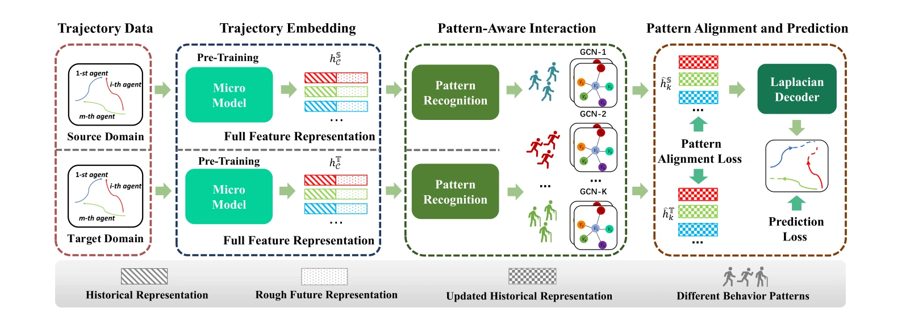

## Cross-domain pedestrian trajectory prediction via behavioral pattern-aware multi-instance GCN

> data: ETH、UCY：ETH/HOTEL/UNIV/ZARA1/ZARA2
>
> Knowledge-Based Systems 2025 · [论文](https://doi.org/10.1016/j.knosys.2025.114266)

#### 引言

通过行为模式聚类、多实例图卷积及模式对齐实现跨域行人轨迹预测，属于跨领域 MIL 方法。

#### 方法

（1）轨迹嵌入：用预训练微模型提取时空特征。

（2）模式交互：聚类行为模式并通过多实例 GCN 迁移相近轨迹信息。

（3）模式对齐：在源域和目标域间约束加权行为表征。

##### 模型结构图

图 4（PDF 第 3 页）

#### 实验

##### 实验设置

观察 8 个时间步（3.2 秒），预测之后 12 步（4.8 秒），按跨场景轨迹预测协议评价。

##### 关键指标 { #key-results }

| 模型 | 平均 ADE ↓ | 平均 FDE ↓ |
| --- | --- | --- |
| PMITra | 0.23 | 0.39 |

数据来源为原文表 1–2，PDF 第 8 页，20 个跨场景迁移任务。

##### 结果解读

结果比较不同场景的轨迹误差与迁移表现；不能将其误差指标映射成 WSI 分类准确率。

##### 消融与讨论

消融轨迹嵌入、模式识别/交互与模式对齐，分析行为模式数等超参数。

#### 参考文献

> Cross-domain pedestrian trajectory prediction via behavioral pattern-aware multi-instance GCN
>
> Knowledge-Based Systems 2025 · [论文](https://doi.org/10.1016/j.knosys.2025.114266)

本文归入相关 MIL 方法：具体研究对象见数据与实验设置。
