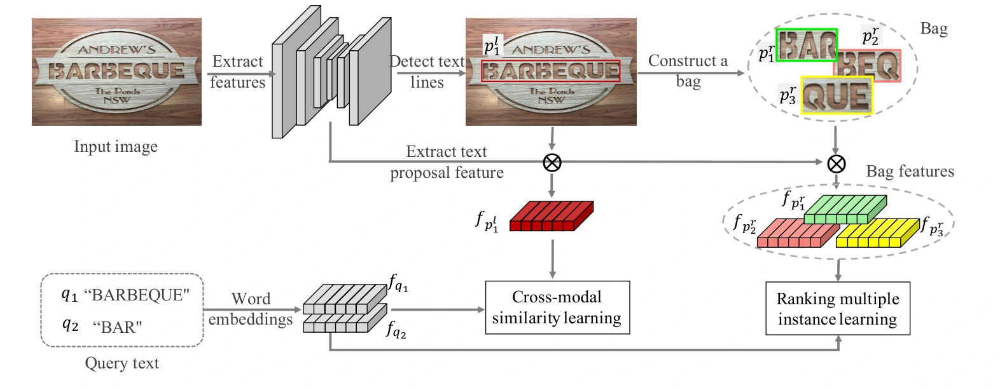

## Partial Scene Text Retrieval

> data: CSVTRv2、ReCTS、LSVT、STR、ArT 等中英文场景文字数据
>
> IEEE TPAMI 2024（PDF 出版信息） · [论文](https://arxiv.org/abs/2411.10261) · [作者代码](https://github.com/lanfeng4659/PSTR)

#### 引言

将查询文本与场景文字映射到共享空间，用排序 MIL 过滤噪声，并以动态部分匹配检索文字行内部片段。研究对象为场景文字检索。

#### 方法

（1）共享嵌入：把查询文本和场景文字片段映射到同一空间。

（2）RankMIL：自适应筛选噪声片段，学习无局部标注的检索相似度。

（3）动态匹配：DPMA 在推理时直接匹配文字行内部片段，减少候选包开销。

##### 模型结构图

图 2（PDF 第 3 页）

#### 实验

##### 实验设置

区分文字行检索和局部文字片段检索，使用 mAP，并比较在线/离线推理效率。

##### 关键指标 { #key-results }

| 场景文字 | 端到端检索平均 mAP 增益 | 以图搜图平均 mAP 增益 |
| --- | --- | --- |
| 英文 | 8.04 个百分点 | 12.71 个百分点 |
| 中文 | 24.45 个百分点 | 38.06 个百分点 |

数据来源为原文摘要，PDF 第 1 页。

##### 结果解读

CMSL 在中英文检索中均有收益；中文字符类别多时 PHOC 维数增加，使跨模态匹配尤为重要。

##### 消融与讨论

消融跨模态相似度学习、RankMIL 和 DPMA；数据对象与 WSI 不同，指标不能混用。

#### 参考文献

> Partial Scene Text Retrieval
>
> IEEE TPAMI 2024（PDF 出版信息） · [论文](https://arxiv.org/abs/2411.10261) · [作者代码](https://github.com/lanfeng4659/PSTR)

本文归入相关 MIL 方法：具体研究对象见数据与实验设置。
