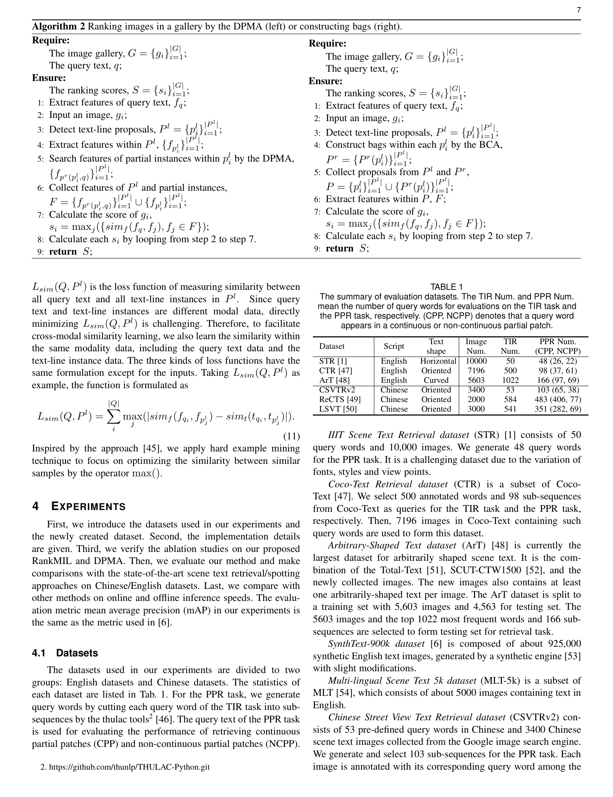
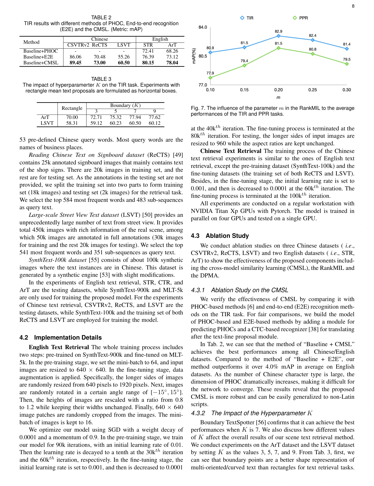
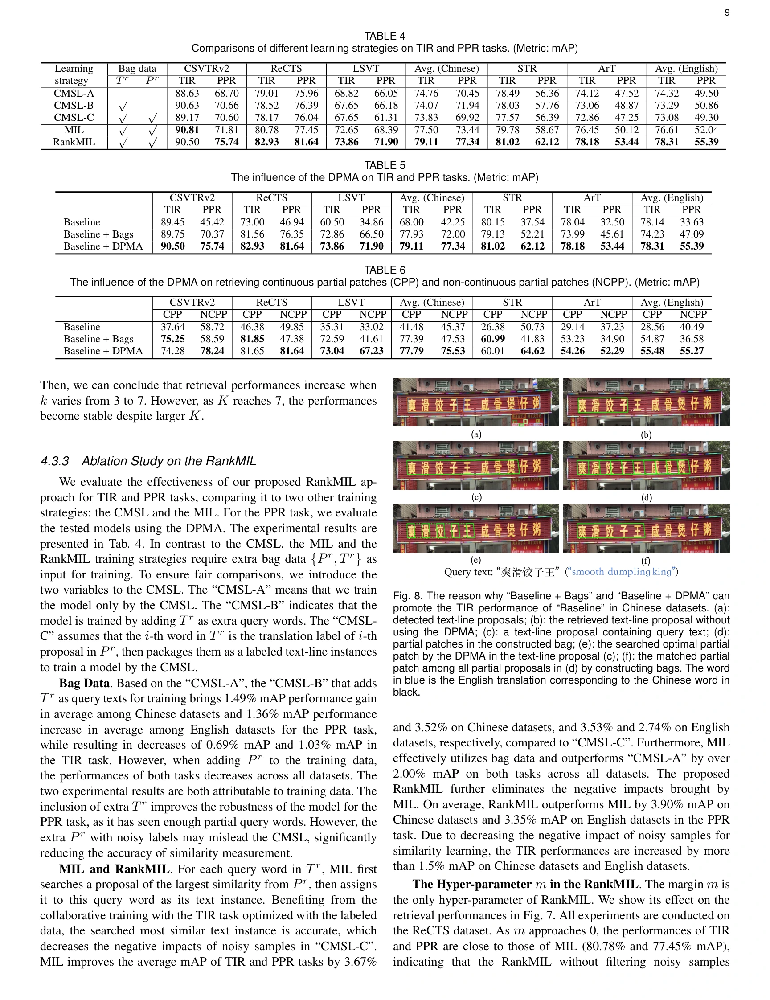
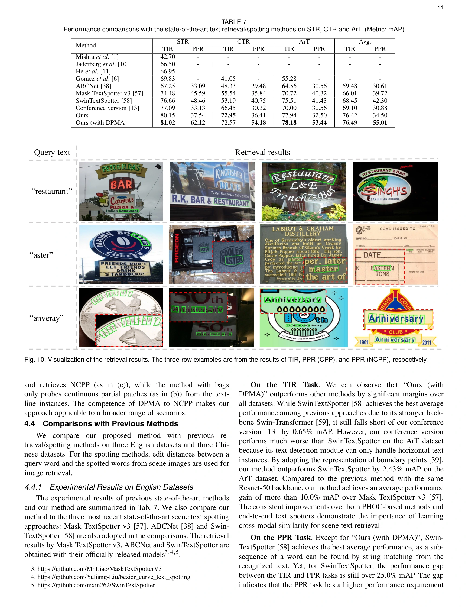
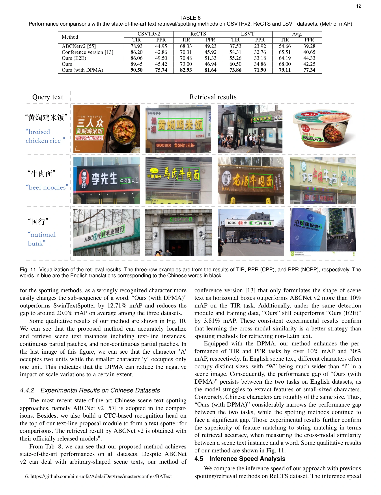
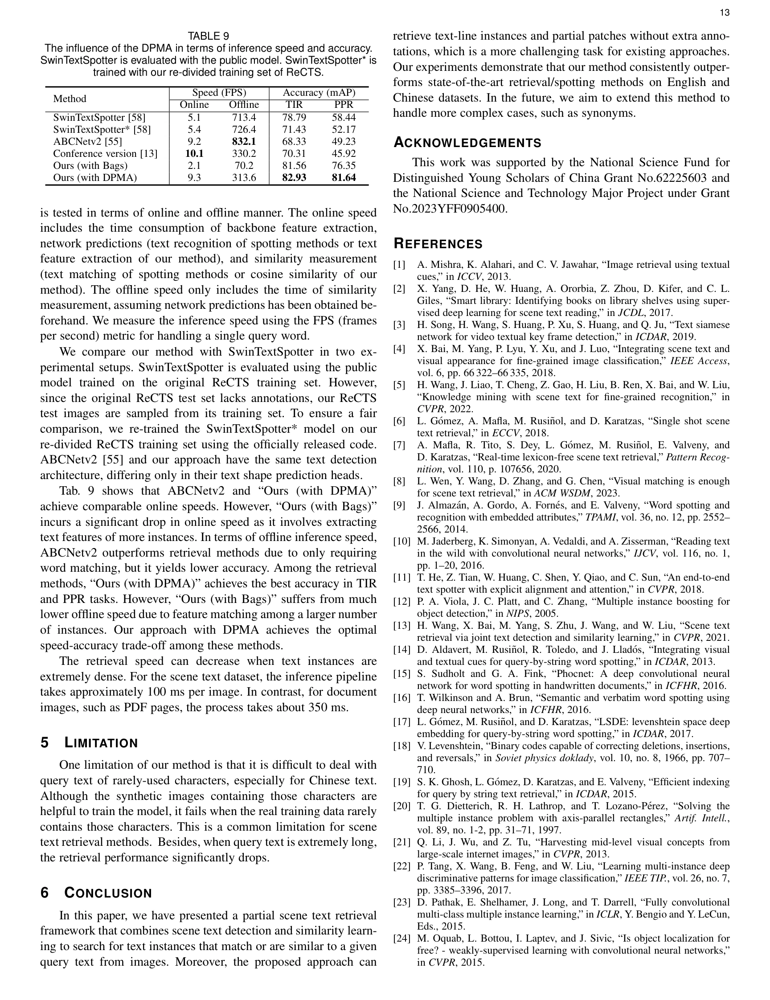

## Partial Scene Text Retrieval

> data: CSVTRv2、ReCTS、LSVT、STR、ArT 等中英文场景文字数据
>
> IEEE TPAMI 2024（PDF 出版信息） · [论文](https://arxiv.org/abs/2411.10261) · [作者代码](https://github.com/lanfeng4659/PSTR)

#### 引言

将查询文本与场景文字映射到共享空间，用排序 MIL 过滤噪声，并以动态部分匹配检索文字行内部片段。研究对象为场景文字检索。

#### 方法

（1）共享嵌入：把查询文本和场景文字片段映射到同一空间。

（2）RankMIL：自适应筛选噪声片段，学习无局部标注的检索相似度。

（3）动态匹配：DPMA 在推理时直接匹配文字行内部片段，减少候选包开销。

<!-- wsi-complete-model -->
##### 模型结构图

**图 2 · 模型结构**（PDF 第 3 页）

> 原文图注：Fig. 2. The training phase of our proposed framework. Given an image, text-line proposals are detected, and a bag is constructed within text-line instances.The features of text-line proposals are extracted to the cross-modal similarity learning for the TIR task. Meanwhile, features of instances within the bag are extracted to ranking multiple instance learning for the PPR task. For visualization simplification, we only show the training process of one text-line instance.

[查看原尺寸](../assest/PSTR-RankMIL/figure-2-complete.webp)

<!-- /wsi-complete-model -->

#### 实验

##### 实验设置

区分文字行检索和局部文字片段检索，使用 mAP，并比较在线/离线推理效率。

##### 主要结果

CMSL 在中英文检索中均有收益；中文字符类别多时 PHOC 维数增加，使跨模态匹配尤为重要。

<!-- wsi-complete-results -->
##### 完整实验指标与对照

下列实验原页保留表头、全部行列、子图、误差说明和脚注，点击可查看原尺寸。比较时请对应相同的数据集、特征编码器和训练设置；`±`、置信区间、百分比和小数均保留原文的单位与统计口径。

| 原表/图中指标 | 读取方式 |
| --- | --- |
| ACC / Accuracy | 越高越好；平衡准确率、平均准确率以原表标注为准 |
| AP / AUPRC / mAP | 越高越好；与 ROC-AUC 不同，保留任务和召回定义 |

| 原文页 | 阅读内容 | 图表及正文引用 |
| --- | --- | --- |
| PDF 第 7 页 | 实验结果 | Table 1 |
| PDF 第 8 页 | 实验结果 | Table 2、Table 3、Figure 7 |
| PDF 第 9 页 | 实验结果 | Table 4、Table 5、Table 6、Figure 8 |
| PDF 第 11 页 | 实验结果 | Table 7 |
| PDF 第 12 页 | 实验结果 | Table 8 |
| PDF 第 13 页 | 实验结果 | Table 9 |

**实验原页 · PDF 第 7 页**（图表及正文引用：Table 1）

[查看原尺寸](../assest/PSTR-RankMIL/experiment-page-07.webp)

**实验原页 · PDF 第 8 页**（图表及正文引用：Table 2、Table 3、Figure 7）

[查看原尺寸](../assest/PSTR-RankMIL/experiment-page-08.webp)

**实验原页 · PDF 第 9 页**（图表及正文引用：Table 4、Table 5、Table 6、Figure 8）

[查看原尺寸](../assest/PSTR-RankMIL/experiment-page-09.webp)

**实验原页 · PDF 第 11 页**（图表及正文引用：Table 7）

[查看原尺寸](../assest/PSTR-RankMIL/experiment-page-11.webp)

**实验原页 · PDF 第 12 页**（图表及正文引用：Table 8）

[查看原尺寸](../assest/PSTR-RankMIL/experiment-page-12.webp)

**实验原页 · PDF 第 13 页**（图表及正文引用：Table 9）

[查看原尺寸](../assest/PSTR-RankMIL/experiment-page-13.webp)

<!-- /wsi-complete-results -->

##### 消融与讨论

消融跨模态相似度学习、RankMIL 和 DPMA；数据对象与 WSI 不同，指标不能混用。

#### 参考文献

> Partial Scene Text Retrieval
>
> IEEE TPAMI 2024（PDF 出版信息） · [论文](https://arxiv.org/abs/2411.10261) · [作者代码](https://github.com/lanfeng4659/PSTR)

本文归入相关 MIL 方法：具体研究对象见数据与实验设置。
