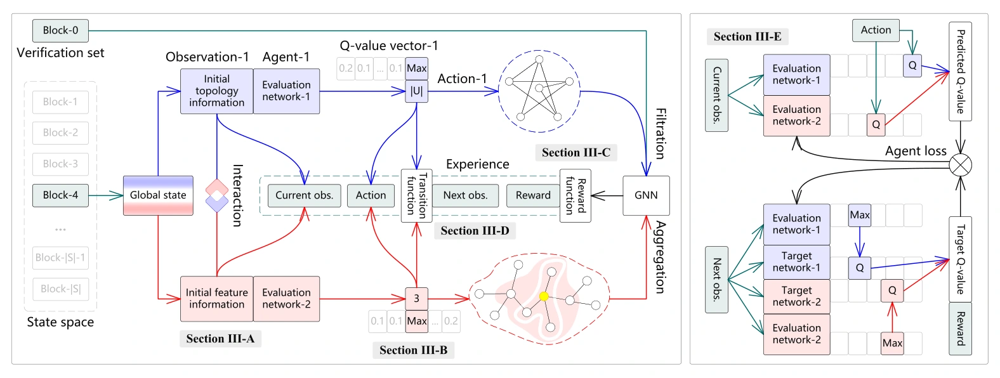
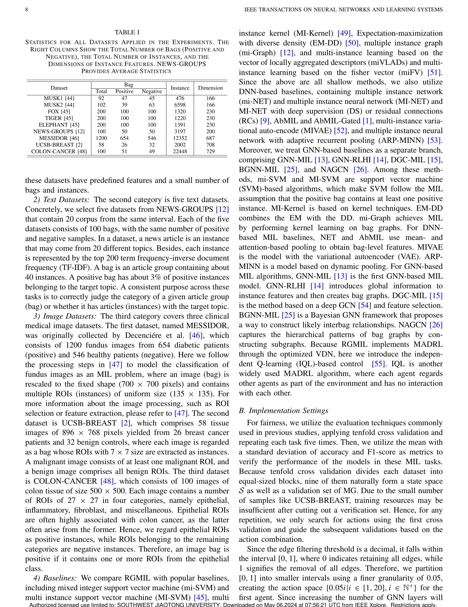
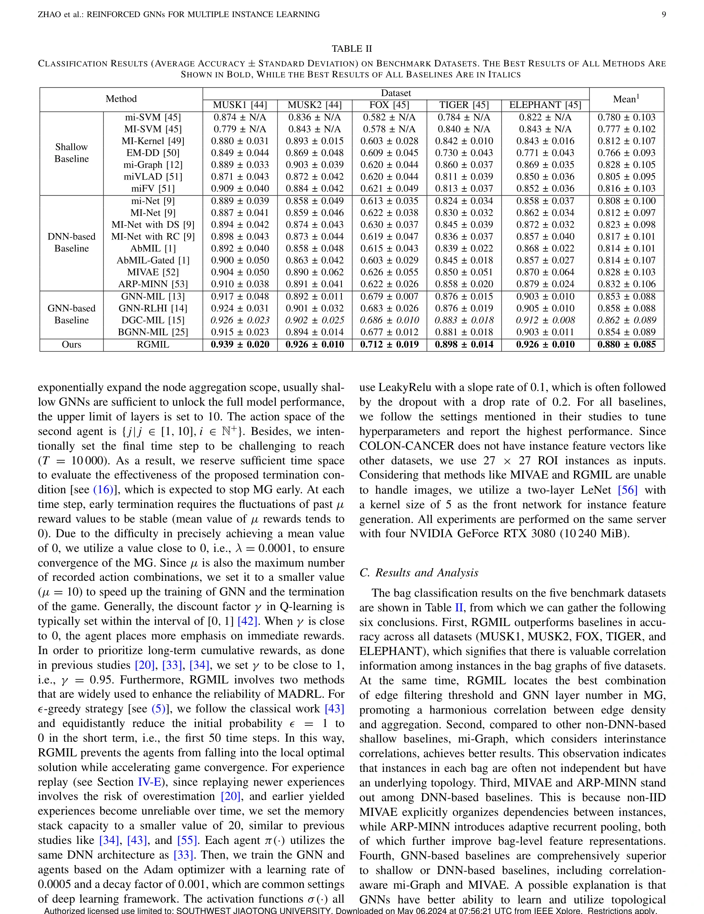
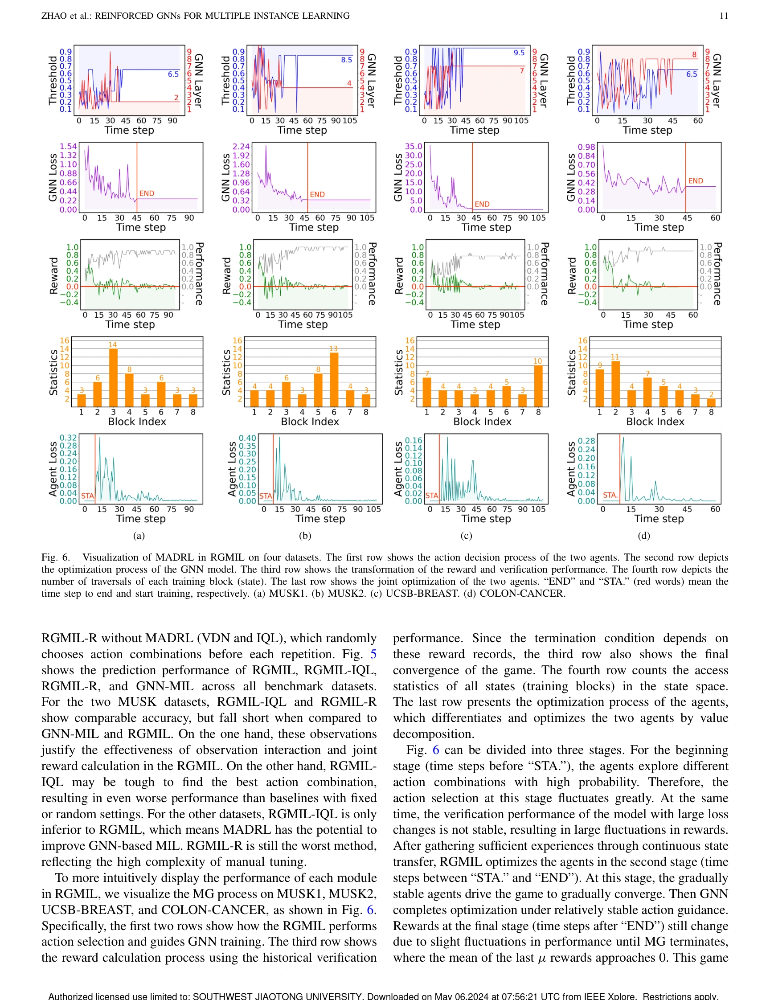
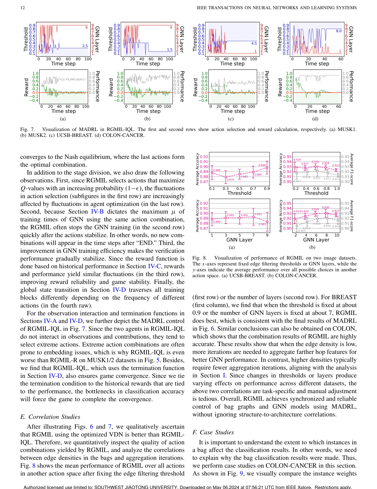
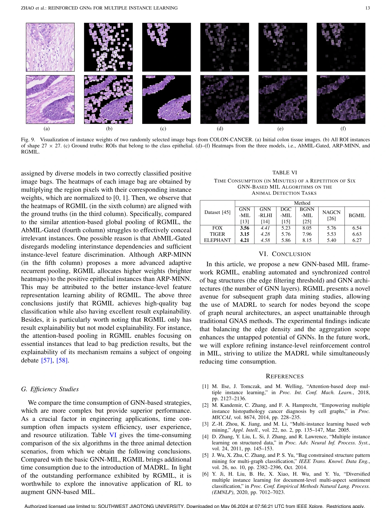
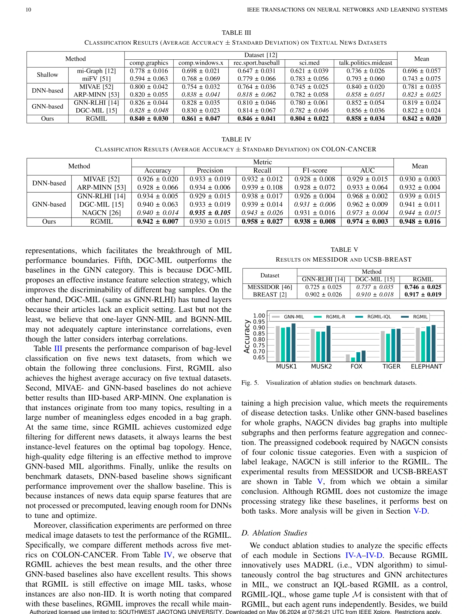

## Reinforced GNNs for Multiple Instance Learning

> data: 五个经典 MIL 基准、五个新闻文本数据、三个医学图像数据
>
> IEEE Transactions on Neural Networks and Learning Systems 2025 · [论文](https://doi.org/10.1109/TNNLS.2024.3392575) · [作者代码](https://github.com/RingBDStack/RGMIL)

#### 引言

使用多智能体强化学习同步调整包内图结构和图神经网络架构，学习两者的关联，减少图构建与网络选择分离带来的限制。

#### 方法

（1）图状态：将包内实例关系和网络配置作为联合优化对象。

（2）多智能体决策：分别调整边结构和 GNN 架构，保留相互依赖。

（3）强化反馈：以任务表现评价策略，使构图与信息聚合协同搜索。

<!-- wsi-complete-model -->
##### 模型结构图

**图 4 · 模型结构**（PDF 第 5 页）

> 原文图注：Fig. 4. Overview of RGMIL. The left and right subfigures respectively show the process of experience collection and agent optimization. At each time step, the initial observations are derived from the current block. Then, the observations are used as inputs to the agents. Each agent chooses an action based on the corresponding observation. Next, it builds reliable bag graphs and feeds them into a customized GNN. After GNN training, assess performance through the action combination to determine the current reward. Finally, the transition function with actions as input is used to obtain the next observations. The quadruple is now recorded in memory. Upon reaching a sufficient quadruple count, optimization of the agents is executed based on VDN.

[查看原尺寸](../assest/RGMIL/figure-4-complete.webp)

<!-- /wsi-complete-model -->

#### 实验

##### 实验设置

同时评估包分类和图结构/网络架构选择，比较浅层 MIL 与深度图模型。

##### 主要结果

经典五个数据集上 RGMIL 的 ACC 均领先比较基线；支持的是特定图结构与网络架构联合搜索的有效性。

<!-- wsi-complete-results -->
##### 完整实验指标与对照

下列实验原页保留表头、全部行列、子图、误差说明和脚注，点击可查看原尺寸。比较时请对应相同的数据集、特征编码器和训练设置；`±`、置信区间、百分比和小数均保留原文的单位与统计口径。

| 原表/图中指标 | 读取方式 |
| --- | --- |
| ACC / Accuracy | 越高越好；平衡准确率、平均准确率以原表标注为准 |

| 原文页 | 阅读内容 | 图表及正文引用 |
| --- | --- | --- |
| PDF 第 8 页 | 实验结果 | Table I |
| PDF 第 9 页 | 实验结果 | Table II |
| PDF 第 10 页 | 消融与参数分析 | Table III、Table IV、Table V、Figure 5 |
| PDF 第 11 页 | 实验结果 | Figure 6 |
| PDF 第 12 页 | 实验结果 | Figure 8 |
| PDF 第 13 页 | 实验结果 | Table VI |

**实验原页 · PDF 第 8 页**（图表及正文引用：Table I）

[查看原尺寸](../assest/RGMIL/experiment-page-08.webp)

**实验原页 · PDF 第 9 页**（图表及正文引用：Table II）

[查看原尺寸](../assest/RGMIL/experiment-page-09.webp)

**实验原页 · PDF 第 11 页**（图表及正文引用：Figure 6）

[查看原尺寸](../assest/RGMIL/experiment-page-11.webp)

**实验原页 · PDF 第 12 页**（图表及正文引用：Figure 8）

[查看原尺寸](../assest/RGMIL/experiment-page-12.webp)

**实验原页 · PDF 第 13 页**（图表及正文引用：Table VI）

[查看原尺寸](../assest/RGMIL/experiment-page-13.webp)

展开消融、参数、数据设置及效率原页

**实验原页 · PDF 第 10 页**（图表及正文引用：Table III、Table IV、Table V、Figure 5）

[查看原尺寸](../assest/RGMIL/experiment-page-10.webp)

<!-- /wsi-complete-results -->

##### 消融与讨论

分析边过滤阈值与 GNN 层数的协同关系，不把强化学习搜索收益等同于单纯加深网络。

#### 参考文献

> Reinforced GNNs for Multiple Instance Learning
>
> IEEE Transactions on Neural Networks and Learning Systems 2025 · [论文](https://doi.org/10.1109/TNNLS.2024.3392575) · [作者代码](https://github.com/RingBDStack/RGMIL)

本文归入相关 MIL 方法：具体研究对象见数据与实验设置。
