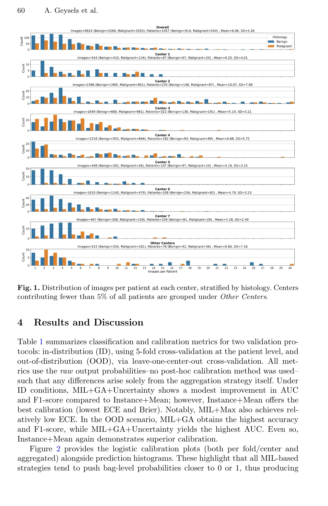
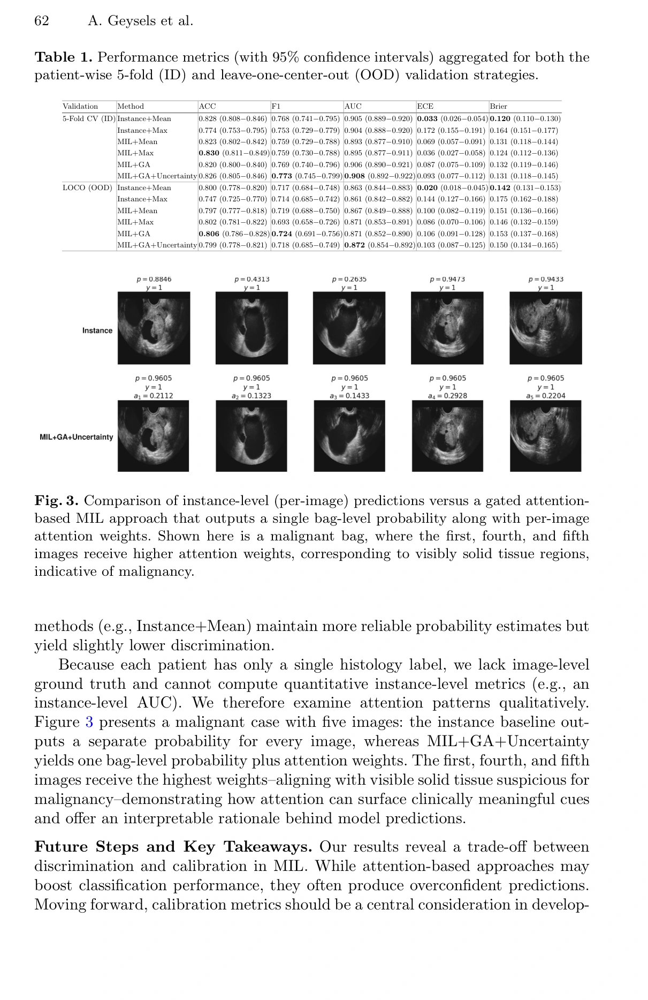

## Calibration in Multiple Instance Learning: Evaluating Aggregation Methods for Ultrasound-Based Diagnosis

> data: 前瞻性卵巢肿瘤超声数据：1,457 位患者、8,824 张图像、11 中心/6 国家
>
> MICCAI 2025 · [论文](https://doi.org/10.1007/978-3-032-05182-0_6)

#### 引言

比较多种聚合器在域内和域外超声诊断中的概率校准，分析分类判别力与预测过度自信之间的权衡。文件名 UBD-MIL 不是正文方法名。

#### 方法

（1）统一 backbone：在相同图像编码器上比较不同 MIL 聚合。

（2）概率评价：同时检验判别力与输出概率是否校准。

（3）跨中心实验：用留一中心测试检查域外过度自信。

<!-- wsi-complete-model -->
##### 模型结构图

本文比较多种 MIL 聚合策略，未提出单一新模型结构。下图依据 PDF 第 2–3、5 页的方法与实现设置整理，不是原文图片。

[查看原尺寸](../assest/Ultrasound-MIL-Calibration/structure-from-methods.svg)

<!-- /wsi-complete-model -->

#### 实验

##### 实验设置

比较按患者五折的域内评估与留一中心的域外评估，同时报告判别力和校准误差。

##### 主要结果

注意力聚合可能有更强判别力但更过度自信；简单实例概率池化在部分条件下校准更可靠。

<!-- wsi-complete-results -->
##### 完整实验指标与对照

下列实验原页保留表头、全部行列、子图、误差说明和脚注，点击可查看原尺寸。比较时请对应相同的数据集、特征编码器和训练设置；`±`、置信区间、百分比和小数均保留原文的单位与统计口径。

| 原文页 | 阅读内容 | 图表及正文引用 |
| --- | --- | --- |
| PDF 第 6 页 | 实验结果 | Figure 1 |
| PDF 第 8 页 | 实验结果 | Table 1 |

**实验原页 · PDF 第 6 页**（图表及正文引用：Figure 1）

[查看原尺寸](../assest/Ultrasound-MIL-Calibration/experiment-page-06.webp)

**实验原页 · PDF 第 8 页**（图表及正文引用：Table 1）

[查看原尺寸](../assest/Ultrasound-MIL-Calibration/experiment-page-08.webp)

<!-- /wsi-complete-results -->

##### 消融与讨论

统一 ConvNeXt-small backbone，比较不同聚合器；包是患者，实例是超声图像。

#### 参考文献

> Calibration in Multiple Instance Learning: Evaluating Aggregation Methods for Ultrasound-Based Diagnosis
>
> MICCAI 2025 · [论文](https://doi.org/10.1007/978-3-032-05182-0_6)

本文归入相关 MIL 方法：具体研究对象见数据与实验设置。
