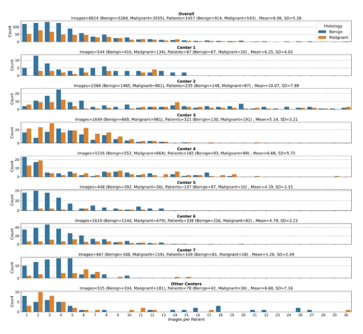
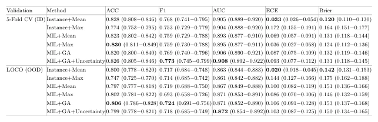

## Calibration in Multiple Instance Learning: Evaluating Aggregation Methods for Ultrasound-Based Diagnosis

> data: 前瞻性卵巢肿瘤超声数据：1,457 位患者、8,824 张图像、11 中心/6 国家
>
> MICCAI 2025 · [论文](https://doi.org/10.1007/978-3-032-05182-0_6)

#### 引言

比较多种聚合器在域内和域外超声诊断中的概率校准，分析分类判别力与预测过度自信之间的权衡。文件名 UBD-MIL 不是正文方法名。

#### 方法

（1）统一 backbone：在相同图像编码器上比较不同 MIL 聚合。

（2）概率评价：同时检验判别力与输出概率是否校准。

（3）跨中心实验：用留一中心测试检查域外过度自信。

原文Fig. 1，PDF 第 6 页。

#### 实验

##### 实验设置

比较按患者五折的域内评估与留一中心的域外评估，同时报告判别力和校准误差。

##### 主要结果

注意力聚合可能有更强判别力但更过度自信；简单实例概率池化在部分条件下校准更可靠。

原文Table 1，PDF 第 8 页。

##### 消融与讨论

统一 ConvNeXt-small backbone，比较不同聚合器；包是患者，实例是超声图像。

#### 参考文献

> Calibration in Multiple Instance Learning: Evaluating Aggregation Methods for Ultrasound-Based Diagnosis
>
> MICCAI 2025 · [论文](https://doi.org/10.1007/978-3-032-05182-0_6)

本文归入相关 MIL 方法：具体研究对象见数据与实验设置。
