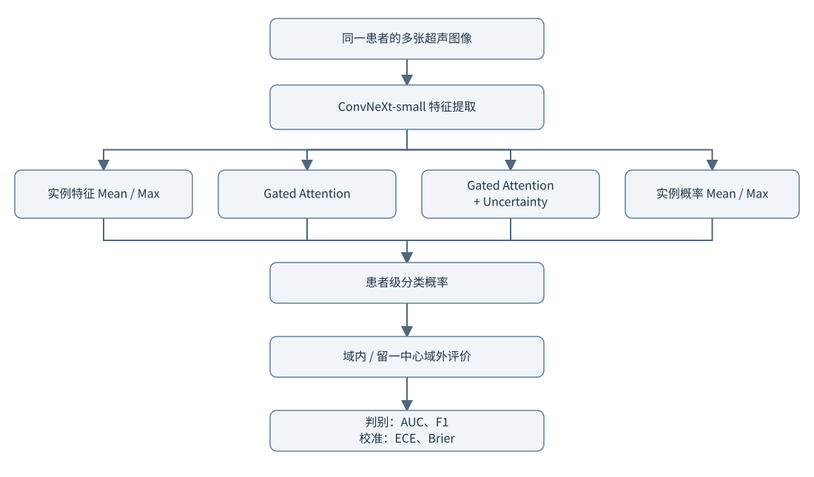

## Calibration in Multiple Instance Learning: Evaluating Aggregation Methods for Ultrasound-Based Diagnosis

> data: 前瞻性卵巢肿瘤超声数据：1,457 位患者、8,824 张图像、11 中心/6 国家
>
> MICCAI 2025 · [论文](https://doi.org/10.1007/978-3-032-05182-0_6)

#### 引言

比较多种聚合器在域内和域外超声诊断中的概率校准，分析分类判别力与预测过度自信之间的权衡。文件名 UBD-MIL 不是正文方法名。

#### 方法

（1）统一 backbone：在相同图像编码器上比较不同 MIL 聚合。

（2）概率评价：同时检验判别力与输出概率是否校准。

（3）跨中心实验：用留一中心测试检查域外过度自信。

##### 模型结构图

按 PDF 第 2–3、5 页绘制。本文比较多种聚合策略，此图概括各策略共用的输入、特征提取和评价流程。

#### 实验

##### 实验设置

比较按患者五折的域内评估与留一中心的域外评估，同时报告判别力和校准误差。

##### 关键指标 { #key-results }

| 聚合方式 | AUC | ECE ↓ | Brier ↓ |
| --- | --- | --- | --- |
| 实例概率均值 | 0.905（0.889–0.920） | 0.033（0.026–0.054） | 0.120（0.110–0.130） |
| 门控注意力 + 不确定性 | 0.908（0.892–0.922） | 0.093（0.077–0.112） | 0.131（0.118–0.145） |

数据来源为原文表 1，PDF 第 8 页，患者级五折验证，括号为 95% CI。

##### 结果解读

域内评估里，注意力加不确定性与实例均值池化的 AUC 很接近。实例均值的校准误差和 Brier 分数更低，说明模型选型还取决于是否需要可靠的概率。

##### 消融与讨论

统一 ConvNeXt-small backbone，比较不同聚合器；包是患者，实例是超声图像。

#### 参考文献

> Calibration in Multiple Instance Learning: Evaluating Aggregation Methods for Ultrasound-Based Diagnosis
>
> MICCAI 2025 · [论文](https://doi.org/10.1007/978-3-032-05182-0_6)

本文归入相关 MIL 方法：具体研究对象见数据与实验设置。
