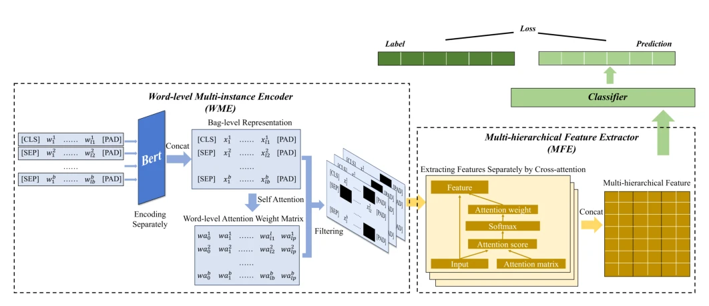
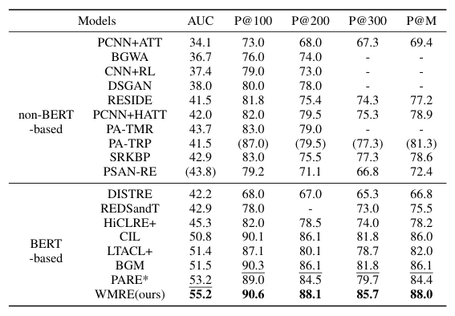

## WMRE: Enhancing Distant Supervised Relation Extraction with Word-level Multi-instance Learning and Multi-hierarchical Feature

> data: NYT-10d、NYT-10m
>
> ICASSP 2025 · [论文](https://doi.org/10.1109/ICASSP49660.2025.10890115)

#### 引言

在词级别筛选注意力并提取多层次文本特征，降低远程监督关系抽取中的噪声。研究对象为自然语言关系抽取。

#### 方法

（1）词级包：把多个句子中的词组织为待筛选实例。

（2）过滤注意力：删除低重要性词，避免仅用加权乘法扭曲嵌入。

（3）层次特征：在多层筛选结果间汇聚关系抽取线索。

原文Fig. 2，PDF 第 3 页。

#### 实验

##### 实验设置

初始化 bert-base-uncased；按数据集分别报告 PR 曲线 AUC、P@N 或 micro-F1。

##### 主要结果

这里的 AUC 指 PR-AUC，不是 ROC-AUC；NYT-10m 含人工标注测试集，而 NYT-10d 的测试标签也来自远程监督。

原文TABLE I，PDF 第 4 页。

##### 消融与讨论

消融多层次特征提取 MFE 与词级多实例嵌入 WME，检查其对噪声文本的过滤作用。

#### 参考文献

> WMRE: Enhancing Distant Supervised Relation Extraction with Word-level Multi-instance Learning and Multi-hierarchical Feature
>
> ICASSP 2025 · [论文](https://doi.org/10.1109/ICASSP49660.2025.10890115)

本文归入相关 MIL 方法：具体研究对象见数据与实验设置。
