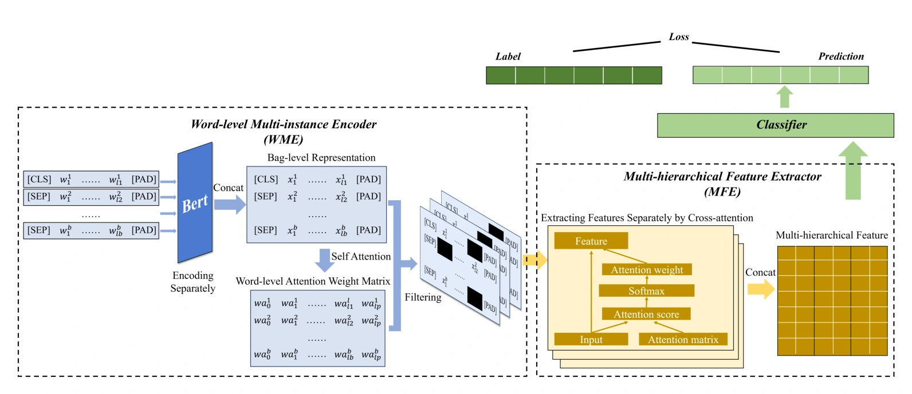
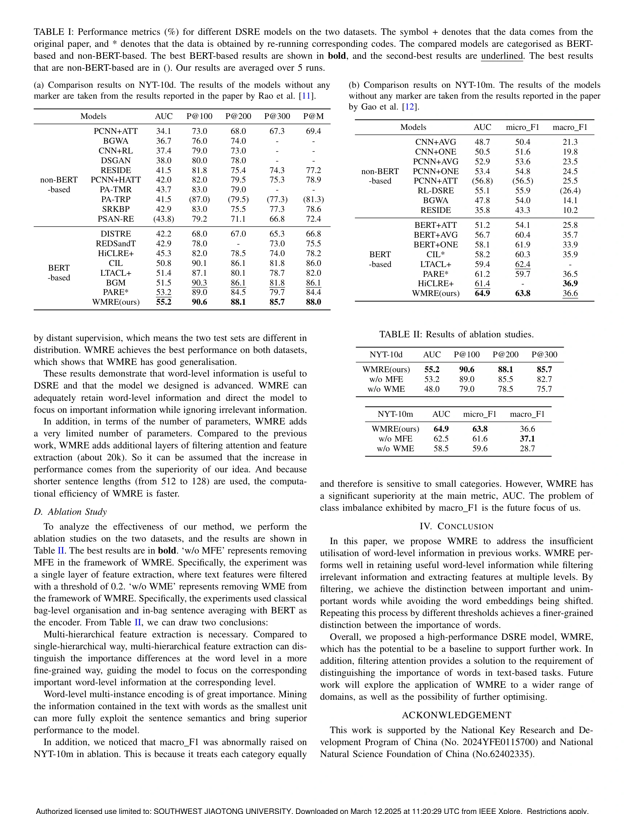

## WMRE: Enhancing Distant Supervised Relation Extraction with Word-level Multi-instance Learning and Multi-hierarchical Feature

> data: NYT-10d、NYT-10m
>
> ICASSP 2025 · [论文](https://doi.org/10.1109/ICASSP49660.2025.10890115)

#### 引言

在词级别筛选注意力并提取多层次文本特征，降低远程监督关系抽取中的噪声。研究对象为自然语言关系抽取。

#### 方法

（1）词级包：把多个句子中的词组织为待筛选实例。

（2）过滤注意力：删除低重要性词，避免仅用加权乘法扭曲嵌入。

（3）层次特征：在多层筛选结果间汇聚关系抽取线索。

<!-- wsi-complete-model -->
##### 模型结构图

**图 2 · 模型结构**（PDF 第 3 页）

> 原文图注：Fig. 2: The architecture of WMRE, which consists of two main components, WME and MFE. The input is multiple sentences annotated with the same DSRE label, and the output is a vector consisting of the predicted scores for each relation.

[查看原尺寸](../assest/WMRE/figure-2-complete.webp)

<!-- /wsi-complete-model -->

#### 实验

##### 实验设置

初始化 bert-base-uncased；按数据集分别报告 PR 曲线 AUC、P@N 或 micro-F1。

##### 主要结果

这里的 AUC 指 PR-AUC，不是 ROC-AUC；NYT-10m 含人工标注测试集，而 NYT-10d 的测试标签也来自远程监督。

<!-- wsi-complete-results -->
##### 完整实验指标与对照

下列实验原页保留表头、全部行列、子图、误差说明和脚注，点击可查看原尺寸。比较时请对应相同的数据集、特征编码器和训练设置；`±`、置信区间、百分比和小数均保留原文的单位与统计口径。

| 原表/图中指标 | 读取方式 |
| --- | --- |
| F1 | 越高越好；保留 macro / weighted / micro 等平均方式 |
| PR-AUC / AUPRC | 越高越好；本文 AUC 指 Precision–Recall 曲线面积 |

| 原文页 | 阅读内容 | 图表及正文引用 |
| --- | --- | --- |
| PDF 第 4 页 | 实验结果 | Table I、Table II |

**实验原页 · PDF 第 4 页**（图表及正文引用：Table I、Table II）

[查看原尺寸](../assest/WMRE/experiment-page-04.webp)

<!-- /wsi-complete-results -->

##### 消融与讨论

消融多层次特征提取 MFE 与词级多实例嵌入 WME，检查其对噪声文本的过滤作用。

#### 参考文献

> WMRE: Enhancing Distant Supervised Relation Extraction with Word-level Multi-instance Learning and Multi-hierarchical Feature
>
> ICASSP 2025 · [论文](https://doi.org/10.1109/ICASSP49660.2025.10890115)

本文归入相关 MIL 方法：具体研究对象见数据与实验设置。
